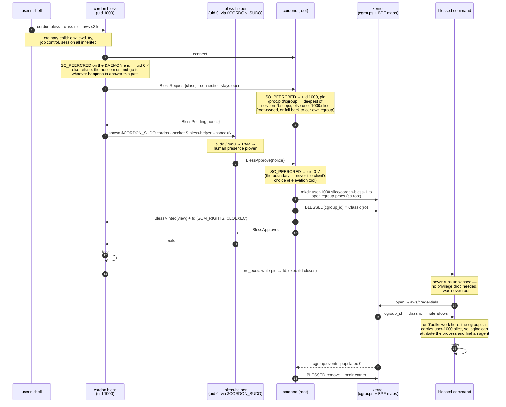

# cordon — design

Working name: **cordon** (object-centric: you *cordon off* the secret dirs).
Deliberately outside the `gate`/`Gatekeeper` namespace.

Language: **Rust**. Policy: a **root-owned text file** compiled to in-kernel BPF maps (§15).

> **Reading guide.** **§15 is the current architecture** — the flat *rule model*,
> implemented in M1 (see [`PLAN-rule-model.md`](PLAN-rule-model.md) for the milestones).
> **§16 specifies *blessing*** — the runtime, human-authenticated access grant
> (`cordon bless`), shipped through B2 — unprivileged CLI, elevation-gated mint; remaining
> milestones in [`PLAN-bless.md`](PLAN-bless.md).
> §1–§14 are the foundational design and its evolution: the v1 **owner model** (owners /
> TOFU / interactive prompts) and the **fanotify** backend they describe were **retired**
> in the rule-model migration and no longer exist in the code. Those sections are kept for
> the durable rationale they still carry (threat model, object-centric insight, identity
> forgeability, prior art). Read §2–§4 and §15 for the live design. Wherever a section
> still describes the owner model, TOFU, interactive prompts, or the fanotify backend, that
> is **history** — carried under a *superseded by §15* note (most concentrated in §5, §6,
> §8.2, §12).

---

## 1. Goal

Make secret-bearing config directories **readable only by the tool that owns
them**, transparently to that tool (it reads its config at the normal path,
unmodified). Everything else running as the same user sees the directories as
denied/empty.

## 2. Threat model

**In scope — defeat these:** one-shot **scrapers** — run once, scan paths,
exfiltrate, exit; same UID as you. Rungs: hardcoded path lists; directory
walkers / content greppers; `environ` readers following path-like values.

**Out of scope — conceded:** **root**, **resident/persistent** (ptrace, wait for
unlocks, replace binaries, kill the daemon, double-fork to launder ancestry),
**targeted** reverse-engineering of this setup. We raise cost and bound blast
radius, no more.

Enabling simplification: we **never confine the adversary**. We protect the
*resource* and serve the *owner*; the scraper finds nothing.

## 3. Key insights

1. **Unix DAC can't separate two same-UID processes.** Add an **object-centric
   authorizer**: protect the resource, deny all subjects by default, allow only
   the owning identity.
2. **Enforcement lives outside the confined process** → a privileged daemon, not
   an in-process `LD_PRELOAD` trick.
3. **Object-centric beats subject-centric.** One rule over the resource covers
   all subjects, including unknown future scrapers — vs. AppArmor/SELinux's
   profile-per-tool with unprofiled = unconfined.
4. **The gater alone meets the threat model — no crypto, no relocation.** Files
   stay plaintext in place; the gater denies non-owner `open()`. Because nothing
   is moved or encrypted, **transparency is automatic**. Encryption/broker/shim
   are an optional later bundle (§7), not v1.
5. **Identity is a predicate set, not exe alone.** Shebang tools exec as their
   interpreter (`python3`, not `aws`), and helpers/installers read configs they didn't
   create. The subject is a *conjunction* of cheap predicates — exe, uid, cgroup, and
   (opt-in) content hash / argv0 / ancestor — ANDed in-kernel (§15.4). The parent chain
   disambiguates the interpreter case but is best-effort (evadable by double-fork), so it
   raises cost, it isn't a boundary.

### 3.1 What the incumbents actually do to a scraper

Insight 3 is checkable, so check it. Against the in-scope adversary — a scraper running at
your uid that copies `~/.aws/credentials` and Chrome's cookie DB — **stock AppArmor and
SELinux do essentially nothing**, with enforcement fully on and no denial logged:

- **Fedora/RHEL targeted policy** runs the login session as `unconfined_t` and labels
  everything in `$HOME` `user_home_t`. `unconfined_t` reads `user_home_t`. Confined user
  domains (`user_u`, `staff_u`, `xguest_u`) exist, are opt-in, and are rarely deployed; even
  under `staff_u` one user app is not separated from another's data by default.
- **Ubuntu's AppArmor** ships profiles for daemons and a handful of apps. Anything else —
  `curl`, a pip install, a binary you downloaded — has no profile, and **unprofiled means
  unconfined**.

This is not an oversight, it is the model: confinement is a property of the *program*, and
the default for an unknown program is none. A scraper is definitionally an unprofiled
program, so the entire class sits outside the deployment. That is insight 3 restated as an
observation rather than a claim. Both systems *can* express "only Firefox reads the cookie
DB" — it is a policy-coverage gap, not a capability limit — but expressing it means confining
the user, retyping the object, and writing a domain for every legitimate reader.

Credit where due: containing a compromised *service* is what they were built for and they do
it well — `httpd_t` cannot read `user_home_t`, so an nginx or mysqld exploit does not become a
home-directory sweep. Note that where a browser profile does ship it runs in the **opposite
direction** to what we want: it protects the system from Firefox, not Firefox's cookie DB from
everything else.

**Android is the counterexample, and it is SELinux.** Per-app uids + per-app domains +
default-deny is this exact protection, working, at scale. The mechanism is therefore proven;
what Android has and a desktop does not is an **install-time identity assignment step**.
Desktop programs arrive by tarball, pip, npm, `curl | sh`, so no such step exists — which is
why cordon assigns identity to the *object* instead and lets subjects stay anonymous.

**Prior art that does solve it, and what to take from each:**

- **Flatpak / snap** genuinely confine (a Flatpak cannot see `~/.ssh`; file access goes
  through portals) but are gated on packaging, and a scraper will not arrive as a Flatpak.
- **macOS TCC** is the closest existing thing to this design: object-side gating, per-app
  grants, prompt on first access. Mainstream and effective. Its two failure modes are ours to
  avoid — **consent fatigue** (§15.10's audit→admit→enforce exists partly for this: admit
  from observed evidence, not from a modal prompt) and **identity resting on a code
  signature**, which is the same question [PLAN-rule-model](PLAN-rule-model.md) M6 is chewing
  on.
- **Windows has the right shape twice, pointed at the wrong verb both times.** *Controlled
  Folder Access* is almost exactly this design — designated folders, an app allowlist — but
  gates **writes only**, because it was built against ransomware; a scraper reads, so CFA
  never sees it. *WDAC/AppLocker* is genuinely default-deny and, with DLL-level enforcement,
  is the closest shipping analogue to M6's fixed-code invariant (an unsigned DLL cannot load
  into a signed process) — but it governs **what may execute**, not what a running program may
  read, and consumer machines effectively never run it in enforcement. *Credential Guard*
  shows Microsoft can do hard isolation when a target matters enough (VBS puts LSA secrets in
  VTL1, out of reach of admin) and that it was done per-target, not as a general mechanism.
- **Chrome's app-bound encryption** (Windows, 2024) is the piece of prior art that tried
  *this* architecture and is therefore the most instructive. Shipped because infostealers were
  reading the cookie DB — the threat is real and unaddressed at the OS layer — it replaced
  DPAPI's user-bound key (any process at your uid could decrypt: our problem, with encryption
  that does not move the trust boundary) with a **privileged SYSTEM service that validates the
  calling executable before returning the key**. That is insight 2, implemented at scale by
  someone else. **It was bypassed within months**, by injecting into Chrome and asking as an
  authorized process, by abusing the elevation service, and by simply running elevated. Google
  has kept hardening since and the current state is not verified here — but the lesson is
  stable and is the strongest external argument for M6: *a privileged broker that
  authenticates by executable identity is only as strong as its code-identity story, and
  injection into the authorized process defeats it.* Our `allow /usr/bin/ssh read ~/.ssh` is
  structurally the same grant and fails the same way, which is why M6 is not an optional
  hardening pass. On Linux Chrome uses the login keyring, reachable over D-Bus by any process
  at your uid, so the file gate is the only control available there at all.
- **Per-app file gating exists commercially** — ThreatLocker's Storage Control and Ringfencing,
  AppGuard, and the previous generation of HIPS products (Comodo, Online Armor) which a decade
  ago let you write "only firefox.exe may read this path". The category is largely dead, and it
  died of **prompt fatigue and rule-management burden**, not of being wrong. Same verdict as
  TCC, from a second direction, and the same reason audit→admit→enforce is the interesting part
  of this design rather than the enforcement primitive.
- **EDR behavioural detection** (CrowdStrike, SentinelOne, Defender for Endpoint) is the
  mainstream commercial answer and is not signature-based: it flags a process opening
  `Login Data`, archiving, then egressing. But it races exfiltration rather than bounding it —
  it kills the process *after* the read. A boundary and a detector are different products; we
  are the former, and the journal is not a detector.

**The approach actually winning is orthogonal: make the loot worthless.** Device Bound
Session Credentials tie a session cookie to a TPM key so a stolen cookie will not
authenticate elsewhere, and a passkey's private key never leaves the secure element. That is
the strongest structural answer to *credential* theft on any OS, and it is complementary
rather than competitive — it covers session secrets and does nothing for `~/.aws/credentials`,
SSH keys, `.env` files, or a password store, which is most of what `@secrets` names. Where a
secret *can* be made non-exfiltratable, prefer that over gating it.

The gap this project targets is therefore specific: **object-first default-deny for same-uid
desktop programs.** Android proves the enforcement works, TCC proves the model is usable,
Windows shows the two halves shipping separately and never joined, and none of it exists for
Linux desktop.

## 4. Architecture

### Core
```
┌──────────────────────────────────────────────────────────────┐
│  GATER — object-centric authorizer, in-kernel (root)          │
│    decide each open() against a flat per-object rule table     │
│    (§15.6 precedence), the verdict returned IN THE KERNEL.     │
│    Linux:  BPF-LSM file_open (policy in BPF maps)              │
│    macOS:  Endpoint Security AUTH_OPEN (planned; audit_token → │
│            SecCodeCheckValidity; native parent/responsible pid) │
├──────────────────────────────────────────────────────────────┤
│  POLICY — a root-owned TEXT FILE (§15.8)                      │
│    (who, where, action, policy) rules + groups; cordond        │
│    compiles it → BPF maps on `cordon policy apply`.            │
└──────────────────────────────────────────────────────────────┘
Files stay in place, plaintext. A rule allows → reads unmodified.
```

The gater is **not** an AppArmor analog — it's a programmable authorizer (cousin
of LSM-BPF). The AppArmor analog on macOS is Seatbelt/SBPL, unused.

**Enforcement posture.** With `bpf-lsm` the verdict is in-kernel, so it does **not**
depend on the daemon being up. Once the programs + maps are **bpffs-pinned** (the
remaining hardening increment) enforcement is **fail-safe** — it survives daemon
death; until then a daemon crash drops the program and fails open.

### Optional later bundle (only to cover un-gated reads — §7)
Relocate + encrypt → needs a **key** → held by a resident **broker** → needs a
**transparency layer** (`fuse-t`, or seccomp `ADDFD` under `cordon run`). All
three or none.

### Optional, orthogonal
**Capability brokering** for tools with a credential-helper seam (git, AWS
`credential_process`, docker, kube): hand back **short-lived** creds. Per-tool.

### Privilege model — pluggable backends
The **policy core** (the §15 compiler, IPC, the `cordon` CLI) is
**privilege-agnostic**. Only the *enforcement backend* — the thing that mediates opens
and carries out allow/deny — needs privilege, and it sits behind one interface:

| Backend | Privilege | Scope | Boundary? | Status |
|---|---|---|---|---|
| `bpf-lsm` | **root** (CAP_BPF + CAP_MAC_ADMIN) | system-wide | **yes** (fail-safe once pinned) | Linux production — **the boundary** |
| `endpoint-security` | **root** + entitlement | system-wide | **yes** | macOS — planned (§12, Phase 4) |
| `mock` / `fanotify` / `seccomp-unotify` | — | — | no | **removed / dropped** — see note |

The build splits along this seam: the core + CLI compile on stable with no kernel deps;
the daemon's `bpf-lsm` feature (on by default, Linux-only) links the aya loader and
enforces. macOS will add an ES backend behind the same interface.

> **Retired backends (history, kept as design contrast).** Earlier iterations shipped a
> `mock` backend (synthetic events for logic tests) and a root **`fanotify`**
> `FAN_OPEN_PERM` backend — a fast, portable MVP that enforced *while running* but was
> **never a boundary**: it fails open (daemon down ⇒ every open allowed), decides in
> userspace on the open-time path (the rename-out-of-zone bypass below), reads identity
> best-effort from `/proc`, and needs `CAP_SYS_ADMIN` for its system-wide veto power (the
> unprivileged `FAN_REPORT_FID` mode is notify-only — useless for gating). So **user-mode
> cannot enforce system-wide** — that motivated the move in-kernel. A `seccomp-unotify`
> `cordon run -- <tool>` sandbox was also evaluated and scoped out (subject-centric,
> opt-in, real `unsafe`). All three were removed in the rule-model migration; **`bpf-lsm`
> is the sole Linux backend.** The in-kernel LSM verdict (below) is the answer to
> fanotify's wrong shape for per-object policy.

### BPF-LSM — the hardened Linux boundary
**BPF-LSM is the Linux mechanism that fits per-object policy**, and is cordon's sole Linux
backend. eBPF programs attach to LSM hooks (`file_open`, `inode_create`/`inode_rename`/
`inode_unlink`, `sb_mount`, `bprm_check_security`) and **return the verdict in-kernel**
(`0` allow / `-EPERM` deny); policy lives in **BPF maps** the daemon fills from the compiled
text policy — *no recompile/reload per rule.* Mediating the operation itself means there
are no per-directory marks to keep race-free and no whole-filesystem funnel through
userspace (the wrong-shape traps of a userspace open-notifier).

cordon returns the verdict **in-kernel** (no synchronous block-and-ask), sidestepping the
*one* thing BPF-LSM can't do (suspend a syscall pending a userspace answer). What the
in-kernel LSM shape buys:
- **No marking → no recursive-mark race.** Hooks fire on the operation; a freshly
  `mkdir`'d / `mv`'d-in / `mount`-ed-in subtree is covered the instant it exists.
- **Structural ops are gateable** (`inode_rename`, `inode_create`, `sb_mount`…), closing
  the **rename-out-of-zone bypass**: a same-uid tool can't rename a secret out of a
  protected subtree and reopen it at an unprotected path — the rename itself is vetoed (and
  identity is keyed on the inode, not the path).
- **In-kernel matching → no funnel.** The program walks the opened file's dentry
  ancestors by **`(dev,inode)`** and allows non-zone opens *without leaving the
  kernel* — no whole-`/` funnel; the hot path never crosses into userspace. Path
  *strings* are out: `bpf_d_path` is **not allowed at the `file_open` hook** (a
  verifier discovery — `security_file_open` isn't in `btf_allowlist_d_path`), so
  matching is inode-based. The daemon resolves paths → `(dev,inode)` at seed time,
  taking the device from the **mount table** (`/proc/self/mountinfo` = the mount's
  `sb->s_dev`) so it agrees with the kernel on overlayfs/btrfs — *not* `stat`'s
  per-layer/-subvolume device.
- **Stronger identity, in-kernel.** Caller exe identity is its **`(dev,inode)`**,
  read straight from `task->mm->exe_file` — race-free, no `/proc` readlink. The
  hardening beyond that is a **content digest** of the opener via
  `bpf_ima_file_hash()` (IMA) or `bpf_get_fsverity_digest()` (fs-verity) —
  identifying the binary by *what it is*: surviving an inode change (package
  upgrade) and resisting copy-to-a-blessed-path, against a hash not a spoofable
  path. (IMA *appraisal* + a keyring gets "verified-signed-by-key," the closest
  Linux analog to ES code-signing — enterprise setup, not free.)
- **Fail-safe, not fail-open.** Pin the programs and their `bpf_link` to **bpffs**
  (`/sys/fs/bpf/…`) and enforcement persists with **no holding process** — the daemon can
  crash/restart with *zero* enforcement gap.

**Implemented (M1 — validated in a VM, see STATUS / [`PLAN-rule-model.md`](PLAN-rule-model.md)):**
the `file_open` verdict over the **flat rule table** — deepest protected object via the
`(dev,inode)` dentry walk, exe-`(dev,inode)` subject match, action from `f_mode`/`f_flags`
(read/write/create), first-match on the copy-down-resolved bucket, default-deny, the
per-rule `policy` the only enforcement level (no global mode, §15.6); the **text policy**
compiled + seeded at startup and re-seeded by `cordon policy apply` via an **atomic
double-buffer swap**; and the
ring-buffer learn path with **in-kernel event coalescing**. The **structural-op gating**
(closing the rename bypass), **content-digest identity** (§15.4), and **fail-safe pinning**
described above are the next increments, not yet shipped — so today's `bpf-lsm` enforces
open-time actions in-kernel and (until pinning) still fails open when the daemon dies.

**Deny/learn delivery — decoupled from the verdict.** The in-kernel program has already
decided; observability rides a **BPF ring buffer** (`BPF_MAP_TYPE_RINGBUF`): on a
`deny` or `audit` the hook emits a record (pid, exe `(dev,inode)`, object
`(dev,inode)`, the opened file's reconstructed leaf path, action, decision), **coalesced
by an in-kernel suppressor** (keyed on the opened file, so distinct leaves surface), and
the daemon
drains it asynchronously. It does **not** block the syscall. Lossy under flood = you drop
*observability records*, never *enforcement* (a discard counter bumps).

**Control plane vs data plane** — the daemon leaves the hot path entirely:
> **Data plane = in-kernel BPF** — every open, every verdict — *always on,
> daemon-independent.*
> **Control plane = the root-owned text policy (durable source of truth) + a thin,
> restartable daemon** that (a) compiles the policy and seeds the maps at startup and on
> `cordon policy apply`, and (b) **drains the ring buffer to the journal.** Off the hot
> path; its absence costs observability, **never** enforcement (and, once pinned, not even
> across a restart). *The daemon is still required* — to ship ring-buffer events to the
> journal and to apply policy changes.

**Map concurrency** is handled by map semantics + RCU, not hand-rolled locks: a
single-element `bpf_map_update_elem` is atomic (a reader sees old-or-new, never torn;
element lifetime is RCU). The atomic *multi-entry* policy swap on `apply` uses exactly the
**generation-counter / double-buffer** this called for — **now implemented** (§15.8): the
three rule maps are banked, and the daemon fills the inactive bank then flips
`Settings.active_bank` in one update, RCU-style. `bpf_spin_lock` is available if a value
ever needs in-program read-modify-write.

**Durability.** BPF maps are ephemeral (lost on reboot / program reload), but the **text
policy is the durable source of truth** — the daemon recompiles and re-seeds it at startup,
so nothing is lost. (The owner model's hazard of an in-kernel TOFU claim not yet persisted
is gone with TOFU itself; autolearn (§15.9) keeps its *proposals* in a separate db, never
the enforced source.)

**Requirements / cost.** `CONFIG_BPF_LSM=y` **and** `bpf` in the active LSM list
(`CONFIG_LSM=` / `lsm=` boot param — common but not universal); kernel ≥ 5.7 (the
content-hash helpers are ≥ 5.11 / 6.x); `CAP_BPF` + `CAP_MAC_ADMIN`. The program is
verifier-friendly, and — since rustc can't emit CO-RE relocations,
<https://github.com/rust-lang/rust/issues/158412> — a userspace shim reads the running
kernel's BTF and injects field offsets into the program's `.rodata`, so one object runs on
any kernel. **Additive** to existing LSMs — it can only *further* restrict, never loosen
(a SELinux/AppArmor deny still denies). So `bpf-lsm` is the hardened production boundary
where available; on older kernels (or with `bpf` absent from the LSM list) there is **no
hardened Linux boundary**. Real precedent for exactly this allow/deny use: **KubeArmor**,
**Tetragon**, **bpflock** (§13).

**Lineage is subsumed here (cancels the standalone cache, §8.2/§12).** Because the
backend already runs in-kernel, the §8.2 ancestry hardening is *folded in*, not a
separate proc-connector subsystem: a live `task->real_parent` walk gives the same
best-effort chain for free at decision time, and durable-across-exit lineage is
just `sched_process_{fork,exec}` tracepoints writing `(pid, starttime)`→parent
into a BPF map *within this backend*. Ceiling unchanged: a real `exec` of a
blessed binary (the **construction** attack, §8.1) is still faithfully recorded,
so ancestry stays best-effort, never the boundary.

Locations: the root system service listens on `/run/cordon.sock` and compiles its policy
(`/etc/cordon/policy.toml`, or a `/etc/cordon/conf.d/` directory of per-user fragments —
§15.8; both root-owned), with operational settings in `/etc/cordon/config.toml`. A
user-session dev daemon can override these to `$XDG_RUNTIME_DIR`/`$XDG_CONFIG_HOME` (the
`cordon` CLI auto-detects), but it is **not** a boundary — only the root service enforces.

**Operational config** is an optional TOML file (`backend`, `socket`, the eBPF-object /
policy-file paths), `${ENV}`-interpolated, precedence CLI > file > default. The
*enforcement policy* — the rules — is **not** here: it lives in the root-owned text policy
(§15.8), applied with `cordon policy apply`. There is no global mode; observe-vs-enforce is
the per-rule `audit`/`deny` choice (§15.6). See `packaging/cordon.example.toml` +
`cordon.example.policy.toml`.

Terminology: this daemon is the **gater**. The **broker** (§7) is the separate,
deferred key-holder.

## 5. Coverage & ownership model

> **Superseded by §15 — historical.** This section describes the v1 *owner* model as
> shipped in Phases 0–1. The flat **rule model** in §15 (shipped in M1) replaces it,
> subsuming owners, explicit rules, and TOFU into one concept (§15.1 explains why). The
> owner model — owners, the SQLite store, TOFU, interactive prompts — was **removed** in
> the migration; what follows is the record of what those phases did, not current behavior.

Two rule sources; explicit wins over auto.

### Explicit rules (highest precedence)
`identity → allowed paths/globs + modes`, e.g. `aws : rw ~/.aws/**`. Includes
both allow and **deny** (so a user can revoke an owner). Root-owned config.

### TOFU auto-ownership (creator-owns)
- **Zones** — configured *traversable-but-never-owned* roots (`~`, `~/.config`,
  `~/.local/share`, `~/.cache`). The first subtree level inside is claimable; the
  zone root itself never is. (Named "zones" in code — `container` was avoided as
  it reads as Docker/OCI.)
- **Claim on create, never on read.** An exe that *creates* a new path in an
  unclaimed zone subtree becomes its owner (`O_CREAT` / `FAN_CREATE`),
  **never on read** — stops a scraper claiming a pre-existing secret.
- **Pre-existing paths** have no auto-owner: handled by interactive mode (§6) or
  `cordon adopt`. Never auto-assigned on first access.
- **Inheritance** — files under an owned subtree inherit its owner group.

### Identity
- **Granularity (default `path`):** owner = exe path. Survives upgrades;
  weak only against replacing the binary file (root/resident → out of scope).
  Per-rule override to `path+inode` or `signature` for stricter dirs.
- **Ancestry (parent chain):** owner-match succeeds if the caller **or an
  ancestor within the session boundary** is in the owner group. Solves the
  interpreter problem (caller exe = `python3`; ancestor/launcher = the tool) and
  helper/creator≠reader. Captured at event time (pidfd + start-time validation),
  walk bounded at session leader / first uid change. **Best-effort:** double-fork
  launders ancestry; argv is *not* trusted (caller-controlled). macOS exposes
  parent + "responsible" pid natively in ES.
- **Tool-groups:** an owner is a named identity set, auto-seeded with the
  creator, expandable (`cordon claim <subtree> --add <id>`).

### Ownership / rules store
SQLite **owned by the daemon (root), not user-writable** — else a scraper writes
itself in as owner. Mutated only via the privileged `cordon` CLI → daemon IPC.

## 6. Decision flow & interactive mode

> **Superseded by §15.6 — historical.** The owner-model decision flow and interactive
> deny-and-learn below were **removed** with the owner model. The live decision flow is
> §15.6: most-specific protected object → first-match on the copy-down bucket →
> default-deny, the per-rule `policy` the only enforcement level (no global mode), with the
> verdict returned **in-kernel** (so there is no synchronous prompt). TOFU's successor is
> **autolearn**
> (§15.9) — an explicit, reviewed training mode, not a per-open prompt (the deadline-safety
> problem below is exactly why). Kept for that rationale and the prompt-UX design.

### Decision flow (evaluated per gated open)
1. Path not under any protected subtree → **allow** (unmediated).
2. Explicit rule matches → **allow/deny** (user rules win → revocation works).
3. Caller *or ancestor* in the subtree's owner group → **allow**.
4. `O_CREAT` of a new path in an unclaimed zone subtree → **TOFU claim** →
   allow.
5. Else (protected, unowned/non-matching, not a create) → **interactive prompt**
   if a session agent is present, else the configured default (**deny**).

### Interactive mode
On step 5, ask the user — but the AUTH path is **synchronous with a deadline**
(ES kills clients that miss it; blocking an `open()` on human reaction time hangs
tools and risks deadlock — Santa's ES authorizer survives this with a secondary
dispatch that returns the default just before the deadline, a pattern we reuse;
see `docs/SANTA.md`). So the model is **deny-and-learn**:

> Deny *this* access to meet the deadline, prompt the user **asynchronously**,
> **persist the choice**, honor it on subsequent accesses. Optional: a short
> synchronous hold (≤ a couple seconds, well under the deadline) so a fast answer
> lets even the first access through; deny-and-learn is the fallback.

Consequence: a brand-new tool errors *once* until approved, then works. TOFU
covers tools that create their own config (no prompt), so prompts mostly fire on
**pre-existing/ambiguous** paths — letting "approve permanently" subsume
`cordon adopt`.

**Prompt outcomes → rules:**
| Choice | Effect |
|---|---|
| Deny once | ephemeral; this event only |
| Deny permanently | explicit deny rule (identity → subtree) |
| Approve once | ephemeral allow (this process instance) |
| Approve for X min | TTL allow rule, expires at now+X |
| Approve permanently | explicit allow / add identity to owner group |

The prompt shows **who** (exe + ancestry chain), **what** (file/subtree), and the
proposed rule scope (per-subtree, not per-file, so it doesn't re-ask).

**Agent architecture:** the root daemon can't draw UI → delegates to an
**unprivileged per-session prompt agent** (polkit-agent style) over IPC, routed
to the user owning the triggering session. Notification channel is the
per-OS-specific bit (libnotify/dbus vs UserNotifications).

## 7. Do we encrypt anything? (what "keys" meant)

**v1: no.** The gater denies the live scraper's `open()`; plaintext-in-place is
fine. Encryption only protects reads the gater *doesn't* mediate:

| Un-gated read | In scope? | Already covered by |
|---|---|---|
| stolen / offline disk | physical → no | FileVault / LUKS |
| pre-daemon boot window | no (scraper is interactive, post-login) | — |
| gater bug / bypass | defense-in-depth only | — |

So it adds ~nothing in scope and drags in keys + broker + shim. Deferred. "Keys"
only exist if we later encrypt: a master key the broker holds in RAM, unlocked
once per session.

## 8. Caller identity (mechanics)

> **Mechanics updated by §15.4.** In the in-kernel backend the caller's identity is its
> exe `(dev,inode)` read straight from `task->mm->exe_file` — race-free, no `/proc`
> readlink, no `FAN_REPORT_PIDFD` — plus the other predicates in §15.4 (uid, cgroup, opt-in
> hash/argv0/ancestor). The fanotify pidfd / `/proc` mechanics below are the retired
> userspace path; the **forgeability analysis in §8.1 is model-agnostic and still
> load-bearing** — §15.4's argv0/ancestor predicates rest on it.

- **Race-free id:** Linux `FAN_REPORT_PIDFD` → pidfd → exe; macOS per-connection
  audit token → code requirement. Don't re-`readlink` `/proc/pid/exe` after the
  fact (PID may have exec'd).
- **Chain walk:** from the triggering pidfd, read ppid (`/proc/<pid>/stat`),
  validate each hop by start-time, bound at session leader / uid change. Snapshot
  at event receipt. Best-effort (see §5 caveats).
- **hardening-vs-injectability tension** & **confused-deputy ceiling**: relevant
  only if we ever add the transparency shim (§7); v1 gates only.

### 8.1 Caller vs. ancestry forgeability (sharpened)
Treat the **immediate caller** and the **ancestry chain** as different security
objects:
- **Immediate caller — strong & race-free.** It is suspended in the kernel
  awaiting our verdict, so it cannot exit/exec under us. Linux: exe path is
  kernel-truth (race-free while blocked). macOS: the per-event `audit_token`
  yields *cryptographic* code identity (`cdhash`/`team_id`/`signing_id`,
  validated via `SecCodeCheckValidity`) — strictly stronger than a path, and the
  real ES win.
- **Ancestry — best-effort, two distinct attacks:**
  - **Removal** (`double-fork` → reparent to init): erases the chain on Linux.
    macOS resists this — `original_ppid` and the *responsible* audit token survive
    reparenting.
  - **Construction** (`fork(scraper); exec(real blessed binary)` in the parent):
    builds *genuine* ancestry whose ancestor really is the blessed tool. This
    defeats ancestry on **both** platforms and is **not** fixed by stricter
    identity (`path+inode`/`signature` or macOS code-signing) — it is the
    authentic binary, attested truthfully. Only a liveness window (the blessed
    ancestor must be alive at access time) bounds it. macOS "responsible process"
    attribution is also launcher-influenceable (`posix_spawn` disclaim
    attributes), so it is not unforgeable either.
- **Interpreter problem persists on macOS:** a script tool surfaces as
  `/usr/bin/python3` (an Apple *platform binary*), so the strong code-identity is
  the interpreter's, not the tool's — pushing you back onto the weaker
  ancestry/responsible-pid link, as on Linux.
- **Conclusion:** ancestry **raises cost, is never a boundary**; the construction
  attacker is the conceded targeted-RE class (§2). The object-centric deny is the
  boundary.

### 8.2 Better Linux lineage sources (beyond the /proc snapshot)
The `/proc` ppid walk is a snapshot taken *after* reparenting has already
destroyed information. Stronger sources, weakest→strongest:
- **Start-time keying** (`/proc/<pid>/stat` field 22): key each hop by
  `(pid, starttime)`; a changed starttime ⇒ pid was recycled ⇒ reject. Kills
  pid-reuse. (Cheap; DESIGN already assumes this.)
- **pidfd**: free for the caller via `FAN_REPORT_PIDFD`; `pidfd_open(ppid)` +
  starttime recheck pins ancestors. Race-free, but still a decision-time snapshot.
- **`loginuid`/`sessionid`**: set at login, immutable without `CAP_AUDIT_CONTROL`,
  inherited by all descendants — a fence the scraper can't shed (unlike `setsid`).
  A robust *bound* on the walk, though it doesn't identify the tool.
- **Proc connector** (`NETLINK_CONNECTOR`/`CN_IDX_PROC`) **or eBPF**
  (`sched_process_{fork,exec}`, BPF-LSM): subscribe at startup, maintain a
  lineage cache keyed by `(pid, starttime)`. Recording the parent **at fork time**
  captures the *original* lineage **before** a later double-fork can erase it —
  defeating the **removal** attack. eBPF is the high-fidelity option (also gets
  argv/cwd/creds at exec); it's how Tetragon/Falco/Sysdig build process trees
  (§13). Root-only — already required.
- **Ceiling:** lineage tracking defeats *removal* + *reuse*, never *construction*
  (a real `exec` is faithfully recorded as a genuine blessed ancestor). Not log
  sources (`auditd` is async, log-only), not `/proc/.../children` (wrong
  direction), not cgroup/session grouping (CLI tools share the shell's cgroup).

> **Superseded as a standalone deliverable.** With the **BPF-LSM backend (§4)** this is
> *folded into the backend*, not a separate proc-connector subsystem: a live
> `task->real_parent` walk is free at decision time, and durable-across-exit lineage is
> just `sched_process_{fork,exec}` hooks writing `(pid, starttime)`→parent into a BPF map
> there (a later increment; ancestry is one of §15.4's opt-in predicates, never the
> boundary, §8.1). So the once-planned event-sourced **proc-connector lineage cache is
> dropped.** The in-kernel walk is *also* best-effort: a parent that already exited is
> already reparented, so only fork-time recording defeats **removal** — the
> **construction** ceiling stands regardless.

## 9. Cross-platform primitive map

| Need | Linux | macOS |
|---|---|---|
| Object-centric open authorizer | **BPF-LSM** `file_open` (in-kernel verdict) | **Endpoint Security** `AUTH_OPEN` |
| Testing without host root | **virtme-ng VM** runs the real `bpf-lsm` backend; `cargo test` covers the compiler/control plane | `mock` only (no unpriv intercept) |
| Caller id (race-free) | exe `(dev,inode)` from `task->mm->exe_file` (in-kernel) | per-conn audit token → code req |
| Parent chain | `task->real_parent` walk (in-kernel) + start-time | ES process struct (parent + responsible pid) |
| Create signal (autolearn / mutation) | `inode_create` hook (§15, M3) | ES create/exec events |
| Prompt channel (deferred — no interactive mode in the rule model) | per-session agent + dbus/libnotify | per-session agent + UserNotifications |
| Key custody (only if encrypting) | kernel keyring / Secret Service | Keychain / Secure Enclave |
| Declarative MAC we're *not* using | AppArmor / SELinux | Seatbelt / SBPL |

Same shape both OSes: a root **in-kernel authorizer** + a **root-owned text policy** +
the `cordon` CLI. Per-protected-dir cost = a rule, not a per-tool profile.

## 10. Honest limitations
- **Fail-open until pinned.** The verdict is in-kernel, but the daemon loads the program —
  until the programs + maps are **bpffs-pinned** (§4), a daemon crash drops enforcement
  (fail-open). Pinning makes it fail-safe; it is the remaining hardening increment. On
  kernels without BPF-LSM (`CONFIG_BPF_LSM` off, or `bpf` not in the LSM list) there is no
  hardened Linux boundary at all.
- **Open-time only (so far).** M1 mediates `file_open` (read/write/create); the structural
  ops (unlink/rename/… — closing the rename-out-of-zone bypass) and `execute` are later
  hooks (§15.5). Until then a same-uid tool can rename a secret out of a protected subtree
  and open it at an unprotected path.
- **Identity is best-effort beyond exe.** The exe `(dev,inode)` is race-free, but the
  parent chain is laundered by double-fork and argv is untrusted; interpreted tools surface
  as their interpreter (`python3`), needing the opt-in argv0/ancestor or hash predicates
  (§15.4). Ancestry raises cost, never the boundary (§8.1).
- **First-access friction.** A tool with no matching rule hitting a protected object is
  default-denied; granting access means editing the root-owned policy + `cordon policy
  apply` (autolearn, §15.9, is the assisted path). There is no interactive per-open prompt.
- **Confused-deputy:** gating ≠ stopping a tool's own export surface (out of scope).
- **Only the root `bpf-lsm` backend is a boundary** — a user-session dev daemon is for
  iteration, not protection; the boundary runs as a root service with `CAP_BPF` +
  `CAP_MAC_ADMIN` (macOS ES needs a restricted entitlement).
- **macOS backend (planned) shares ES's ceiling** — open()-time mediation only (no
  `read(2)` event), symlinks not followed, ES "default mute set" binaries unmediated.
  Same limits Santa's FAA hits (`docs/SANTA.md`); inherent to ES.

## 11. Testing strategy — internal fixtures

> **Definition of done — every change is VM-validated locally before it's complete.** Run
> `packaging/test/run-bpf-lsm-vm.sh` (default = the CI-pinned kernel, currently `v6.12`) and
> confirm **all** `bpf-lsm-smoke.sh` scenarios pass — *including for userspace-only changes*
> (policy compiler, CLI, daemon control plane): the VM is the one tier that exercises the
> real kernel boundary end-to-end, and a userspace change can still break seeding, the IPC
> apply path, or a policy shape. `cargo test` (the unprivileged tier) is necessary but **not
> sufficient**. When a change adds or alters enforcement behavior, add or extend a scenario
> so the suite still covers it. The same harness + pinned kernel run locally and in CI, so a
> green local VM run is the gate, not a courtesy.

The kernel-backed smoke (`bpf-lsm-smoke.sh`) drives the rule model end-to-end with
distinct-inode exes (copies of `bash`, so each is its own subject) reading/writing secrets
under a protected subtree, against a policy file:
- an **owner** exe allowed to read its secret; a **scraper** with no matching rule →
  default-deny (`EPERM`), reported on the ring buffer with the object inode + action;
- per-action (read allowed, write default-denied on the same object), subject + object
  **groups**, **deny > allow** ties, **copy-down** precedence (subtree allow + a
  file-specific deny for one subject, the sibling still readable), **audit→deny** (observe
  with a catch-all, then enforce by flipping that one rule — no global mode), **silence**
  (denied, not logged), runtime **`policy apply`**, and **event coalescing**.

Asserts: the right subject reads, the wrong one is denied **in-kernel**, precedence
resolves as §15.6 says, and a tight open-loop collapses to a few records — all on a real
kernel (the unprivileged `cargo test` tier covers the parser + copy-down compiler).

### Test tiers (by privilege)
- **Unprivileged (no kernel backend):** the policy parser + copy-down compiler and the
  IPC types — `cargo test` (`--all-features` also builds and unit-tests the `bpf-lsm`
  control plane, incl. event coalescing), CI-friendly, no root. Covers everything but
  the in-kernel hook itself.
- **The `bpf-lsm` boundary in a VM, without host root → virtme-ng.** Loading the LSM
  program needs `CAP_BPF`+`CAP_MAC_ADMIN` plus `bpf` in the active LSM list — both come
  from a **virtme-ng VM** (`packaging/test/run-bpf-lsm-vm.sh`) booting a **pinned
  upstream kernel** (Ubuntu mainline, e.g. `v6.12`) as guest-root with `lsm=…,bpf`,
  needing only `/dev/kvm` (group `kvm`), no host root. The VM runs qemu **directly** (no
  container) and virtme-ng reuses the host userspace, so there is no rootfs to build and
  no glibc mismatch — the *same* harness + kernel run locally and in CI, so the kernel
  never diverges. (`CORDON_VM_KERNEL` selects the pinned version; unset = the host
  kernel for fast local iteration.)
- **Why not libkrun/krunvm:** evaluated and dropped — getting `krunvm` onto a CI runner
  means nesting it *inside a container*, stacking two user namespaces (`buildah unshare`)
  under the libkrun VMM, which fails **differently per environment** (`gid_map: operation
  not permitted` locally vs `memfd_create: EINVAL` on GitHub) — non-reproducible.
  virtme-ng collapses the stack to a single `/dev/kvm` dependency.
- `bpf-lsm-smoke.sh` proves the rule model end-to-end (allow/deny, per-action, subject +
  object groups, copy-down precedence, audit→deny, silence, runtime `policy apply`, event
  coalescing) through a real kernel — green in the virtme-ng VM (host kernel + pinned
  `v6.12`, booted `lsm=…,bpf`).

## 12. Phased plan

> **Superseded by [`PLAN-rule-model.md`](PLAN-rule-model.md) + §15.11 — historical.** The
> phases below are the *owner-model* roadmap. They shipped through Phase 1, after which the
> owner model + fanotify were **removed**; the **current** roadmap is the rule-model
> milestones M1–M5 (M1 done) in PLAN-rule-model.md, summarized in §15.11. Kept for the
> design history and the macOS/ES notes (Phase 4), which still apply.

- **Phases 0–3 (owner model — shipped, then retired).** Phase 0 built the
  privilege-agnostic core + a SQLite store + the `cordon` CLI on a `mock` backend; Phase 1
  added the root **`fanotify`** `FAN_OPEN_PERM` backend (TOFU-on-create read from
  `/proc/<pid>/syscall`, ancestry from `/proc`), VM-validated; Phase 3 moved the verdict
  **in-kernel** (the bpf-lsm backend, then keyed on `subtrees` + `owner_identities`). Phase
  2 (interactive deny-and-learn + ancestry hardening) was specced, not built. The
  rule-model migration (§15) replaced this whole line — detail in git history; the
  interactive/prompt design survives as the §6 record and **autolearn** (§15.9), the
  ancestry analysis as §8.1/§8.2.
- **Phase 4 — macOS gater.** Bespoke ES `AUTH_OPEN` client — **decided**: Santa's
  FAA can't do dynamic, reviewable policy + autolearn (`docs/SANTA.md`). Reuse Santa's
  Apache-2.0 source as a reference (deadline-safety dispatch, multi-ES-client
  layout, identity matching). Same policy + CLI abstraction behind the backend interface.
- **Phase 5 — (optional) at-rest bundle; capability brokering; canaries.**

## 13. Related work / prior art

References we draw from, and why none is a drop-in for "deny non-owner reads of
secret config dirs — transparently, cross-platform, zero per-tool policy."

### Closest architectural cousins (authorizer daemon + rule store)
- **Santa** (macOS, North Pole Security) — the closest existing tool. Its **File
  Access Authorization (FAA)** is a real object-centric, code-identity-keyed file
  gater on Endpoint Security (~80% of our macOS gater). But it's **macOS-only**
  (no cross-platform plans), and FAA is **static admin policy** — no interactive
  prompt, no TOFU, poll-reloaded (≥15s); its interactive TOFU (standalone mode) is
  **execution-only**. So it can't do cordon's dynamic creator-owns +
  deny-and-learn for files. **Full functionality + roadmap analysis and the
  reuse-vs-build decision: `docs/SANTA.md`.** (We borrow its ES deadline-safety
  pattern and identity-match schema; Apache-2.0.)
- **OpenSnitch** (Linux) / **Little Snitch**, **LuLu** (macOS) — interactive
  application *firewalls*. The reference for our deny-and-learn UX (allow once /
  for-X-min / forever, by-exe rules) and per-process attribution. But they gate
  **network egress**, not file reads: they'd catch an exfil *connection*, yet a
  scraper that stages to a local file, or leaves over an already-allowed channel
  (the browser, DNS), slips by. Complementary layer, not a substitute.

### Mandatory Access Control (the per-tool-policy family we reject as primary)
- **AppArmor / SELinux / macOS Seatbelt (`sandbox-exec`)** — see §3/§9.
  Subject-centric: a profile/policy **per program**, and unprofiled = unconfined
  (an unknown scraper is unrestricted). SELinux *can* be object-centric via
  labels, but it's compiled + per-domain-transition + Linux-only. We want one
  object-centric rule that covers all subjects, including unknown ones.
- **Landlock** (Linux, unprivileged LSM) — a process restricts **its own** (and
  children's) FS access. Modern and root-free, but it's *self*-confinement:
  useless against a scraper that won't opt in. The inverse of what we need.
- **bubblewrap / firejail / Flatpak** — namespace sandboxes; Flatpak even gives
  each app its own data dir (`~/.var/app/<id>`) — the per-app-isolation north
  star. But subject-centric and opt-in per app; CLI dev tools aren't packaged,
  and you can't wrap a scraper you've never seen.

### Secret brokers / keystores (our deferred §7 + orthogonal capability brokering)
- **ssh-agent / gpg-agent** — never release the key; perform the op. The broker
  pattern in miniature, but ssh/gpg-only and protocol-bound.
- **HashiCorp Vault (+agent), aws-vault, envchain, 1Password CLI,
  git-credential-manager** — short-lived-credential brokering with OS-keystore
  custody, several cross-platform. We borrow the short-lived-capability idea, but
  each needs **per-tool integration** and none transparently protects the long
  tail of existing flat config files.
- **OS keystores** (Keychain / Secret Service / kernel keyring) and **SOPS / age
  / git-crypt** — "the secret isn't a readable file" / encrypt-at-rest. Borrowed
  for the deferred at-rest bundle, but tools must adopt them and they don't gate
  live reads of dirs that already exist.

### Filesystem-view / redirection (evaluated and rejected earlier)
- **fakechroot / proot** — `LD_PRELOAD` / `ptrace` path remapping. Cooperative or
  same-UID-bypassable → not a boundary (see the preload discussion).
- **FUSE: bindfs / gocryptfs / fuse-t** — a userspace FS can gate on the caller's
  pid, and **fuse-t** does it on macOS without a kext. But the mount is global
  (not per-process), PID identity is racy, and macFUSE's kext *lowers* platform
  security. We use a kernel authorizer (bpf-lsm/ES) instead; `fuse-t` is kept
  only for the deferred transparency layer.

### Observability & eBPF enforcement
- **auditd / fanotify-notify / inotify** — can *watch* file access by path, but
  **cannot deny**. We need the permission (veto) path, not just logging.
- **Tetragon / Falco** (eBPF, LSM-BPF) — runtime security; Tetragon can even
  enforce (override/kill). Architecturally this **is** our LSM-BPF alternative
  backend — but it's container/k8s-oriented and heavyweight to drive as a
  per-user desktop secret gate.

### aya-ecosystem peers (our toolchain — pure-Rust eBPF via aya)
The eBPF enforcers above (Tetragon/Falco/KubeArmor/bpflock) are the **mechanism**
precedent but all **Go/libbpf**. The projects that share cordon's actual *toolchain*
— a `no_std` `aya-ebpf` kernel crate + an `aya` userspace loader, maps/ring-buffers,
and the same CO-RE/BTF offset problem (rustc can't emit CO-RE relocations,
<https://github.com/rust-lang/rust/issues/158412>) — live in
[`aya-rs/awesome-aya`](https://github.com/aya-rs/awesome-aya), and **every security
one is subject-centric, most observe-only**. None is an object-centric file
authorizer for a personal box, so cordon shares their plumbing, not their shape:
- **lockc** — eBPF **LSM-MAC** for *containers* (Docker/k8s), Rust/aya. Closest
  cousin by mechanism (LSM hooks → MAC), but **container/profile-centric** and
  audit-framed/experimental — it restricts the confined workload, not an *object*
  the way we protect a subtree.
- **suidsnoop** — aya **LSM programs**, the only peer that actually **denies**
  (audit-or-enforce) — but scoped to **suid `execve`** and keyed on **uid**
  (subject-centric); a research demo, not a file-read gate.
- **bombini** — aya **LSM-BPF**, but **observe-only**: modular "detectors"
  (exec / connect / file-access) emit JSON, no veto. Subject-centric, k8s runtime-sec.
- **kunai** — aya, kprobes/tracepoints (not LSM enforcement); **observe-only** host
  threat-hunting (Sysmon-for-Linux). The most mature of the set and the **least**
  like cordon — it logs events, it doesn't gate opens.

So in the aya world cordon's niche is empty: object-centric, enforcing,
personal-desktop, TOFU + interactive. The precedent for the *use* (allow/deny on LSM
hooks) is the Go tools above; the precedent for the *stack* is these — and they all
answer "what may this subject do?", never "who may touch this resource?"

### Authorization-agent architecture
- **polkit** — privileged daemon + **unprivileged per-session agent** that draws
  the prompt. Exactly our daemon/agent split (§6). But polkit authorizes D-Bus
  privileged *actions*, not file reads.

## 14. Open decisions
See `STATUS.md`.

## 15. The rule model — current architecture (supersedes §1–§14)

The flat **rule model** — `(who, where, action, policy)`, in the SELinux/AppArmor lineage
— is cordon's architecture, **shipped in M1**. It subsumes the v1 owner model's owners,
explicit rules, and TOFU (§5) into one concept, enforced uniformly in-kernel. This section
is the design; milestone-by-milestone status is in
[`PLAN-rule-model.md`](PLAN-rule-model.md) (M1 done, M3 partly; M5 and M6 are the must-haves).

### 15.1 Why
The owner entity is reducible to allow-rules: `owner_match` ≡ "an allow rule exists for
(caller-exe, subtree)." Owner groups bought grouping / dedup / naming — but a general
**group** mechanism (§15.7) gives that for *all* axes, symmetrically, so a dedicated
owner table was incidental complexity. Collapsing it also closed a real gap: the
owner-model bpf-lsm backend enforced only `subtrees` + `owner_identities`, **not** the
`rules` table, so `cordon add` allow/deny and TOFU were silently unenforced in-kernel.
One model, now enforced uniformly.

### 15.2 The rule
`(who, where, action, policy)`:
- **who** — subject: a *conjunction of predicates*, not just an exe (§15.4).
- **where** — object: a file, directory, or **subtree** (recursive). Matched in-kernel
  by the dentry ancestor walk (most-specific wins).
- **action** — `read | write | create | execute | listdir | unlink | mkdir | rmdir |
  rename | link` (extensible). Each maps to an LSM hook (§15.5).
- **policy** — `allow | deny | audit | silence` = `{allow,deny} × {log,silent}`:
  allow=allow+silent, audit=allow+log, deny=deny+log, silence=deny+silent.

### 15.3 The compile principle (load-bearing)
**Groups, nesting, defaults, and precedence are resolved entirely in userspace at
compile time; the kernel evaluates a flat, pre-resolved decision table.** cordond
parses the text policy → expands groups → resolves paths→`(dev,ino)` → flattens to a
per-object rule table → loads BPF maps. Like SELinux's `checkpolicy`: expressive
source, dumb-fast binary form. The eBPF program never sees a group or a nested ref,
so it stays small and verifier-friendly no matter how expressive authoring gets.

### 15.4 Subject = predicate set (the identity frontier)
`who` is a conjunction of cheap-to-check predicates, ANDed:
- `exe` — path/inode (cheap)
- `uid` / `gid` — cheap (`bpf_get_current_uid_gid`)
- `cgroup` / unit — cheap (`bpf_get_current_cgroup_id`); names a systemd service
- `exe-hash` — content identity via **IMA/fsverity** (kernel-measured), *not* hashed in
  BPF; survives upgrades, resists binary swap
- `argv0` / `ancestor-exe` — moderate cost; the only real fix for the **interpreter
  problem** (`~/.aws` is opened by `python3`, not `aws` — match "python3 whose
  argv0/ancestor is aws", not all python)

v1 ships `exe`+`uid`+`cgroup`; hash/argv/ancestor are opt-in later. No rule grammar
fixes identity granularity — this axis is where the security actually lives.

### 15.5 Action ↔ hook map (actions are not uniform)
| action | LSM hook | notes |
|---|---|---|
| read / write / create | `file_open` | one program; `f_flags`/`f_mode` already encode RDONLY/WRONLY/RDWR/`O_CREAT` — three actions free at open time |
| execute | `bprm_check_security` | exec of a binary |
| unlink / rmdir / mkdir / rename | `inode_unlink/_rmdir/_mkdir/_rename` | second program; fire on mutation (cheap) |
| **link** | **`inode_link`** | **a distinct hook — `rename` does not cover it (see below)** |
| listdir | `file_open` of a directory (coarse) | no clean per-`getdents` hook; finer needs the hot `file_permission` |

**The second-name escape — why `link` is not optional.** A *directory* object protects its
children by **ancestry**: the kernel walks `d_parent` from the opened file up to a
`PROTECTED` `(dev,ino)`. A file's membership is therefore positional, and **any second name
for the same inode outside the object has a different ancestry and matches nothing**:

```
open ~/.ssh/id_ed25519 → leaf ino (miss) → .ssh ino (HIT)  → deny
ln ~/.ssh/id_ed25519 ~/x
open ~/x               → leaf ino (miss) → ~ (miss) → / (miss) → unprotected → ALLOW
```

Both `rename` and `link` create that second name, and **`link` is the cheaper attack**:
`rename(2)` needs write+execute on *both* directories and is destructive (the secret
vanishes from `~/.ssh`, the owning tool breaks, you notice), while `link(2)` needs write
only on the *destination* directory, requires no read on the secret, and leaves the
original untouched — silent and non-destructive. `protected_hardlinks=1` does not help: it
restricts only linking files the caller does not own, and here the adversary *is* the owner.

So the invariant is not "gate rename" but **a protected inode must not acquire a name
outside its object** — which needs `inode_link` *and* `inode_rename`.

**Shipped.** Both hooks, plus `inode_unlink`/`inode_rmdir`/`inode_mkdir`, share one resolver
over `find_object`. Four cases. `dst` is the destination **directory**
(`new_dentry.parent()`); `target` is the destination **dentry itself**, which is a distinct
question — see below:

| | condition | verdict |
|---|---|---|
| **destroy** | `target` protected (rename over an existing name) | that object's `write` verdict — asked **first**, before the shuffle short-circuit |
| internal | `src == dst` | allow — an atomic save (temp beside the target, rename over it) must keep working inside a protected dir |
| **escape** | `src` protected, `dst != src` | **deny, unconditionally** |
| clobber | `src` unprotected, `dst` protected | the subject's `create`/`write` verdict on `dst` |

`inode_unlink`/`inode_rmdir` have no destination, so they take the subject's `write`
verdict — gated because objects resolve **once**, at `policy apply`, and nothing re-checks
them: `rm -rf ~/.ssh && mkdir ~/.ssh` would otherwise dangle the `PROTECTED` entry and leave
the path unprotected forever.

`inode_mkdir` is the mirror of `rmdir` and the one hook whose dentry is **negative**: there is
no inode yet, so it matches nothing itself and the verdict comes from its **parent**, like the
clobber arm above. Adding a name inside an object is an ordinary `create`/`write` on it. Note
this does *not* cover the `rm -rf` case above — once the object's own directory is gone there
is no protected ancestor left to find, which is exactly why `rmdir` is the hook that closes it.

**Why escape consults no rule.** An escape publishes the inode to *every* subject,
permanently, and silently — afterwards `find_object` misses, so nothing is ever logged
again. Gating it on the acting subject's read verdict was considered and rejected: `allow
/usr/bin/ssh read ~/.ssh` would then let a scriptable or `LD_PRELOAD`-ed allowed subject
convert a scoped, logged grant into an unscoped permanent one. So no subject may escape —
not an allowed exe, not a blessed session. Blessing grants *read*, not re-parenting.

The cost is deliberate and one-sided: this enforces on `audit` objects too, which otherwise
never enforce, so renames *out of* `~/.config` now fail with `EPERM` (app config migrations,
manual `mv ~/.config/foo ~/backup/`). Internal renames are unaffected, which is the common
case. Whether an escape is *journaled* still follows the object's policy, so a `silence`
object refuses it silently and the `{allow,deny}×{log,silent}` split holds. If the cost ever
bites, the one-line softening is to allow the escape where a `*` subject may already read
the object. The journal cause is a distinct synthetic `escape-deny` (like `default-deny`),
because "structurally refused" and "a rule of yours blocked it" want different fixes.

Also note the asymmetry the walk creates: the leaf's own id is tested *first*, so a rule
naming a **file** matches that inode by any name and was hardlink-proof even before these
hooks; a rule naming a **directory** protects children only by ancestry. Enumerating secret
files as objects was therefore a real mitigation, and was rejected anyway: it requires
listing every secret, so a key generated tomorrow would be silently unprotected. Directory
objects had to become sound on their own.

*Not* bypasses, for contrast: **symlinks** (`file_open` sees the resolved target dentry),
**`/proc/PID/fd/N` reopen** (same), **bind mounts** (`d_parent` is filesystem-level, not
mount-level — walking the dentry chain instead of a path string buys this for free), and
**copying** (needs a read, which is mediated). **Overlayfs in a user namespace was measured,
not assumed** (2026-07-27, 7.1.4-zen): mounting an overlay over `$HOME` and reading through
it journaled `object=~/.config path=~/.config/dconf/user`, i.e. the ancestor walk resolved
the *real* object and the path reconstruction walked the *real* dentry chain. Overlayfs
presents the underlying dentry to `security_file_open`, so it is mediated and needs no
`sb_mount` gating.

**Why the destination is classified twice.** The destination *directory* answers escape and
clobber, but it cannot answer for the name being overwritten. `rename(2)` onto an existing
name **destroys** that inode, and `security_inode_rename` is the only hook the kernel fires
for it: `security_inode_unlink` is reachable solely from `vfs_unlink`, and `do_renameat2`'s
own target check is `may_delete()`, which is DAC-only. Left unclassified — as it was when
these hooks first landed — the `inode_unlink` gate is bypassable by its sibling syscall,
`rm secret` refused while `mv anything secret` destroys the same inode and dangles the
`PROTECTED` entry permanently. Two shapes, both invisible to the directory-pair
classification:

- **the destination is an object whose parent is not** — `deny * * ~/.ssh/authorized_keys`
  with no rule on `~/.ssh`: both directory walks miss, so the pair reads as `(None, None)`,
  "nothing protected is moving".
- **the destination is a nested, more specific object** — `mv ~/.aws/tmp ~/.aws/.danger-token`
  reads as an *internal shuffle*, both sides resolving to `~/.aws`, while the `silence` object
  it overwrites is a different and tighter one. Precedence (§15.6) says the more specific
  object wins; taking the directory's verdict inverts that.

So `find_object` runs on `new_dentry` itself, first, before the shuffle short-circuit. A hit
takes that object's own `write` verdict — the same treatment `inode_unlink` gives, because it
is the same event. `link` is unaffected: its target is always negative (`do_linkat` resolves
with `LOOKUP_CREATE`, so an existing name is `EEXIST` before the hook runs), and
`Dentry::inode` returns `None` on a NULL `d_inode`, so the walk yields nothing on its first
step. **Atomic save still works**: a rename over a name in an object the subject may already
write takes that same `allow`, so the shuffle proceeds — it bites only where the destination
carries a tighter rule, which is the case worth biting on.

`renameat2(RENAME_EXCHANGE)` is *improved but not closed* by this. Both dentries are positive,
so the destination object now at least receives a `write` verdict instead of nothing — but an
exchange re-parents both inodes rather than destroying one, and the protected side moving
*out* deserves the unconditional escape refusal, which only fires if the kernel calls the hook
a second time with the pair swapped. That second call is still believed, not verified —
**verify before relying on it**.

`file_permission` / `inode_permission` (per-I/O) are hot paths → any per-access action
is opt-in. `bpf_d_path` is unavailable at `file_open` (and inconsistent elsewhere), so
**identity is inode across all hooks** (the dentry walk), never path.

### 15.6 Precedence (pin it explicitly)
The kernel takes the **first matching rule** in the most-specific protected object's
bucket; the compiler pre-sorts each bucket so first-match = most-specific-wins:
1. Most-specific **where** — object depth (exact file > deeper subtree > ancestor).
2. Most-specific **who** — a concrete subject (an `exe`; later, more predicates) beats
   `who="*"`, so a specific `allow`/`deny` overrides a broad catch-all on the same object.
3. **deny > allow** — fail-safe, but only as the tie-break among rules of *equal*
   object+subject specificity (`allow X` vs `deny X` → deny; `allow *` vs `deny *` → deny).

A protected object with no matching rule → **default-deny** (logged with a distinct
`default-deny` cause, so it reads apart from an explicit `deny`). "Protected" = appears
in/under some rule; everything else is unmediated **allow** (you cannot default-deny the
whole filesystem).

**No global mode — the per-rule `policy` *is* the enforcement level.** `audit` (allow+log)
*observes* an object; `deny` (block+log) *enforces* it — so observe-vs-enforce is
per-object, flipped by editing that object's catch-all rule, not a system-wide switch. This
deliberately drops SELinux's `enforce|permissive|off`: cordon's user is their *own* policy
admin iterating live on one box, not an admin staging policy for a fleet, so a global
"permissive" preview + "enforce" cutover is just the **audit→deny** progression (§15.10).
"Off" is an empty policy (or a stopped daemon). *(M1 shipped a global enforce/permissive/off
mode; it has since been **removed** — the kernel now blocks iff `policy.denies()` — and the
subject-specificity precedence key in (2) above is implemented. See
[`PLAN-rule-model.md`](PLAN-rule-model.md).)*

### 15.7 Groups
Named, nestable, **symmetric across all three axes** (subject / object / action),
cycle-checked at load. The v1 "owner" becomes one ordinary *subject group*. Example
(TOML):
```toml
[group.subject.ssh-tools]  members = ["/usr/bin/ssh", "/usr/bin/scp", "/usr/bin/git"]
[group.object.cloud-creds] members = ["~/.aws", "~/.config/gcloud", "~/.config/gh"]
[group.action.ro]          members = ["read", "listdir"]

[[rule]]  who = "@ssh-tools"  where = "~/.ssh"        action = "@ro"             policy = "allow"
[[rule]]  who = "*"           where = "@cloud-creds"  action = ["read", "write"] policy = "audit"
```

### 15.8 Storage
- **Authoritative policy = a root-owned text file.** Not user-writable, else a scraper
  writes itself in. Git-versionable, reviewable, diffable — policy as code.
- **Two authoring surfaces, one model (✅ 2026-06-28).** Each rule is either a verbose
  `[[rule]]` TOML table or a line in a compact `rules = '''…'''` **DSL** block —
  `POLICY SUBJECT ACTION OBJECT`, one rule per line, columns whitespace-aligned, list
  items comma-separated, `"…"` quoting a token with spaces (and forcing `*`/`@` literal),
  `#` comments. A *literal* TOML string so paths keep backslashes and the DSL owns `"`/`\`;
  its content is a verbatim source slice, so diagnostics map to exact `line:col`. Both
  surfaces normalize to the same parsed rule and may be mixed in one file — the DSL is
  *only* surface syntax (the kernel is unaffected), the natural form for the decision
  table a policy actually is.
- **Per-user `~` (✅ 2026-06-28).** An optional `user = "name"` header expands `~`
  against that account's home (via `/etc/passwd`), so a root-owned per-user file writes
  `~/.ssh` not `/home/<name>/.ssh` — the daemon runs as root, so absent the header `~`
  would be `/root`.
- **conf.d split (✅ 2026-06-28).** A policy path is a single file *or* a directory of
  `*.toml` fragments (loaded in name order). Each fragment parses/resolves independently
  — **file-local groups**, its own `user =` home — then the resolved rules are **merged**
  into one table and compiled together. Precedence (object/subject specificity, then
  deny>allow) is source-order-independent, so fragment load order can't change a verdict;
  a flat merge is safe because every fragment is root-owned. A
  bad fragment fails the whole apply, named in the diagnostic — never a silent partial
  load. `apply` ships the read fragments (`Vec<PolicySource>`) to the daemon, which
  resolves their homes and merges.
- **System / user tiers (✅ 2026-06-29).** The effective policy is **system tier ⊕ user
  tier**. A *system* fragment can pull in a *user-tier* file with an `[[include]]` directive
  naming the owning user; that file's rules are **confined to that user's home** (every
  object path must resolve under `~user`, enforced at compile — a user can't write rules
  about `/etc` or another home). The binding lives system-side (an admin opt-in), so a user
  file can't self-declare its own scope, and a user-tier file may not itself `[[include]]`.
  Each `PolicySource` now carries its [`SourceOrigin`] tier; `load_policy` does the include
  expansion (CLI on `apply`, daemon at startup). **Precedence between tiers is deferred:**
  the intended semantics is *system-is-a-floor* (a user may tighten — add denies — but not
  loosen a system deny), which needs the kernel to evaluate the two tiers' buckets
  separately and combine deny-wins — **not expressible in the single first-match bucket**
  today. It only becomes a security boundary once user files move into user-owned homes, so
  it lands with that migration; for now the tiers merge flat (both are root-owned ⇒ equally
  trusted), and the tier only drives `~` resolution and the home-scope lint.
  ```toml
  # /etc/cordon/conf.d/00-users.toml  (system tier, root-authored)
  [[include]]
  user = "alice"
  path = "/etc/cordon/users/alice.toml"   # later: ~alice/.config/cordon/policy.toml

  # /etc/cordon/users/alice.toml  (user tier — every object must be under ~alice)
  rules = '''
  allow  /usr/bin/ssh  read  ~/.ssh
  deny   *             read  ~/.config/my-secret
  '''
  ```
  Author it with `cordon policy edit --user alice`.
  > **Migration roadmap.** User files are root-owned under `/etc` for now (so `sudo` gates
  > every edit). The target is to move them into `~user/.config/cordon/`, at which point
  > **cordon must cordon its own user-policy file** — make it a protected object only an
  > authorized editor may write — so a same-uid scraper can't author policy. That self-protection
  > *is* the "edit without sudo" mechanism, and it's why the file belongs in the home.
- **Applied explicitly.** `cordon policy apply` parses → lints → compiles → atomically
  swaps the BPF maps. **No autoreload** (no inotify/SIGHUP watch): changes take effect
  only on an explicit apply, so an edit-in-progress is never half-enforced.
- **`cordon policy check`** — linter/compiler: unknown exes, group cycles, shadowed /
  unreachable rules, missing paths, deny-shadowed-by-allow.
- **`cordon policy edit`** — the **sudoedit analog** (✅ 2026-06-29). `sudo cordon policy
  edit` copies the root-owned file to a private temp, runs `$EDITOR` **as the invoking
  user** (never root — `sudo $EDITOR policy.toml` would run the editor as root, and a
  same-uid scraper (§2) that wrote your `.vimrc`/plugins gets root: a self-inflicted
  escalation in cordon's own threat model), then *validates → applies → saves* in one step.
  visudo-style: a policy that won't compile is rejected with diagnostics and re-prompts
  rather than persisting a broken file. It writes the file **only after** the daemon accepts
  the policy, so on-disk == live (daemon down ⇒ saved, warned "not applied"). Self-privileged
  (the CLI stays root in the parent, drops only in the editor child); reuses `PolicyApply`,
  no new IPC. **Bare `cordon policy edit` opens the invoker's own user tier** — the common
  case, and the reason the dangerous target is the explicit one: `--system` edits the system
  policy, `cordon policy edit FILE` a system file (a bare name → that conf.d fragment), and
  `cordon policy edit --user NAME` the user-tier file a system `[[include]]` binds to `NAME`
  (home-scope-validated). The invoker is `SUDO_UID` under sudo and the caller's own euid
  unprivileged (which is what the future "edit without sudo" posture needs); real root with
  neither has no own tier and must name a target. When **no** include exists yet, `--user` is
  self-bootstrapping: it opens the file at the convention path (`…/users/NAME.toml`) and, only
  **after** the edit validates and saves, registers the `[[include]]` in `…/conf.d/00-users.toml`
  — so a cancelled or rejected edit never leaves a stale binding. It reaches the daemon only
  through `PolicyApply`, so it is covered by the socket authorization below.
- **Socket authorization** (✅ B2). Every **write** on the control socket — `PolicyApply`,
  `BlessMint`, `BlessRevoke` — requires the peer to be **root**, kernel-attested via
  `SO_PEERCRED`; every **read** — `Status`, `PolicyShow`, `BlessList` — is open. The gate is a
  pure `authorize(req, peer_uid)` table with an exhaustive match, so a new verb cannot be added
  without choosing a side.

  The socket is `0666`, and this is deliberate: `connect(2)` on a Unix socket needs *write*, so
  a `root:root` socket made **every** verb root-only in practice — which is what made
  `cordon bless list` unusable from a user account (§16). Opening it while moving `PolicyApply`
  behind the uid gate is strictly *tighter* than the previous state, where "whoever can reach
  the socket can apply" was literally true and DAC was the only thing standing in the way. The
  file mode now decides who can *reach* the daemon; `authorize` decides what they may do.

  **Deployment posture.** `0666` makes `PolicyShow` world-readable, which discloses protected
  *paths* to any local account. On a single-user workstation that is the intent. A multi-user
  host that must not disclose them wants `0660` + a `cordon` group instead (the group created
  by packaging, members added deliberately) — same `authorize` table, narrower reach.
- **Atomic swap** in-kernel — **implemented** as a generation-counter **double-buffer**:
  the rule maps are banked, the daemon fills the inactive bank and flips `active_bank` in
  one write (RCU-style), so an `apply` has no visible window.
- **Learned rules** live in a *separate* SQLite db (high-churn, machine-managed),
  **lower precedence**, never overriding a hand-written deny; promoted into the text
  file on review (§15.9).

### 15.9 Autolearn (the zones layer)
TOFU generalized: a bounded **training mode** (AppArmor complain-mode / fapolicyd
trust-DB lineage). `zones` = the scope where autolearn may propose rules.
- Explicit activation (`cordon learn`), bounded window; **the trust window is the whole
  vulnerability** (anything malicious running during learning gets trusted) — so never
  auto-enforce, review before promote.
- Generalize (collapse per-file opens into a subtree rule) + confidence (seen N times)
  + dedup, or you drown in candidates.
- Record the *rich* subject (argv0 / ancestor / hash) so promoted rules are tight, not
  just `exe=python3`.
- `cordon learn review` → diff of proposed rules → promote into the text file. The
  learned db is throwaway; the text file is durable.

### 15.10 Authoring flows
Both flows are just *edit the root-owned text policy → `cordon policy apply`* — or, in one
safe step, `cordon policy edit` (§15.8: edit-as-you → validate → apply → save). There is no
global mode and no daemon-side wizard; the journal (`audit`/`deny`/`default-deny`, each with
the caller's `user` and the matched `exe`/`object`/`action`/`policy`) is the whole feedback
loop. The `user` is the caller's real uid resolved to a login name (captured in-kernel); for
a *regular* user (§15.8) the `object=`/`path=` print with that user's home collapsed to `~`,
so a `deny` line copy-pastes straight into their user-tier policy.

**A. Protect a known dir — observe → admit → enforce.** *(The middle step adds static
`allow` rules; it is unrelated to the runtime `cordon bless` grant — §16 — which is why it
is "admit", not "bless".)*
1. *Observe.* Add the dir with a `who="*" … policy="audit"` catch-all. Every access logs as
   `audit`, nothing blocks — the blast-radius preview.
2. *Admit.* For each legit `(exe → dir)` the log shows, add `who=<exe> … policy="allow"`.
   Subject-specificity (§15.6) makes the specific allow win over the `*` catch-all, so an
   admitted exe goes silent and the catch-all keeps logging only the not-yet-admitted.
3. *Enforce.* When the audit stream is quiet, flip the catch-all `policy="audit"` →
   `"deny"`: admitted exes stay silent, everything else is blocked **and logged** (`deny`),
   so a tool you broke surfaces and you add an allow. Per dir, on your own schedule.

**B. Discover where an app hides secrets — a "smart `strace -efile`".**
Audit one exe across your home: `who=<app> where="~" action="*" policy="audit"`. Two wins
over `strace`: the `where="~"` scope leaves `/usr/lib/*.so`, `/dev`, `/proc` *unprotected*
→ never logged (only home-subtree access surfaces), and coalescing prevents the flood. The
discovered paths then graduate into `@secrets` under flow A. *Implemented: the kernel
reconstructs the opened file's path by walking `d_name` (no `bpf_d_path` at `file_open`)
and the suppressor keys on the opened file, so each leaf surfaces with its real `path=` —
the same mechanism M4 autolearn needs to collapse per-file opens into a subtree rule.*

### 15.11 Phasing (M1–M6; full status in [`PLAN-rule-model.md`](PLAN-rule-model.md))
1. **Rule core** — **done.** Text policy + compiler (groups/precedence resolved in
   userspace) → flat maps; open-time read/write/create via `f_flags`/`f_mode`; the per-rule
   `policy` the only enforcement level (no global mode — `audit` observes, `deny` enforces);
   explicit `policy apply` via an atomic double-buffer swap; in-kernel event coalescing.
   Replaced the owner model and closed the in-kernel-rules gap.
2. **Subject predicates** beyond exe — uid, cgroup; then IMA/fsverity hash; then
   argv0/ancestor.
3. **Mutation + exec hooks** — unlink/mkdir/rmdir/rename + `bprm_check_security` as a
   second program (closes the rename-out-of-zone bypass).
4. **Autolearn** (separate sqlite db) + review/promote, scoped to zones.
5. **Fail-safe pinning** so the compiled policy keeps enforcing across daemon restarts —
   until it ships, enforcement fails **open** on daemon exit (must ship with a singleton
   guard — see the plan).
6. **Fixed code as the precondition for a grant** — `exe` is `mm->exe_file`, the file that
   was exec'd, not the code that runs, so `LD_PRELOAD` hijacks any static `allow`. A sticky
   load-time taint plus an attestation lint make the subject `exe AND untainted`. The largest
   known hole; full design in the plan.

Numbering is identity, not schedule: the working order is **bugs → finish 3 → 5 → 6**, with 2
and 4 contributing the pieces 6 needs rather than shipping on their own.

## 16. Blessing — runtime, authenticated access grants

**Status: B1 + B2 implemented (2026-07-27), sudo-gated.** The predicate, carrier, daemon verbs
and CLI ship and are VM-validated, and B2 made the CLI unprivileged (the `cgroup.procs`
hand-off over `SCM_RIGHTS`); the authenticator is **sudo**, not PAM-in-the-daemon
(§16.5 — the substitution is confined to *how the human proves presence*; everything else
below is as specified). The remaining milestones (B3, B4) are **deferred behind the core** —
see [`PLAN-bless.md`](PLAN-bless.md).

### 16.1 The gap it fills
The rule model (§15) keys the subject on `exe` (plus the §15.4 predicates). That is exactly
wrong for the tools you reach for *interactively over secrets* — `cat`, `find`, `du`, `ls`,
a shell. You can't write `allow /usr/bin/cat read @secrets`: it would admit **every** `cat`,
including the one a scraper `exec`s. Generic-interpreter exes are too coarse a subject, and
no static predicate fixes it — what you actually want to express is *"the `cat` **I** just
launched, now,"* i.e. **provenance: a human at the keyboard chose to run this."**

**Blessing is sudo for file reads.** `cordon bless --class <name> -- <cmd> <args>` runs `<cmd>`
with a runtime, human-authenticated grant that lets it (and its descendants) cross the
cordon, per a class defined *in policy* (no hardcode; class names like `ro`/`rw` are policy
conventions, not built-ins). It is the inverse of the project's
"never confine the adversary" stance (§2): here we **elevate the ally**. It complements, and
does not replace, static rules and autolearn (§15.9) — those admit *known* exes durably;
bless covers the *ad-hoc, interactive* long tail a static rule can't name.

> **Terminology.** "Blessing" / `cordon bless` is **this** runtime grant. Elsewhere the docs
> use *blessed* adjectivally in the threat model (§8.1: a "blessed binary/ancestor" = one a
> *static* rule trusts) — that is generic English, not this feature. Authoring flow A
> (§15.10) was renamed observe → **admit** → enforce precisely to free the word.

### 16.2 Why it must authenticate a human (threat-model fit)
A blessing is carried by something descendants inherit, so by the construction attack (§8.1)
it is **forgeable** unless *minting* it requires something the in-scope adversary (§2:
one-shot, non-interactive, same-uid, not root, no persistence, no targeted RE) cannot
produce. Enumerate what that adversary lacks:

| Candidate distinguisher | Gates the scraper? |
|---|---|
| A secret in a file | ✗ same-uid reads it too (and it's circular) |
| An agent/keyring holding a secret | ✗ same-uid client → can't tell you from the scraper without prompting a human |
| Best-effort ancestry ("my shell launched it") | ✗ §8.1 — the scraper is also your descendant; constructible |
| Controlling TTY + foreground pgrp | ~ kills the canonical `curl\|sh` (no tty); not a boundary |
| **A human at the keyboard** (PAM: password / fingerprint / token) | ✓ the one-shot automated scraper has no one to answer |

Everything that isn't "a human acts" collapses under same-uid — the same wall that forced
the object-centric model (§3.1). So **the blessing's strength is exactly the human-presence
check at mint time, and nothing else.**

This is why an *unauthenticated* bless is rejected even though §2 concedes targeted RE:
`cordon bless --` is a 13-character prefix from the README, not reverse-engineering — a
*generic* bypass, on the wrong side of the threat-model line. A human-presence check puts it
back on the right side, and the alignment is exact:
- **one-shot scraper** (in scope): no human ⇒ can't mint ⇒ **defeated**;
- **resident adversary that acts against a *live* blessed process** (ptrace it, or use its
  open fds — §16.7) (out of scope, §2): not defeated — but already conceded (the
  ptrace / already-open-fd class), and bounded by the blessed process's lifetime.

So it defeats *exactly* the in-scope adversary and concedes *exactly* the out-of-scope one —
the strongest honest claim available. **Ideally there is no auth-cache / grace window** (every
mint authenticates): the answer to "I need repeated access" is to `bless` a shell and work in
it, not to cache the credential. Dropping the cache also removes the one window a resident
adversary could otherwise ride — the only residual is acting against an *already-live* blessed
process (§16.7), which short-lived blesses bound.

> **As shipped (§16.5):** the human-presence check is `sudo`, which runs PAM itself — so this
> argument holds unchanged for the *presence* property. The one caveat is right here: sudo
> caches its timestamp, so B1 does have a grace window unless sudoers sets
> `Defaults!/usr/bin/cordon timestamp_timeout=0`. PAM-in-the-daemon (PLAN-bless B3) closes it
> by construction.

### 16.3 Mechanism — blessing is a subject predicate
Mechanism and authorization are orthogonal; only authorization (§16.2) is hard. The carrier
must be **kernel-readable at `file_open`, inherited across fork/exec, and policy-matchable** —
that is **cgroup id** (`bpf_get_current_cgroup_id`; the §15.4 / M2 `cgroup` predicate reads the
same value). The key design choice: **a blessing is not a separate grant table — it is one
more `SubjectMatch` predicate (§15.4), `blessing = "<class>"`, ANDed with the rest.** That
makes grants **fully policy-customizable and scoped** with zero new precedence machinery: a
blessing rule is an ordinary rule, so its action, its object scope, its conjunction with other
predicates, and its precedence all come from the existing rule model.

- **Class = a named subject predicate, defined in policy.** `[group.subject.blessed-ro]
  blessing = "ro"` declares a class; ordinary rules referencing it (`allow @blessed-ro read
  ~/.aws`) say *exactly* what it may do and **where**. Scope is just the rule's object column —
  not blanket. Because the predicate composes, you can also write `who = {exe = "/usr/bin/cat",
  blessing = "ro"}` — "`cat`, but only when blessed" — which is the precise fix for the
  coarse-exe problem (§16.1) without granting all `cat`s.
- **Cgroup = carrier lifetime, per-invocation.** Each `cordon bless` gets a **fresh,
  root-owned** cgroup (`cordon-bless-<id>.<class>`), tagged with its class — per-invocation (not
  one shared cgroup per class) buys automatic teardown, a per-bless audit/revoke handle, and a
  smaller standing surface (§16.6). Orthogonal axes: the *class* is static (a policy name), the
  *cgroup* is per-invocation.
- **`BLESSED` map = a tiny cgroup→class indirection.** A BPF map `HashMap<cgroup_id u64,
  ClassId>`, written by the daemon at mint (and cleared at GC). The daemon derives the
  carrier's id from the directory's **`st_ino`**: on cgroup2 (kernfs) that *is* the id
  `bpf_get_current_cgroup_id()` returns, which the smoke's scoped-grant scenario proves
  end-to-end rather than trusting. It is **not** part of the
  banked compiled rule table (§15.8): the static `@blessed-*` rules compile into the per-object
  buckets like any rule and only change on `policy apply`; the per-bless churn is confined to
  this one small, unbanked, single-writer map. So a bless never recompiles policy, and policy
  apply never disturbs a live bless.
- **Compiler:** assigns a dense `ClassId` to each named blessing class, stamps it into the
  `SubjectMatch` of every rule that references the class (clearing the predicate's wildcard
  flag), and emits a `class-name → ClassId` registry on the compiled output (the daemon/CLI use
  it to validate `--class` and to write `BLESSED` at mint). No hardcode: `ro`/`rw` are just
  whatever names the policy declares.

**`decide()` integration (§15 kernel flow).** No separate fast-path and no deny→allow flip —
blessing folds into the existing first-match scan. `subject_matches` gains: resolve the
caller's class once (`BLESSED[current_cgroup_id]`, or a "not blessed" sentinel), and a rule's
`blessing` predicate matches iff it is wildcard or equals that class. Everything else is
unchanged: copy-down resolves object precedence, and **subject-specificity already ranks a
concrete `blessing` rule above a `who="*"` catch-all** (§15.6), so a blessing `allow` outranks
the catch-all `deny` that protects the object — no special casing. Because it is a real rule,
a blessing can also be `audit` (observe a blessed class) and is **logged like any decision**
(extend `DecisionEvent` with the matched class so the journal shows bless-mediated access —
bless is loud).

> **Precedence note.** A `blessing` predicate counts as **one** unit of subject specificity,
> like `exe`. So a *targeted* `deny <exe> …` and an `allow @blessed-ro …` on the same object
> are equal-specificity → `deny>allow` wins: an explicit deny of a known-bad binary beats a
> blessing (you can deny-list even inside blessed sessions). Conjunctions raise specificity the
> usual way (`{exe, blessing}` = 2 beats a bare `blessing` = 1).

### 16.4 The membership boundary — what forbids other processes from joining (critical)
Unlike exe/ancestry identity, this is a **real boundary, not best-effort**: plain DAC on a
root-owned kernfs file, backed by cgroup-v2's delegation rule.

1. The blessed cgroup is **created and owned by root** (the daemon, or a systemd transient
   scope under a root `cordon.slice`). Its `cgroup.procs` is `root:root`, **not
   user-writable**.
2. cgroup v2 moves a task by **writing its PID to the destination `cgroup.procs`**. A
   non-root, same-uid scraper **cannot open that file for write** (VFS permission) →
   `EACCES`; the migration never begins.
3. Defense in depth: even with a writable fd, v2's **"common ancestor" rule** additionally
   requires an unprivileged writer to hold `MAY_WRITE` on the common ancestor's
   `cgroup.procs`. We never delegate the subtree to the user — second closed door.
4. `clone3(CLONE_INTO_CGROUP)` (birth a child directly into a cgroup) runs the **same**
   write-permission check on the target — so the scraper can't sidestep by spawning into it.
5. The cgroup **id** is kernel-assigned and unique per directory; the scraper can't forge a
   cgroup whose id collides with a blessed one, and only daemon-created ids are in `BLESSED`.
6. The **only** legitimate entry is **at spawn**, and only **after the human authenticates**.
   As shipped (§16.6) the unprivileged `cordon bless` joins the carrier in the child's
   `pre_exec` — *before* `exec`, so the target runs zero instructions unblessed, exactly the
   property `clone3(CLONE_INTO_CGROUP)` was specced for. It can do that without being root
   because what it holds is the *descriptor* the root daemon opened post-approval, not
   privilege (see the delegation note below). Inheritance to children is automatic and is the
   intended `bless -- bash` behavior.

The entire lock is: **root owns `cgroup.procs`, and only opens it post-auth.** That makes
cgroup membership the *strongest* subject identity in the system — a same-uid process cannot
forge it the way it forges ancestry.

> **Delegation by descriptor (B2).** The daemon does not hand back the carrier's *path*; it
> opens `cgroup.procs` itself, as root, and passes that **descriptor** over `SCM_RIGHTS`.
> cgroup-v2 checks migration permission against the credentials of whoever **opened** the
> file (`cgroup_procs_write_permission()` overrides with `of->file->f_cred`) — exactly so
> delegation-by-fd works — so the holder can join a task to the carrier without ever being
> root. That is what lets `cordon bless` run unprivileged as an ordinary child of the user's
> shell, which in turn is what gives the blessed process its natural environment, tty, and
> logind session (§16.6). Point 1 above is unchanged: the *fd* is delegated, the *directory*
> is still root-owned, and only the daemon ever opens it — post-auth.
>
> **The honest cost:** the fd's holder can move **any task it can name** into the carrier,
> not just its own child — the check is on the opener, so the writer's own credentials are
> not consulted. This is not an escalation: the blessing grants only what the class's rules
> name, DAC still applies to every object, and the holder is the invoking user, who could
> already run those tasks. But it is a real widening of "who can be blessed" from *this
> child* to *anything this user can name*, so the descriptor's reach is kept as short as
> the mechanism allows: it is received **close-on-exec** (`MSG_CMSG_CLOEXEC` — *not* the
> kernel's default for `SCM_RIGHTS`), so it dies at the `exec` that starts the blessed
> command and never becomes a standing capability held by the blessed process itself.

> **Mechanism wrinkle.** systemd owns the unified hierarchy (single-writer; no procs in
> inner nodes). The clean placement is a **systemd transient scope** via the daemon, or a
> subtree **delegated** to the (root) daemon (`Delegate=yes`); a hand-rolled cgroup outside
> systemd's knowledge invites conflicts. Either way the per-bless cgroup is root-owned.

### 16.5 Authentication — client-side elevation (shipped), PAM-in-daemon (future)
The requirement from §16.2 is *a human at the keyboard proves presence at mint time*. What
satisfies it is **reaching uid 0**: the daemon refuses to approve a mint for any other peer,
and every elevation tool worth the name puts a human in front of that transition. Which tool
is not cordon's business, and deliberately so — B1 hardcoded `sudo`, B2 made it a seam.

- **The boundary is `SO_PEERCRED` uid 0 on `BlessApprove`.** Kernel-attested, never asserted.
  `PolicyApply` and `BlessApprove` require root; `Status`, `PolicyShow`, `BlessList` and
  `BlessRequest` are open (asking for a blessing is not getting one — the request stays inert
  until approved); `BlessRevoke` passes the uid gate for anyone and is ownership-checked
  against the recorded requester in the backend, which is the only place that knows who minted
  what. That table is what let the socket be opened to `0666` without loosening anything
  (§15.8): the mode decides who can *reach* the daemon, `authorize()` decides what they may do.

- **The mint is a two-connection handshake**, because the two facts it needs come from two
  different peers:

  | | connection | verb | what it establishes |
  |---|---|---|---|
  | 1 | `cordon bless`, **the user** | `BlessRequest` → `BlessPending{nonce}` | *whose* session the carrier belongs in (§16.6) |
  | 2 | the helper, **root** | `BlessApprove{nonce}` | that a human authenticated |
  | 3 | back down connection 1 | `BlessMinted` + the carrier fd | — |

  **The daemon is the rendezvous, not the helper.** The obvious shape — the root helper mints
  and forwards the descriptor to the unprivileged parent — cannot work, because the helper's
  own credentials say nothing about whose session this is: under `run0` it lives in a transient
  unit with no session at all. Having the helper *claim* a pid instead would be worse, letting
  a caller name another user's process and get a carrier created inside that user's session.
  So each fact is read from the one peer that cannot lie about it.

  The nonce is 128 bits from `getrandom(2)`, single-use, and bound to the requesting
  connection. It need not be *secret* — approving one requires uid 0 regardless, and the
  descriptor returns to the requester rather than the approver — but it must be **unguessable**:
  a predictable value would let an attacker register a request and have someone else's
  authenticated helper approve *theirs*.

- **`$CORDON_SUDO` (default `sudo`) chooses the elevation.** Not a hole, and the reason is
  structural: a faked elevation simply yields a non-root helper whose approval the daemon
  refuses. Security lives in the daemon's uid check, never in the client's choice of tool —
  which is also what makes the variable safe to expose as the seam the systemd-less smoke VM
  needs.

- **The client checks the daemon too.** `cordon bless` verifies `SO_PEERCRED` uid 0 on the
  daemon end *before* sending anything, and passes the same `--socket` to the helper. Without
  that, the nonce is a bearer token handed to whoever answers the socket: a local user
  squatting the client's socket path could park its own request on the real daemon, answer the
  victim with that nonce, and let the human's authentication mint a carrier for the attacker.
  The human really did authenticate — just not for their own request. A blessing from a
  non-root daemon could not grant anything anyway (§16.4), so refusing costs nothing.

- **Known deltas, accepted:**
  - **An elevation tool's auth cache is a grace window.** §16.2 argues for *no* cache; sudo
    has one (~15 min by default), so a resident adversary who runs `cordon bless` inside that
    window mints without a human. *Deployment note:* `Defaults!/usr/bin/cordon
    timestamp_timeout=0` in sudoers restores the no-grace property for this command.
  - **Blessing is sudoer-only.** A non-sudoer cannot bless their own tools, because they
    cannot reach uid 0 to approve. PAM-in-daemon authenticates *the requesting user* instead
    and needs no admin rights at all — which is why it remains the intended upgrade.
- **Why not PAM-in-daemon now:** implementation exploration found it much heavier than specced
  — a PAM conversation proxied over the control socket as multi-frame IPC, stdio fd passing so
  the modules can reach the tty, and daemon-spawned children with degraded job control — and
  the systemd-less smoke VM cannot test transient scopes at all. The design below is retained
  verbatim as the upgrade path.
  > **Future (PAM upgrade).** Auth runs against a `cordon` PAM service (`/etc/pam.d/cordon`)
  > in the **root daemon** (it needs `/etc/shadow`); the daemon's PAM *conversation function*
  > sends prompt/info frames over the control socket to the `cordon bless` front-end, which
  > renders them on the tty (echo-off for a password, "swipe now" for fingerprint) and returns
  > input. A malicious front-end controls only the **I/O channel**, never the **verdict** —
  > real modules in the daemon verify, so a wrong/absent answer simply fails. Identity still
  > comes from `SO_PEERCRED`.
  >
  > **B2 did the structural work.** The `SCM_RIGHTS` hand-off and the unprivileged CLI this
  > upgrade would otherwise have had to invent already ship, so B3 reduces to swapping *what
  > proves a human is present*: replace the helper's uid-0 approval with a PAM conversation
  > against the requesting peer. It then **relaxes** the gate rather than tightening it — a
  > non-sudoer can bless their own tools — and restores "no grace window" by construction.
  > *Deployment consideration:* a method needing the user's session bus (some `pam_fprintd`
  > setups) is awkward for a system service.

- **Environment: nothing is restored, because nothing was ever taken.** `cordon bless` runs as
  the user, an ordinary child of their shell, so the blessed command inherits its environment,
  cwd, tty, job control and logind session by construction. The only thing the grant adds is
  cgroup membership. This is the whole reason the privilege flow was inverted in B2: under the
  older root-first shape the target was born under a privilege tool that had already scrubbed
  the environment, and under `run0` there is not even a parent chain left to recover it from —
  so "restore the env" was not separable from "fix who spawns the target". `$SHELL` is
  authoritative again for the same reason.

### 16.6 Lifecycle
1. `cordon bless --class NAME -- <cmd>` — **no `sudo` prefix**; it runs as you. (`--class`
   may be omitted when the policy declares exactly one class; with no `<cmd>`, the default is
   `$SHELL`.)
2. The CLI verifies the daemon is root, sends `BlessRequest`, and holds the connection open.
   The daemon parks a single-use nonce and blocks. **Nothing is minted yet.**
3. The CLI spawns `$CORDON_SUDO cordon bless-helper --nonce=…`. The human authenticates to
   whatever that tool is; the helper reaches the daemon as uid 0 and approves (§16.5).
4. The daemon validates `NAME` against the compiled class registry and creates a fresh
   root-owned cgroup `cordon-bless-<id>.<class>` **inside the requester's own user subtree**,
   located from that connection's `SO_PEERCRED` pid. logind attributes a process to a user —
   and thence to a session, which is what polkit needs to find an auth agent — purely from
   the cgroup path, so the carrier must keep one of the two components it reads:
   - `session-N.scope` when the requester is in one (a tty or login session): most precise,
     an exact session id;
   - otherwise `user-<uid>.slice`. **This is the common desktop case**: on a modern systemd a
     terminal lives under the *delegated* `user@UID.service/app.slice/app-*.scope` with no
     session scope anywhere above it, and `cg_path_get_owner_uid` keys on the user slice to
     resolve the user, from which logind falls back to that user's display session — exactly
     how an ordinary unblessed shell there resolves.

   A parent that is not root-owned is refused (`user@UID.service` and everything below it is
   delegated to the user; a user-owned parent would let the invoker rmdir an empty carrier and
   mkdir a replacement onto a recycled inode — a cgroup id — that is still registered),
   falling back to the daemon's own cgroup, where the blessing still *works* but the blessed
   shell loses polkit. The daemon registers `BLESSED[cgroup_id] = ClassId(NAME)` and sends the
   carrier's **`cgroup.procs` descriptor** back down the requester's connection (§16.4).
5. **The CLI is the spawner, unprivileged throughout.** It forks, and the child's `pre_exec`
   writes its own pid through that descriptor — joining *before* `exec`, so the target runs
   zero instructions unblessed — then execs. No privilege drop, because there was never any
   privilege: the write succeeds on the descriptor's *opener's* credentials. Environment, cwd,
   tty, job control, signals and exit code are inherited because nothing ever moved them.
6. Descendants inherit the cgroup ⇒ inherit the blessing (`bless -- bash` blesses the
   subtree).
7. **GC on exit.** The daemon watches the carrier's `cgroup.events` `populated` flag; when the
   tree drains (`populated 0`) it removes the cgroup and drops the `BLESSED` entry — the grant
   **evaporates with the process tree**. No standing always-armed cgroup. A mint **grace
   window** (30s) covers the interval where a fresh carrier is legitimately empty because the
   CLI has not joined the target yet; it also reaps a carrier whose CLI died before joining.
8. `cordon bless list` / `cordon bless revoke <id>` enumerate and tear down live blessings
   (the per-invocation cgroup *is* the handle; revoke writes `cgroup.kill`, and the same GC
   finishes the teardown). Revoke is allowed for root **or the uid that minted it** — having
   minted one unprivileged, you must be able to revoke it the same way.
9. **Restart reconciliation.** `BLESSED` is deliberately unpinned, so a daemon restart drops
   every entry (fail-closed). At startup the daemon scans its own cgroup **and every live
   session scope** — carriers now live in both — for leftovers: empty ones are removed,
   populated ones are re-registered if their class is still declared, and populated ones whose
   class vanished are adopted **inert** (GC only — a live process tree is never killed because
   policy changed under it). Only **root-owned** directories are adopted: re-registering is a
   *grant*, so it is held to the same trust check as placement in step 4.



> **Why placement is not "put it in the session scope".** That was the first shape tried, and
> it is wrong on any desktop: the requester is not *in* the session scope, only the session
> leader is. A rule that keyed on the session scope alone sent every desktop blessing to the
> daemon's cgroup — where logind cannot attribute the process at all — and the failure looked
> exactly like the bug it was meant to fix. What the carrier needs is not the session; it is
> to remain somewhere logind can still say *whose* the process is.

> **Apply-time remap (correctness keystone).** `policy apply` recompiles, and `ClassId`s are
> dense and name-sorted — so they *renumber*. Every apply therefore re-points live `BLESSED`
> entries **by class name** inside the same single-writer path that owns the maps; a class
> that disappeared is unregistered (the blessing goes inert) rather than left pointing at a
> renumbered id. Without this, a live blessing would silently change meaning on an unrelated
> policy edit.

### 16.7 Blast radius and limits (honest)
- **`bless -- bash` trusts the whole subtree.** A scraper you run *inside* a blessed shell
  inherits the blessing. That is the grant working as designed, not a bypass — but it means
  bless is for tools/shells you trust *in that moment*. Prefer per-command blesses; treat a
  blessed shell as a deliberate, loud, ideally short-lived "vault session."
- **ptrace.** A long-lived blessed process is a fat target for the conceded resident
  adversary (§2): same-uid ptrace → make it read the secret. Default yama `ptrace_scope ≥ 1`
  restricts ptrace to descendants, so a *non-descendant* scraper can't touch it — recommend
  it as a deployment note. Argues again for short-lived per-command blesses.
- **Already-open fds (§10).** cordon gates `open()`, not `read()`. A blessed process that
  opens a secret and passes the fd (SCM_RIGHTS, or a non-CLOEXEC leak across exec) hands the
  content to a non-blessed process. Inherent; the blessed process is trusted not to.
- **Every bless is journaled** (§16.3 — the matched class on `DecisionEvent`), so even the
  conceded cases leave an audit trail.

### 16.8 Policy surface (authoring)
A class is an ordinary **subject group** with a `blessing` predicate — symmetric with the
§15.7 group model, no new top-level concept. **Blessings are fully policy-customizable:** their
action, object scope, polarity, and conjunction with other predicates are all just ordinary
rules, so the policy author declares as many classes as they like and says precisely what each
reaches.
```toml
[group.subject.blessed-ro]   blessing = "ro"
[group.subject.blessed-rw]   blessing = "rw"
[group.subject.aws-rw]       blessing = "aws"          # a narrow, single-target class
[group.object.secrets]       members = ["~/.aws", "~/.ssh", "~/.config/gcloud"]

# Ordinary rules — the object column IS the scope (no blanket grant):
rules = '''
allow  @blessed-ro   read,listdir   @secrets       # broad read across all secrets
allow  @blessed-rw   read,write      @secrets       # …and write
allow  @aws-rw       read,write      ~/.aws         # scoped to one dir only
'''
```
`cordon bless --class aws -- terraform apply` runs `terraform` in an `aws`-class cgroup; the
kernel matches the `blessing="aws"` predicate on those rules, so it can read/write `~/.aws`
**and nothing else protected** — scope is exactly the rule's object column. Because the
predicate composes, `who = {exe = "/usr/bin/cat", blessing = "ro"}` admits *only* `cat` *only*
when blessed; and a class may even be `audit` to observe a blessed cohort. Subject-specificity
(§15.6) makes any concrete `blessing` rule outrank a `who="*"` catch-all on the same object,
and the §16.3 precedence note covers the targeted-deny tie.

### 16.9 Relationship to the rest of cordon
- **vs. flow A "admit" (§15.10):** admit adds a *durable static* `allow` for a *known* exe;
  bless is a *runtime, authenticated* grant for an *ad-hoc* invocation. Different lifetimes,
  different trust basis.
- **vs. autolearn (§15.9):** autolearn *observes* to *propose* durable rules; bless *grants*
  immediately under human auth. Orthogonal.
- **vs. `cordon policy edit` (§15.8):** both are privileged, authenticated mutations of *what
  is allowed* — edit mutates the durable policy, bless mints a transient grant — and as
  shipped both authenticate the same way (`sudo`) and share the privilege-drop discipline (run
  the child as the invoking user, never root). One deliberate difference: the editor is
  dropped with **no** supplementary groups (it is a hostile-input processor), while a blessed
  session keeps the user's full group list (it is their normal session).
