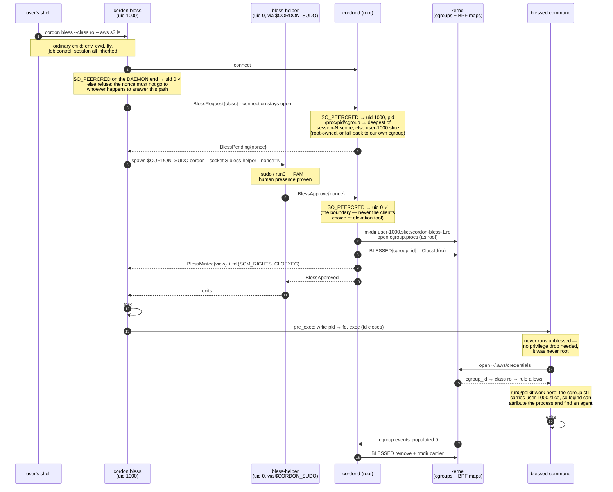

# cordon — design

The working name is cordon. It is object-centric, because you *cordon off* the secret
directories. It is deliberately outside the `gate`/`Gatekeeper` namespace.

The language is Rust. The policy is a root-owned text file, compiled to in-kernel BPF maps
(§15).

> **Reading guide.** §15 is the current architecture. It describes the flat *rule model*,
> which M1 implemented (see [`PLAN-rule-model.md`](PLAN-rule-model.md) for the milestones).
> §16 specifies *blessing*, the runtime access grant that a human authenticates
> (`cordon bless`). Blessing has shipped through B2, with an unprivileged CLI and a mint that
> is gated on elevation. The remaining milestones are in [`PLAN-bless.md`](PLAN-bless.md).
> §1 to §14 are the foundational design and its evolution. The rule-model migration retired
> the v1 owner model (owners, TOFU and interactive prompts) and the fanotify backend that those
> sections describe, and neither exists in the code any more. The sections are kept for the
> durable rationale they still carry: the threat model, the object-centric insight, identity
> forgeability, and prior art. Read §2 to §4 and §15 for the live design. Wherever a section
> still describes the owner model, TOFU, interactive prompts or the fanotify backend, that text
> is history, and it sits under a *superseded by §15* note. Such text is most concentrated in
> §5, §6, §8.2 and §12.

---

## 1. Goal

Make secret-bearing config directories readable only by the tool that owns them. The owning
tool notices nothing, because it reads its config at the normal path, unmodified. Everything
else running as the same user sees the directories as denied or empty.

## 2. Threat model

**In scope (defeat these).** One-shot scrapers, which run once, scan paths, exfiltrate and
exit, with the same UID as you. They come in rungs: hardcoded path lists, directory walkers and
content greppers, and `environ` readers that follow path-like values.

**Out of scope (conceded).** Root is out of scope. So is a resident or persistent attacker,
who can ptrace, wait for unlocks, replace binaries, kill the daemon, or double-fork to launder
ancestry. Targeted reverse-engineering of this setup is out of scope too. We raise the cost
and bound the blast radius, and no more.

The simplification that makes this possible is that we never confine the adversary. We
protect the *resource* and serve the *owner*, and the scraper finds nothing.

## 3. Key insights

1. **Unix DAC can't separate two processes with the same UID.** So we add an object-centric
   authorizer. It protects the resource, denies all subjects by default, and allows only the
   owning identity.
2. **Enforcement lives outside the confined process.** So it is a privileged daemon, not an
   in-process `LD_PRELOAD` trick.
3. **Object-centric beats subject-centric.** One rule over the resource covers all subjects,
   including unknown future scrapers. AppArmor and SELinux instead need a profile for each
   tool, and a tool without a profile is unconfined.
4. **The gater alone meets the threat model, with no crypto and no relocation.** Files stay
   plaintext in place, and the gater denies `open()` to anyone but the owner. Because nothing
   is moved or encrypted, transparency is automatic. Encryption, a broker and a shim are an
   optional later bundle (§7), not part of v1.
5. **Identity is a predicate set, not the exe alone.** Shebang tools exec as their interpreter
   (`python3`, not `aws`), and helpers and installers read configs they didn't create. So the
   subject is a conjunction of cheap predicates, ANDed in the kernel (§15.4). They are the
   exe, the uid and the cgroup, plus an opt-in content hash, argv0 and ancestor. The parent
   chain disambiguates the interpreter case, but it is best-effort, because a double fork
   evades it. So it raises the cost, and it isn't a boundary.

### 3.1 What the incumbents actually do to a scraper

Insight 3 is checkable, so check it. The in-scope adversary is a scraper running at your uid
that copies `~/.aws/credentials` and Chrome's cookie DB. Against it, stock AppArmor and SELinux
do essentially nothing, with enforcement fully on and no denial logged:

- **Fedora and RHEL targeted policy** runs the login session as `unconfined_t` and labels
  everything in `$HOME` as `user_home_t`. `unconfined_t` can read `user_home_t`. Confined user
  domains (`user_u`, `staff_u`, `xguest_u`) exist, but they are opt-in and rarely deployed.
  Even under `staff_u`, one user app is not separated from another app's data by default.
- **Ubuntu's AppArmor** ships profiles for daemons and a handful of apps. Anything else, such
  as `curl`, a pip install or a binary you downloaded, has no profile, and a program without a
  profile is unconfined.

This is not an oversight. It is the model. Confinement is a property of the *program*, and the
default for an unknown program is no confinement. A scraper is by definition a program without
a profile, so the entire class sits outside the deployment. That is insight 3, restated as an
observation rather than a claim. Both systems *can* express "only Firefox reads the cookie
DB". The gap is in policy coverage, not in capability. But expressing it means confining the
user, retyping the object, and writing a domain for every legitimate reader.

Credit where it is due. Containing a compromised *service* is what these systems were built
for, and they do it well. `httpd_t` cannot read `user_home_t`, so an nginx or mysqld exploit
does not become a sweep of home directories. Where a browser profile does ship, it points in
the opposite direction to what we want. It protects the system from Firefox, not Firefox's
cookie DB from everything else.

**Android is the counterexample, and it is SELinux.** Per-app uids, per-app domains and default
deny together are this exact protection, and it works at scale. So the mechanism is proven.
What Android has and a desktop does not is a step that assigns identity at install time.
Desktop programs arrive by tarball, pip, npm and `curl | sh`, so no such step exists. That is
why cordon assigns identity to the *object* instead and lets subjects stay anonymous.

**This prior art does solve the problem, and each piece has something to take from it:**

- **Flatpak and snap** genuinely confine. A Flatpak cannot see `~/.ssh`, and its file access
  goes through portals. But they are gated on packaging, and a scraper will not arrive as a
  Flatpak.
- **macOS TCC** is the closest existing thing to this design. It gates on the object side,
  grants per app, and prompts on first access. It is mainstream and effective. Its two failure
  modes are ours to avoid. The first is consent fatigue. §15.10's audit, admit, enforce flow
  exists partly for this, because it admits from observed evidence rather than from a modal
  prompt. The second is identity that rests on a code signature, which is the same question
  that [PLAN-rule-model](PLAN-rule-model.md) M6 is working through.
- **Windows has the right shape twice, and points it at the wrong verb both times.**
  *Controlled Folder Access* is almost exactly this design, with designated folders and an app
  allowlist. But it gates writes only, because it was built against ransomware. A scraper
  reads, so CFA never sees it. *WDAC/AppLocker* is genuinely default-deny. With DLL-level
  enforcement it is the closest shipping analogue to M6's fixed-code invariant, because an
  unsigned DLL cannot load into a signed process. But it governs what may execute, not what a
  running program may read, and consumer machines effectively never run it in enforcement
  mode. *Credential Guard* shows that Microsoft can do hard isolation when a target matters
  enough. VBS puts the LSA secrets in VTL1, out of reach of an admin. It also shows that this
  was done for one target, not as a general mechanism.
- **Chrome's app-bound encryption** (Windows, 2024) is the piece of prior art that tried
  *this* architecture, so it is the most instructive. It shipped because infostealers were
  reading the cookie DB, which shows that the threat is real and unaddressed at the OS layer.
  It replaced DPAPI's user-bound key, which any process at your uid could use to decrypt.
  That was our problem, with encryption that does not move the trust boundary. The
  replacement is a privileged SYSTEM service that validates the calling executable before it
  returns the key. That is insight 2, implemented at scale by someone else. It was bypassed
  within months. Attackers injected into Chrome and asked as an authorized process, abused the
  elevation service, or simply ran elevated. Google has kept hardening it since, and its
  current state is not verified here. But the lesson is stable, and it is the strongest
  external argument for M6: *a privileged broker that authenticates by executable identity is
  only as strong as its code-identity story, and injection into the authorized process
  defeats it.* Our `allow /usr/bin/ssh read ~/.ssh` is structurally the same grant and fails
  the same way. That is why M6 is not an optional hardening pass. On Linux, Chrome uses the
  login keyring, which any process at your uid can reach over D-Bus. So the file gate is the
  only control available there at all.
- **Per-app file gating exists commercially.** Examples are ThreatLocker's Storage Control and
  Ringfencing, AppGuard, and the previous generation of HIPS products (Comodo, Online Armor).
  A decade ago those products let you write "only firefox.exe may read this path". The
  category is largely dead. It died of prompt fatigue and the burden of managing rules, not of
  being wrong. That is the same verdict as for TCC, reached from a second direction. It is
  also the same reason why the audit, admit, enforce flow is the interesting part of this
  design, rather than the enforcement primitive.
- **EDR behavioural detection** (CrowdStrike, SentinelOne, Defender for Endpoint) is the
  mainstream commercial answer, and it is not signature-based. It flags a process that opens
  `Login Data`, archives it and then sends it out. But it races the exfiltration rather than
  bounding it, because it kills the process after the read. A boundary and a detector are
  different products. We are the former, and the journal is not a detector.

**The approach that is actually winning is orthogonal: make the loot worthless.** Device Bound
Session Credentials tie a session cookie to a TPM key, so a stolen cookie will not authenticate
elsewhere. A passkey's private key never leaves the secure element. That is the strongest
structural answer to *credential* theft on any OS. It complements cordon rather than competing
with it. It covers session secrets, and it does nothing for `~/.aws/credentials`, SSH keys,
`.env` files or a password store, which is most of what `@secrets` names. Where a secret *can*
be made impossible to exfiltrate, prefer that over gating it.

So the gap this project targets is specific: object-first default deny for desktop programs
that share a uid. Android proves that the enforcement works, and TCC proves that the model is
usable. Windows ships the two halves separately and never joins them, and none of it exists for
the Linux desktop.

## 4. Architecture

### Core
```
┌──────────────────────────────────────────────────────────────┐
│  GATER — object-centric authorizer, in-kernel (root)          │
│    decide each open() against a flat per-object rule table     │
│    (§15.6 precedence), the verdict returned IN THE KERNEL.     │
│    Linux:  BPF-LSM file_open (policy in BPF maps)              │
│    macOS:  Endpoint Security AUTH_OPEN (planned; audit_token → │
│            SecCodeCheckValidity; native parent/responsible pid) │
├──────────────────────────────────────────────────────────────┤
│  POLICY — a root-owned TEXT FILE (§15.8)                      │
│    (who, where, action, policy) rules + groups; cordond        │
│    compiles it → BPF maps on `cordon policy apply`.            │
└──────────────────────────────────────────────────────────────┘
Files stay in place, plaintext. A rule allows → reads unmodified.
```

The gater is not an AppArmor analog. It is a programmable authorizer, a cousin of LSM-BPF.
The AppArmor analog on macOS is Seatbelt/SBPL, and cordon does not use it.

**Enforcement posture.** With `bpf-lsm` the verdict is made in the kernel, so it does not
depend on the daemon being up. The links are pinned to bpffs (M5), so enforcement is
fail-safe. It survives the daemon's death, and a crash or a restart leaves the boundary
standing with no gap.

### Optional later bundle (only to cover un-gated reads — §7)
Relocating and encrypting the files needs a key. The key has to be held by a resident broker.
And the broker needs a transparency layer (`fuse-t`, or seccomp `ADDFD` under `cordon run`).
So it is all three or none.

### Optional, orthogonal
Capability brokering serves tools that have a credential-helper seam (git, AWS
`credential_process`, docker, kube). The broker hands back short-lived credentials. It works
one tool at a time.

### Privilege model — pluggable backends
The policy core (the §15 compiler, IPC and the `cordon` CLI) is privilege-agnostic. Only the
enforcement backend needs privilege. The backend is the part that mediates opens and carries
out allow and deny, and it sits behind one interface:

| Backend | Privilege | Scope | Boundary? | Status |
|---|---|---|---|---|
| `bpf-lsm` | root (CAP_BPF + CAP_MAC_ADMIN) | system-wide | yes (fail-safe, because it is pinned to bpffs) | Linux production, and the boundary |
| `endpoint-security` | root plus an entitlement | system-wide | yes | macOS, planned (§12, Phase 4) |
| `mock` / `fanotify` / `seccomp-unotify` | — | — | no | removed or dropped (see the note below) |

The build splits along this seam. The core and the CLI compile on stable Rust with no kernel
dependencies. The daemon's `bpf-lsm` feature, which is on by default and Linux-only, links the
aya loader and enforces. macOS will add an ES backend behind the same interface.

> **Retired backends (history, kept as design contrast).** Earlier iterations shipped a
> `mock` backend, which produced synthetic events for logic tests. They also shipped a root
> `fanotify` `FAN_OPEN_PERM` backend. It was a fast, portable MVP that enforced while it ran,
> but it was never a boundary. It fails open, so every open is allowed while the daemon is
> down. It decides in userspace on the open-time path, which allows the rename-out-of-zone
> bypass described below. It reads identity best-effort from `/proc`. And it needs
> `CAP_SYS_ADMIN` for its system-wide veto power, because the unprivileged `FAN_REPORT_FID`
> mode only notifies and is useless for gating. So user mode cannot enforce system-wide, and
> that motivated the move into the kernel. A `seccomp-unotify` sandbox (`cordon run --
> <tool>`) was also evaluated and scoped out. It was subject-centric and opt-in, and it needed
> real `unsafe` code. All three were removed in the rule-model migration, and `bpf-lsm` is the
> sole Linux backend. The in-kernel LSM verdict described below answers fanotify's wrong shape
> for per-object policy.

### BPF-LSM — the hardened Linux boundary
BPF-LSM is the Linux mechanism that fits per-object policy, and it is cordon's sole Linux
backend. eBPF programs attach to LSM hooks (`file_open`, `inode_create`, `inode_rename`,
`inode_unlink`, `sb_mount`, `bprm_check_security`) and return the verdict in the kernel (`0`
to allow, `-EPERM` to deny). The policy lives in BPF maps that the daemon fills from the
compiled text policy, so a rule change needs no recompile or reload. Because the hooks
mediate the operation itself, there are no per-directory marks to keep race-free, and there is
no funnel of the whole filesystem through userspace. Those are the traps that a userspace
open-notifier falls into because of its shape.

cordon returns the verdict in the kernel and never blocks a syscall to ask userspace. That
sidesteps the one thing BPF-LSM can't do, which is to suspend a syscall until userspace
answers. The in-kernel LSM shape buys the following:
- **No marking, so no recursive-mark race.** Hooks fire on the operation. A subtree is
  covered the instant it exists, whether it was just made by `mkdir`, moved in with `mv`, or
  mounted.
- **Structural operations are gateable** (`inode_rename`, `inode_create`, `sb_mount` and so
  on). That closes the rename-out-of-zone bypass. A same-uid tool can't rename a secret out of
  a protected subtree and reopen it at an unprotected path, because the rename itself is
  vetoed. Identity is also keyed on the inode, not on the path.
- **Matching happens in the kernel, so there is no funnel.** The program walks the ancestors
  of the opened file's dentry by `(dev,inode)`, and it allows opens outside any zone without
  leaving the kernel. There is no funnel of all of `/`, and the hot path never crosses into
  userspace. Path strings are ruled out, because `bpf_d_path` is not allowed at the
  `file_open` hook. That was a verifier discovery, since `security_file_open` isn't in
  `btf_allowlist_d_path`. So matching is inode-based. The daemon resolves paths to
  `(dev,inode)` at seed time. It takes the device from the mount table, so the device agrees
  with the kernel's `sb->s_dev` on overlayfs and btrfs. There, `stat` reports a device for
  each layer or subvolume, which does not agree (`proc::file_id` in
  `crates/daemon/src/proc.rs`).
- **Identity is stronger and lives in the kernel.** The caller's exe identity is its
  `(dev,inode)`, read straight from `task->mm->exe_file`. That is race-free and needs no
  `/proc` readlink. The hardening beyond that is a content digest of the opener, made with
  `bpf_ima_file_hash()` (IMA) or `bpf_get_fsverity_digest()` (fs-verity). It identifies the
  binary by what it is. So the identity survives an inode change such as a package upgrade,
  and it resists a copy to a blessed path, because it checks a hash rather than a path that
  can be spoofed. IMA appraisal plus a keyring gets "verified as signed by this key", which is
  the closest Linux analog to ES code signing. That is an enterprise setup, and it is not
  free.
- **Fail-safe, not fail-open, as implemented in M5.** The `bpf_link`s are pinned to bpffs,
  and enforcement persists with no process holding it. So the daemon can crash or restart
  with zero gap in enforcement. Only the links are pinned. A link holds its program and a
  program holds its maps, so the seeded policy stays resident too, and no map is ever shared
  between processes. `PinDir::pin_links` in `crates/daemon/src/backend/bpf_lsm/pin.rs` owns
  the layout and the handover. Turning enforcement off is the explicit `cordond --teardown`.

**Implemented in M1, and validated in a VM (see STATUS and [`PLAN-rule-model.md`](PLAN-rule-model.md)).**
M1 delivers the `file_open` verdict over the flat rule table. The program finds the deepest
protected object with the `(dev,inode)` dentry walk, matches the subject by the exe's
`(dev,inode)`, and derives the action (read, write or create) from `f_mode` and `f_flags`. It
takes the first match in the bucket that copy-down resolved, and denies by default. The
per-rule `policy` is the only enforcement level, and there is no global mode (§15.6). M1 also
delivers the text policy, which is compiled and seeded at startup and re-seeded by
`cordon policy apply` with an atomic double-buffer swap. And it delivers the ring-buffer learn
path, with event coalescing in the kernel. Structural-operation gating (M3, which closes the
rename bypass and adds `execute`) and fail-safe pinning (M5) have shipped since. So `bpf-lsm`
mediates opens and mutations, and it keeps enforcing when the daemon dies. Content-digest
identity (§15.4) remains unshipped, and it is not what closes the `LD_PRELOAD` hole (see
M6).

**Deny and learn records are delivered separately from the verdict.** The in-kernel program
has already decided, and observability rides on a BPF ring buffer (`BPF_MAP_TYPE_RINGBUF`).
On a `deny` or an `audit`, the hook emits a record. The record holds the pid, the exe's
`(dev,inode)`, the object's `(dev,inode)`, the reconstructed leaf path of the opened file, the
action and the decision. An in-kernel suppressor coalesces the records. Its key,
`SuppressKey`, includes the opened file, so distinct leaves surface separately. The daemon
drains the ring asynchronously, and it does not block the syscall. Under a flood, the losses
are observability records and never enforcement. A full ring loses the record silently
(`emit` in `crates/bpf/src/kernel.rs`).

**Control plane and data plane.** The daemon leaves the hot path entirely:
> The data plane is in-kernel BPF. It handles every open and every verdict, and it is always
> on and independent of the daemon.
> The control plane is the root-owned text policy, which is the durable source of truth, plus
> a thin daemon that can restart. The daemon (a) compiles the policy and seeds the maps at
> startup and on `cordon policy apply`, and (b) drains the ring buffer to the journal. It is
> off the hot path. Its absence costs observability and never enforcement, not even across a
> restart, because the links are pinned. The daemon is still required, to ship ring-buffer
> events to the journal and to apply policy changes.

**Map concurrency** is handled by map semantics and RCU, not by hand-rolled locks. A
single-element `bpf_map_update_elem` is atomic. A reader sees the old value or the new one,
never a torn one, and element lifetime is managed by RCU. The atomic multi-entry policy swap
on `apply` uses exactly the generation counter, or double buffer, that this design called for
(§15.8). The three rule maps are banked. `Maps::seed` fills the inactive bank and then flips
`Settings.active_bank` in one update, in the style of RCU. `bpf_spin_lock` is available if a
value ever needs an in-program read-modify-write.

**Durability.** BPF maps are ephemeral, and they are lost on a reboot or a program reload. But
the text policy is the durable source of truth, and the daemon recompiles and re-seeds it at
startup, so nothing is lost. The owner model had a hazard where an in-kernel TOFU claim was
not yet persisted. That hazard went away with TOFU itself. Autolearn (§15.9) keeps its
proposals in a separate database, which is never the enforced source.

**Requirements and cost.** The kernel needs `CONFIG_BPF_LSM=y`, and `bpf` in the active LSM
list (`CONFIG_LSM=` or the `lsm=` boot parameter). That is common but not universal. The
kernel must be 5.7 or later, and the content-hash helpers need 5.11 or 6.x. The daemon needs
`CAP_BPF` and `CAP_MAC_ADMIN`. The program is friendly to the verifier. rustc can't emit CO-RE
relocations (<https://github.com/rust-lang/rust/issues/158412>), so a userspace shim reads
the running kernel's BTF and injects field offsets into the program's `.rodata`. That way one
object runs on any kernel. BPF-LSM adds to the existing LSMs. It can only restrict further and
never loosens, so a SELinux or AppArmor deny still denies. So `bpf-lsm` is the hardened
production boundary where it is available. On older kernels, or with `bpf` absent from the LSM
list, there is no hardened Linux boundary. KubeArmor, Tetragon and bpflock are real precedent
for exactly this allow and deny use (§13).

**Lineage is subsumed here, which cancels the standalone cache (§8.2, §12).** The backend
already runs in the kernel, so the ancestry hardening of §8.2 is folded in rather than built
as a separate proc-connector subsystem. A live walk of `task->real_parent` gives the same
best-effort chain for free at decision time. Lineage that lasts past a process's exit only
needs `sched_process_{fork,exec}` tracepoints that write `(pid, starttime)` to parent into a BPF
map within this backend. The ceiling is unchanged. A real `exec` of a blessed binary (the
construction attack, §8.1) is still recorded faithfully, so ancestry stays best-effort and is
never the boundary.

**Locations.** The root system service listens on `/run/cordon.sock`. It compiles its policy
from `/etc/cordon/policy.toml`, or from a `/etc/cordon/conf.d/` directory of per-user fragments
(§15.8), and both are root-owned. Operational settings live in `/etc/cordon/config.toml`. A
dev daemon in a user session can move these to `$XDG_RUNTIME_DIR` and `$XDG_CONFIG_HOME`, and
the `cordon` CLI detects that automatically. But such a daemon is not a boundary, and only the
root service enforces.

**Operational config** is an optional TOML file. It holds `backend`, `socket`, and the paths
of the eBPF object and the policy file. Values are interpolated from `${ENV}`, and the
precedence is the CLI first, then the file, then the default. The enforcement policy, meaning
the rules, is not here. It lives in the root-owned text policy (§15.8), and
`cordon policy apply` applies it. There is no global mode. Whether to observe or enforce is
the per-rule choice between `audit` and `deny` (§15.6). See `packaging/cordon.example.toml`
and `cordon.example.policy.toml`.

**Terminology.** This daemon is the gater. The broker (§7) is the separate key holder, which
is deferred.

## 5. Coverage & ownership model

> **Superseded by §15 (historical).** This section describes the v1 *owner* model as it
> shipped in Phases 0 and 1. The flat rule model in §15, which shipped in M1, replaces it. The
> rule model folds owners, explicit rules and TOFU into one concept, and §15.1 explains why.
> The migration removed the owner model, including owners, the SQLite store, TOFU and
> interactive prompts. What follows records what those phases did, and it is not current
> behavior.

There were two sources of rules, and an explicit rule won over an automatic one.

### Explicit rules (highest precedence)
An explicit rule mapped an identity to the paths or globs it was allowed and their modes, for
example `aws : rw ~/.aws/**`. Rules could allow or deny, so a user could revoke an owner. They
lived in a root-owned config.

### TOFU auto-ownership (creator-owns)
- **Zones** were configured roots that could be traversed but were never owned (`~`,
  `~/.config`, `~/.local/share`, `~/.cache`). The first subtree level inside a zone could be
  claimed, and the zone root itself never could. The code called them "zones", because
  `container` reads as Docker or OCI.
- **A claim happened on create and never on read.** An exe that *created* a new path in an
  unclaimed zone subtree became its owner (`O_CREAT` / `FAN_CREATE`). Reading never claimed a
  path, which stopped a scraper from claiming a pre-existing secret.
- **Pre-existing paths** had no automatic owner. Interactive mode (§6) or `cordon adopt`
  handled them, and they were never assigned on first access.
- **Inheritance.** Files under an owned subtree inherited its owner group.

### Identity
- **Granularity (default `path`).** The owner was the exe path. That survived upgrades, and it
  was weak only against replacing the binary file, which needs root or a resident attacker and
  is out of scope. A rule could override it to `path+inode` or `signature` for stricter
  directories.
- **Ancestry (the parent chain).** An owner match succeeded if the caller, or an ancestor
  within the session boundary, was in the owner group. That solved the interpreter problem,
  where the caller's exe is `python3` and the ancestor that launched it is the tool. It also
  solved the case where the helper that creates a file is not the tool that reads it. The
  chain was captured at event time, with a pidfd and start-time validation, and the walk
  stopped at the session leader or at the first uid change. It was best-effort. A double fork
  launders ancestry, and argv is *not* trusted, because the caller controls it. macOS exposes
  the parent pid and a "responsible" pid natively in ES.
- **Tool groups.** An owner was a named set of identities. It was seeded automatically with
  the creator and could be expanded (`cordon claim <subtree> --add <id>`).

### Ownership / rules store
The store was SQLite, owned by the root daemon and not writable by the user. Otherwise a
scraper could have written itself in as an owner. Only the privileged `cordon` CLI could change
it, through the daemon's IPC.

## 6. Decision flow & interactive mode

> **Superseded by §15.6 (historical).** The owner-model decision flow and the interactive
> deny-and-learn described below were removed together with the owner model. The live decision
> flow is §15.6. It finds the most specific protected object, takes the first match in the
> copy-down bucket, and denies by default. The per-rule `policy` is the only enforcement level,
> and there is no global mode. The verdict is returned in the kernel, so there is no
> synchronous prompt. TOFU's successor is autolearn (§15.9), an explicit training mode whose
> results are reviewed, not a prompt on each open. The deadline-safety problem below is exactly
> why. The section is kept for that rationale and for the design of the prompt UX.

### Decision flow (evaluated per gated open)
1. If the path is not under any protected subtree, allow it without mediation.
2. If an explicit rule matches, allow or deny as it says. User rules win, which makes
   revocation work.
3. If the caller or an ancestor is in the subtree's owner group, allow.
4. If the open is an `O_CREAT` of a new path in an unclaimed zone subtree, make a TOFU claim
   and allow.
5. Otherwise (the path is protected, it is unowned or the owner does not match, and the open is
   not a create), show an interactive prompt if a session agent is present. Without an agent,
   apply the configured default, which is deny.

### Interactive mode
On step 5 the daemon asks the user. But the AUTH path is synchronous and has a deadline. ES
kills clients that miss it, and blocking an `open()` on human reaction time hangs tools and
risks deadlock. Santa's ES authorizer survives this with a secondary dispatch that returns the
default just before the deadline, and we reuse that pattern (see `docs/SANTA.md`). So the
model is deny-and-learn:

> Deny *this* access to meet the deadline. Prompt the user asynchronously, persist the
> choice, and honor it on later accesses. Optionally, hold the open synchronously for a short
> time (a couple of seconds at most, well under the deadline), so that a fast answer lets even
> the first access through. Deny-and-learn is the fallback.

The consequence is that a brand-new tool errors once until it is approved, and then it works.
TOFU covers tools that create their own config without a prompt. So prompts mostly fire on
paths that already existed or are ambiguous, and that lets "approve permanently" subsume
`cordon adopt`.

**How prompt outcomes become rules:**
| Choice | Effect |
|---|---|
| Deny once | ephemeral, for this event only |
| Deny permanently | an explicit deny rule (identity to subtree) |
| Approve once | an ephemeral allow (for this process instance) |
| Approve for X min | a TTL allow rule that expires at now+X |
| Approve permanently | an explicit allow, or the identity added to the owner group |

The prompt shows who is asking (the exe and its ancestry chain), what is asked for (the file or
subtree), and the proposed rule scope. The scope is per subtree, not per file, so the prompt
doesn't ask again.

**Agent architecture.** The root daemon can't draw UI. So it delegates to an unprivileged
prompt agent in each session, in the style of a polkit agent, over IPC. The request is routed
to the user who owns the triggering session. The notification channel is the part that differs
by OS (libnotify or D-Bus on Linux, UserNotifications on macOS).

## 7. Do we encrypt anything? (what "keys" meant)

**Not in v1.** The gater denies the live scraper's `open()`, so plaintext in place is fine.
Encryption only protects reads that the gater *doesn't* mediate:

| Un-gated read | In scope? | Already covered by |
|---|---|---|
| stolen / offline disk | no, because it is physical | FileVault / LUKS |
| pre-daemon boot window | no (a scraper is interactive and runs after login) | — |
| gater bug / bypass | defense in depth only | — |

So encryption adds almost nothing in scope, and it drags in keys, a broker and a shim. It is
deferred. "Keys" only exist if we encrypt later. There would be a master key that the broker
holds in RAM and that is unlocked once per session.

## 8. Caller identity (mechanics)

> **§15.4 updates these mechanics.** In the in-kernel backend, the caller's identity is its
> exe `(dev,inode)`, read straight from `task->mm->exe_file`. That is race-free and needs no
> `/proc` readlink and no `FAN_REPORT_PIDFD`. The other predicates of §15.4 add to it (uid,
> cgroup, and an opt-in hash, argv0 or ancestor). The fanotify pidfd and `/proc` mechanics
> below are the retired userspace path. But the forgeability analysis in §8.1 does not depend
> on the model, and it still carries weight, because §15.4's argv0 and ancestor predicates rest
> on it.

- **Race-free identity.** On Linux, `FAN_REPORT_PIDFD` gives a pidfd, and the pidfd gives the
  exe. On macOS, the audit token of each connection gives a code requirement. Don't
  re-`readlink` `/proc/pid/exe` after the fact, because the PID may have exec'd.
- **Chain walk.** Starting from the triggering pidfd, read the ppid (`/proc/<pid>/stat`), and
  validate each hop by its start time. Stop at the session leader or at a uid change. Take the
  snapshot when the event arrives. The walk is best-effort (see the caveats in §5).
- **The tension between hardening and injectability, and the confused-deputy ceiling.** These
  matter only if we ever add the transparency shim (§7). v1 only gates.

### 8.1 Caller vs. ancestry forgeability (sharpened)
Treat the immediate caller and the ancestry chain as different security objects:
- **The immediate caller is strong and race-free.** It is suspended in the kernel while it
  waits for our verdict, so it cannot exit or exec under us. On Linux, the exe path is
  kernel truth, and it is race-free while the caller is blocked. On macOS, the per-event
  `audit_token` yields a *cryptographic* code identity (`cdhash`, `team_id`, `signing_id`,
  validated with `SecCodeCheckValidity`). That is strictly stronger than a path, and it is the
  real win of ES.
- **Ancestry is best-effort, and it faces two distinct attacks:**
  - **Removal.** A double fork reparents the process to init and erases the chain on Linux.
    macOS resists this, because `original_ppid` and the *responsible* audit token survive
    reparenting.
  - **Construction.** The attacker runs `fork(scraper); exec(real blessed binary)` in the
    parent. That builds a *genuine* ancestry whose ancestor really is the blessed tool. It
    defeats ancestry on both platforms. Stricter identity does not fix it, whether that is
    `path+inode`, `signature` or macOS code signing, because the binary is authentic and is
    attested truthfully. Only a liveness window bounds it, where the blessed ancestor must be
    alive at access time. The launcher can also influence macOS's "responsible process"
    attribution (through the `posix_spawn` disclaim attributes), so that is not unforgeable
    either.
- **The interpreter problem persists on macOS.** A script tool surfaces as `/usr/bin/python3`,
  which is an Apple *platform binary*. So the strong code identity belongs to the interpreter,
  not the tool. That pushes you back onto the weaker link of ancestry or the responsible pid,
  as on Linux.
- **Conclusion.** Ancestry raises the cost and is never a boundary. The construction attacker
  belongs to the targeted reverse-engineering class that §2 concedes. The object-centric deny
  is the boundary.

### 8.2 Better Linux lineage sources (beyond the /proc snapshot)
The `/proc` ppid walk is a snapshot, taken *after* reparenting has already destroyed the
information. Stronger sources exist. From weakest to strongest, they are:
- **Start-time keying** (`/proc/<pid>/stat` field 22). Key each hop by `(pid, starttime)`. A
  changed starttime means the pid was recycled, so the hop is rejected. This kills pid reuse.
  It is cheap, and the design already assumes it.
- **pidfd.** The caller's pidfd comes free with `FAN_REPORT_PIDFD`. `pidfd_open(ppid)` plus a
  starttime recheck pins the ancestors. That is race-free, but it is still a snapshot taken at
  decision time.
- **`loginuid` and `sessionid`.** They are set at login, they can't change without
  `CAP_AUDIT_CONTROL`, and all descendants inherit them. So they are a fence the scraper can't
  shed, unlike `setsid`. They give the walk a robust bound, though they don't identify the
  tool.
- **The proc connector** (`NETLINK_CONNECTOR`/`CN_IDX_PROC`) **or eBPF**
  (`sched_process_{fork,exec}`, BPF-LSM). Subscribe at startup, and maintain a lineage cache
  keyed by `(pid, starttime)`. Recording the parent at fork time captures the *original*
  lineage before a later double fork can erase it, which defeats the removal attack. eBPF is
  the high-fidelity option, because it also gets argv, cwd and credentials at exec. It is how
  Tetragon, Falco and Sysdig build process trees (§13). It needs root, which is already
  required.
- **Ceiling.** Lineage tracking defeats removal and reuse, and never construction, because a
  real `exec` is faithfully recorded as a genuine blessed ancestor. Log sources don't help,
  because `auditd` is asynchronous and only logs. `/proc/.../children` points in the wrong
  direction. Grouping by cgroup or session doesn't help either, because CLI tools share the
  shell's cgroup.

> **Superseded as a standalone deliverable.** With the BPF-LSM backend (§4), this work is
> folded into the backend rather than built as a separate proc-connector subsystem. A live
> walk of `task->real_parent` is free at decision time. Lineage that lasts past a process's
> exit only needs `sched_process_{fork,exec}` hooks there that write `(pid, starttime)` to
> parent into a BPF map. That is a later increment. Ancestry is one of §15.4's opt-in
> predicates and never the boundary (§8.1). So the once-planned event-sourced proc-connector
> lineage cache is dropped. The in-kernel walk is best-effort too. A parent that has already
> exited has already been reparented, so only recording at fork time defeats removal. The
> construction ceiling stands regardless.

## 9. Cross-platform primitive map

| Need | Linux | macOS |
|---|---|---|
| Object-centric open authorizer | BPF-LSM `file_open` (in-kernel verdict) | Endpoint Security `AUTH_OPEN` |
| Testing without host root | a virtme-ng VM runs the real `bpf-lsm` backend, and `cargo test` covers the compiler and the control plane | `mock` only (no unprivileged intercept) |
| Caller id (race-free) | exe `(dev,inode)` from `task->mm->exe_file` (in the kernel) | the audit token of each connection, checked against a code requirement |
| Parent chain | a `task->real_parent` walk (in the kernel) plus start time | the ES process struct (parent and responsible pid) |
| Create signal (autolearn / mutation) | the `inode_create` hook (§15, M3) | ES create and exec events |
| Prompt channel (deferred, because the rule model has no interactive mode) | a per-session agent plus D-Bus or libnotify | a per-session agent plus UserNotifications |
| Key custody (only if encrypting) | kernel keyring / Secret Service | Keychain / Secure Enclave |
| Declarative MAC we're *not* using | AppArmor / SELinux | Seatbelt / SBPL |

Both OSes have the same shape: a root in-kernel authorizer, a root-owned text policy, and the
`cordon` CLI. Protecting a directory costs one rule, not a profile for each tool.

## 10. Honest limitations
- **~~Fail-open until pinned.~~ Closed (M5).** The LSM links are pinned to bpffs (§4), so a
  daemon crash, kill or restart leaves enforcement standing with no gap. What remains is a
  usability edge rather than a hole. `systemctl stop cordond` no longer stops enforcement,
  and `cordond --teardown` does. Teardown is also asynchronous, because the kernel detaches
  the hooks from a workqueue once the pin's reference goes. On kernels without BPF-LSM
  (`CONFIG_BPF_LSM` off, or `bpf` not in the LSM list), there is still no hardened Linux
  boundary at all.
- **Only some operations are mediated.** The program hooks `file_open`, link, rename,
  unlink, rmdir, mkdir and exec (§15.5; the list is the
  `#[lsm]` programs in crates/bpf/src/main.rs). Other operations on a protected inode are not
  hooked. These include changing its mode or owner, changing its extended attributes, and
  truncating it by path.
- **Identity beyond the exe is best-effort.** The exe `(dev,inode)` is race-free. But a double
  fork launders the parent chain, and argv is untrusted. Interpreted tools surface as their
  interpreter (`python3`), so they need the opt-in argv0, ancestor or hash predicates
  (§15.4). Ancestry raises the cost, and it is never the boundary (§8.1).
- **First-access friction.** When a tool with no matching rule hits a protected object, it is
  denied by default. Granting access means editing the root-owned policy and running
  `cordon policy apply`. Autolearn (§15.9) is the assisted path. There is no interactive
  prompt on each open.
- **Confused deputy.** Gating an open does not stop a tool's own export surface, and that is
  out of scope.
- **Only the root `bpf-lsm` backend is a boundary.** A dev daemon in a user session is for
  iteration, not protection. The boundary runs as a root service with `CAP_BPF` and
  `CAP_MAC_ADMIN`, and macOS ES needs a restricted entitlement.
- **The planned macOS backend shares ES's ceiling.** It mediates only at `open()` time, because
  ES has no `read(2)` event. It does not follow symlinks, and binaries in the ES "default mute
  set" are not mediated. Santa's FAA hits the same limits (`docs/SANTA.md`), and they are
  inherent to ES.

## 11. Testing strategy — internal fixtures

> **Definition of done: every change is validated in a VM locally before it is complete.**
> Run `packaging/test/run-bpf-lsm-vm.sh`, which defaults to the CI-pinned kernel (currently
> `v6.12`), and confirm that all `bpf-lsm-smoke.sh` scenarios pass. This holds for
> userspace-only changes too, such as the policy compiler, the CLI or the daemon's control
> plane. The VM is the one tier that exercises the real kernel boundary end to end, and a
> userspace change can still break seeding, the IPC apply path, or a policy shape. `cargo
> test` (the unprivileged tier) is necessary but not sufficient. When a change adds or alters
> enforcement behavior, add or extend a scenario so that the suite still covers it. The same
> harness and the same pinned kernel run locally and in CI, so a green local VM run is the
> gate, not a courtesy.

The kernel-backed smoke test (`bpf-lsm-smoke.sh`) drives the rule model end to end against a
policy file. Its subjects are exes with distinct inodes (copies of `bash`, so each is its own
subject) that read and write secrets under a protected subtree. It covers:
- an owner exe that is allowed to read its secret, and a scraper with no matching rule that
  is denied by default (`EPERM`) and reported on the ring buffer with the object inode and the
  action;
- per-action rules (read allowed and write denied by default on the same object), subject and
  object groups, and ties where deny beats allow. It also covers copy-down precedence, where
  a subtree allow is combined with a file-specific deny for one subject and the sibling file
  stays readable. Then there is audit to deny, which observes with a catch-all and then
  enforces by flipping that one rule, with no global mode. Finally it covers silence (denied
  but not logged), runtime `policy apply`, and event coalescing.

The suite asserts that the right subject reads, that the wrong one is denied in the kernel,
that precedence resolves as §15.6 says, and that a tight loop of opens collapses to a few
records. All of this runs on a real kernel. The unprivileged `cargo test` tier covers the
parser and the copy-down compiler.

### Test tiers (by privilege)
- **Unprivileged, with no kernel backend.** `cargo test` covers the policy parser, the
  copy-down compiler and the IPC types. With `--all-features` it also builds and unit-tests
  the `bpf-lsm` control plane, including event coalescing. It is CI-friendly and needs no
  root, and it covers everything except the in-kernel hook itself.
- **The `bpf-lsm` boundary in a VM, without host root, through virtme-ng.** Loading the LSM
  program needs `CAP_BPF` and `CAP_MAC_ADMIN`, plus `bpf` in the active LSM list. A virtme-ng
  VM (`packaging/test/run-bpf-lsm-vm.sh`) provides both. It boots a pinned upstream kernel
  (Ubuntu mainline, for example `v6.12`) with `lsm=…,bpf` and runs as root in the guest. It
  needs only `/dev/kvm` (group `kvm`) and no host root. The VM runs qemu directly, with no
  container, and virtme-ng reuses the host userspace. So there is no rootfs to build and no
  glibc mismatch. The same harness and kernel run locally and in CI, so the kernel never
  diverges. `CORDON_VM_KERNEL` selects the pinned version, and leaving it unset selects the
  host kernel for fast local iteration.
- **Why not libkrun or krunvm.** They were evaluated and dropped. Getting `krunvm` onto a CI
  runner means nesting it inside a container. That stacks two user namespaces
  (`buildah unshare`) under the libkrun VMM, and the stack fails differently in each
  environment (`gid_map: operation not permitted` locally, and `memfd_create: EINVAL` on
  GitHub). So it is not reproducible. virtme-ng collapses the stack to a single dependency on
  `/dev/kvm`.
- `bpf-lsm-smoke.sh` proves the rule model end to end through a real kernel. It covers allow
  and deny, per-action rules, subject and object groups, copy-down precedence, audit to deny,
  silence, runtime `policy apply` and event coalescing. It is green in the virtme-ng VM, on
  both the host kernel and the pinned `v6.12`, booted with `lsm=…,bpf`.

## 12. Phased plan

> **Superseded by [`PLAN-rule-model.md`](PLAN-rule-model.md) and §15.11 (historical).** The
> phases below are the roadmap of the *owner model*. They shipped through Phase 1, and after
> that the owner model and fanotify were removed. The current roadmap is the rule-model
> milestones M1 to M6 in PLAN-rule-model.md, of which M1, M3 and M5 are done, and §15.11
> summarizes them. This section is kept for the design history and for the macOS and ES notes
> (Phase 4), which still apply.

- **Phases 0 to 3 (the owner model, shipped and then retired).** Phase 0 built the
  privilege-agnostic core, a SQLite store and the `cordon` CLI on a `mock` backend. Phase 1
  added the root `fanotify` `FAN_OPEN_PERM` backend, which was VM-validated. It read
  TOFU-on-create from `/proc/<pid>/syscall` and ancestry from `/proc`. Phase 3 moved the
  verdict into the kernel, with the bpf-lsm backend, which was then keyed on `subtrees` and
  `owner_identities`. Phase 2 (interactive deny-and-learn plus ancestry hardening) was
  specified but not built. The rule-model migration (§15) replaced this whole line, and the
  detail is in git history. The interactive prompt design survives as the record in §6 and as
  autolearn (§15.9), and the ancestry analysis survives as §8.1 and §8.2.
- **Phase 4: the macOS gater.** It will be a bespoke ES `AUTH_OPEN` client. That is decided,
  because Santa's FAA can't do dynamic, reviewable policy or autolearn (`docs/SANTA.md`). We
  reuse Santa's Apache-2.0 source as a reference for the deadline-safety dispatch, the layout
  with several ES clients, and identity matching. The policy and the CLI abstraction stay the
  same, behind the backend interface.
- **Phase 5 (optional): the at-rest bundle, capability brokering, and canaries.**

## 13. Related work / prior art

These are the references we draw from. None of them is a drop-in for "deny reads of secret
config directories to everyone but the owner, transparently, cross-platform, with no per-tool
policy."

### Closest architectural cousins (authorizer daemon + rule store)
- **Santa** (macOS, North Pole Security) is the closest existing tool. Its File Access
  Authorization (FAA) is a real object-centric file gater on Endpoint Security, keyed on code
  identity. It covers about 80% of our macOS gater. But Santa is macOS-only, with no
  cross-platform plans. And FAA is static admin policy. It has no interactive prompt and no
  TOFU, and it reloads by polling (every 15 seconds at the fastest). Its interactive TOFU
  (standalone mode) covers execution only. So it can't do cordon's dynamic creator-owns and
  deny-and-learn for files. The full analysis of its functionality and roadmap, and the
  decision between reuse and building our own, are in `docs/SANTA.md`. We borrow its ES
  deadline-safety pattern and its identity-match schema, which are Apache-2.0.
- **OpenSnitch** (Linux), **Little Snitch** and **LuLu** (macOS) are interactive application
  *firewalls*. They are the reference for our deny-and-learn UX (allow once, for X minutes or
  forever, with rules by exe) and for attribution to a process. But they gate network egress,
  not file reads. They would catch an exfiltration *connection*. Yet a scraper that stages to a
  local file, or leaves over a channel that is already allowed (the browser, DNS), slips by.
  They are a complementary layer, not a substitute.

### Mandatory Access Control (the per-tool-policy family we reject as primary)
- **AppArmor, SELinux and macOS Seatbelt (`sandbox-exec`)**: see §3 and §9. They are
  subject-centric. Each program needs its own profile or policy, and a program without a
  profile is unconfined, so an unknown scraper is unrestricted. SELinux *can* be
  object-centric through labels. But its policy is compiled, it works through domain
  transitions, and it is Linux-only. We want one object-centric rule that covers all subjects,
  including unknown ones.
- **Landlock** (Linux, an unprivileged LSM) lets a process restrict its own file system access
  and its children's. It is modern and needs no root. But it is *self*-confinement, so it is
  useless against a scraper that won't opt in. It is the inverse of what we need.
- **bubblewrap, firejail and Flatpak** are namespace sandboxes. Flatpak even gives each app its
  own data directory (`~/.var/app/<id>`), which is the north star for per-app isolation. But
  they are subject-centric and opt-in for each app. CLI dev tools aren't packaged, and you
  can't wrap a scraper you've never seen.

### Secret brokers / keystores (our deferred §7 + orthogonal capability brokering)
- **ssh-agent and gpg-agent** never release the key, and perform the operation instead. That
  is the broker pattern in miniature, but it covers only ssh and gpg and is bound to their
  protocols.
- **HashiCorp Vault (with its agent), aws-vault, envchain, the 1Password CLI and
  git-credential-manager** broker short-lived credentials and keep custody in an OS keystore.
  Several are cross-platform. We borrow the idea of a short-lived capability. But each one
  needs integration with each tool, and none of them transparently protects the long tail of
  existing flat config files.
- **OS keystores** (Keychain, Secret Service, the kernel keyring) and **SOPS, age and
  git-crypt** make the secret something other than a readable file, or encrypt it at rest. We
  borrow them for the deferred at-rest bundle. But tools must adopt them, and they don't gate
  live reads of directories that already exist.

### Filesystem-view / redirection (evaluated and rejected earlier)
- **fakechroot and proot** remap paths with `LD_PRELOAD` or `ptrace`. They are cooperative, or
  a same-UID process can bypass them, so they are not a boundary (see the preload discussion).
- **FUSE (bindfs, gocryptfs, fuse-t).** A userspace file system can gate on the caller's pid,
  and fuse-t does it on macOS without a kext. But the mount is global rather than per
  process, PID identity is racy, and macFUSE's kext *lowers* platform security. We use a
  kernel authorizer (bpf-lsm or ES) instead, and keep fuse-t only for the deferred
  transparency layer.

### Observability & eBPF enforcement
- **auditd, fanotify in notify mode, and inotify** can *watch* file access by path, but they
  cannot deny. We need the permission path, which can veto, and not just logging.
- **Tetragon and Falco** (eBPF, LSM-BPF) do runtime security, and Tetragon can even enforce,
  by overriding or killing. Architecturally, Tetragon is the same as our LSM-BPF backend. But
  it is oriented to containers and Kubernetes, and it is heavyweight to drive as a secret gate
  for one desktop user.

### aya-ecosystem peers (our toolchain — pure-Rust eBPF via aya)
The eBPF enforcers above (Tetragon, Falco, KubeArmor and bpflock) are the precedent for the
mechanism, but all of them use Go and libbpf. Some projects share cordon's actual toolchain:
a `no_std` `aya-ebpf` kernel crate, an `aya` userspace loader, maps and ring buffers, and the
same CO-RE and BTF offset problem (rustc can't emit CO-RE relocations,
<https://github.com/rust-lang/rust/issues/158412>). They are listed in
[`aya-rs/awesome-aya`](https://github.com/aya-rs/awesome-aya). Every security project there is
subject-centric, and most only observe. None is an object-centric file authorizer for a
personal box. So cordon shares their plumbing, not their shape:
- **lockc** is an eBPF LSM-based MAC for *containers* (Docker, Kubernetes), written in Rust
  with aya. It is the closest cousin by mechanism, because it turns LSM hooks into MAC. But it
  is centred on containers and profiles, and it is framed around audit and experimental. It
  restricts the confined workload, not an *object* the way we protect a subtree.
- **suidsnoop** uses aya LSM programs, and it is the only peer that actually denies, with an
  audit or enforce mode. But it is scoped to suid `execve` and keyed on the uid, so it is
  subject-centric. It is a research demo, not a gate on file reads.
- **bombini** uses aya LSM-BPF, but it only observes. Its modular "detectors" (exec, connect,
  file access) emit JSON and never veto. It is subject-centric runtime security for
  Kubernetes.
- **kunai** uses aya with kprobes and tracepoints, not LSM enforcement. It only observes, for
  host threat hunting, like Sysmon for Linux. It is the most mature of the set and the least
  like cordon, because it logs events and doesn't gate opens.

So cordon's niche in the aya world is empty. That niche is object-centric, enforcing, on a
personal desktop, with TOFU and interaction. The Go tools above are the precedent for the
*use*, which is allow and deny on LSM hooks. These aya projects are the precedent for the
*stack*. They all answer "what may this subject do?", and never "who may touch this
resource?"

### Authorization-agent architecture
- **polkit** pairs a privileged daemon with an unprivileged agent in each session that draws
  the prompt. That is exactly our split between daemon and agent (§6). But polkit authorizes
  privileged D-Bus *actions*, not file reads.

## 14. Open decisions
See `STATUS.md`.

## 15. The rule model — current architecture (supersedes §1–§14)

The flat rule model is cordon's architecture, and it shipped in M1. A rule is
`(who, where, action, policy)`, in the lineage of SELinux and AppArmor. The model folds the v1
owner model's owners, explicit rules and TOFU (§5) into one concept, and the kernel enforces
it uniformly. This section is the design. The status of each milestone is in
[`PLAN-rule-model.md`](PLAN-rule-model.md), where M1, M3 and M5 are done and M6 is the
remaining must-have.

### 15.1 Why
The owner entity reduces to allow rules. `owner_match` means the same as "an allow rule
exists for this caller exe and this subtree." Owner groups bought grouping, deduplication and
naming. But a general group mechanism (§15.7) gives that on all axes, symmetrically, so a
dedicated owner table was incidental complexity. Collapsing it also closed a real gap. The
owner model's bpf-lsm backend enforced only `subtrees` and `owner_identities`, and not the
`rules` table. So `cordon add` allow and deny rules and TOFU were silently not enforced in the
kernel. Now there is one model, enforced uniformly.

### 15.2 The rule
A rule is `(who, where, action, policy)`:
- **who** is the subject. It is a *conjunction of predicates*, not just an exe (§15.4).
- **where** is the object. It is a file, a directory, or a recursive subtree. The kernel
  matches it with the walk over dentry ancestors, and the most specific object wins.
- **action** is one of `read | write | create | execute | listdir | unlink | mkdir | rmdir |
  rename | link`, and the list can grow. Each action maps to an LSM hook (§15.5).
- **policy** is one of `allow | deny | audit | silence`. The four are the product of
  `{allow,deny}` and `{log,silent}`. `allow` allows silently, `audit` allows and logs, `deny`
  denies and logs, and `silence` denies silently.

### 15.3 The compile principle (load-bearing)
**Userspace resolves groups, nesting, defaults and precedence entirely at compile time, and
the kernel evaluates a flat decision table that is already resolved.** cordond parses the text
policy, expands the groups, and resolves paths to `(dev,ino)`. It then flattens the result to
a rule table for each object and loads the BPF maps. This works like SELinux's `checkpolicy`,
with an expressive source and a simple, fast binary form. The eBPF program never sees a group
or a nested reference. So it stays small and friendly to the verifier, however expressive the
authoring gets.

### 15.4 Subject = predicate set (the identity frontier)
`who` is a conjunction of predicates that are cheap to check, ANDed together:
- `exe` is the path or inode, and it is cheap.
- `uid` and `gid` are cheap (`bpf_get_current_uid_gid`).
- `cgroup` or unit is cheap (`bpf_get_current_cgroup_id`), and it names a systemd service.
- `exe-hash` is the content identity, which IMA or fsverity measures in the kernel. It is
  *not* hashed in BPF. It survives upgrades and resists a binary swap.
- `argv0` and `ancestor-exe` cost more. They are the only real fix for the interpreter
  problem. `~/.aws` is opened by `python3`, not by `aws`. So the rule must match "python3
  whose argv0 or ancestor is aws", and not every python.

v1 ships `exe`, `uid` and `cgroup`, and the hash, argv and ancestor predicates are opt-in
later. No rule grammar fixes the granularity of identity. This axis is where the security
actually lives.

### 15.5 Action ↔ hook map (actions are not uniform)
| action | LSM hook | notes |
|---|---|---|
| read / write / create | `file_open` | One program. `f_flags` and `f_mode` already encode RDONLY, WRONLY, RDWR and `O_CREAT`, so three actions come free at open time. |
| execute | `bprm_check_security` | The exec of a binary. It is not implied by `read` (see below). |
| unlink / rmdir / mkdir / rename | `inode_unlink/_rmdir/_mkdir/_rename` | A second program. It fires on a mutation, which is cheap. |
| link | `inode_link` | A distinct hook. `rename` does not cover it (see below). |
| listdir | `file_open` of a directory (coarse) | It compiles but never fires (see below). Anything finer needs the hot `file_permission` hook. |

**The second-name escape, and why `link` is not optional.** A *directory* object protects its
children by ancestry. The kernel walks `d_parent` from the opened file up to a `PROTECTED`
`(dev,ino)`. So a file's membership depends on its position. Any second name for the same
inode outside the object has a different ancestry and matches nothing:

```
open ~/.ssh/id_ed25519 → leaf ino (miss) → .ssh ino (HIT)  → deny
ln ~/.ssh/id_ed25519 ~/x
open ~/x               → leaf ino (miss) → ~ (miss) → / (miss) → unprotected → ALLOW
```

Both `rename` and `link` create that second name, and `link` is the cheaper attack.
`rename(2)` needs write and execute permission on both directories, and it is destructive.
The secret vanishes from `~/.ssh`, the owning tool breaks, and you notice. `link(2)` needs
write permission only on the destination directory. It needs no read permission on the
secret, and it leaves the original untouched, so it is silent and non-destructive.
`protected_hardlinks=1` does not help. It only restricts linking files that the caller does
not own, and here the adversary *is* the owner.

So the invariant is not "gate rename". The invariant is that a protected inode must not
acquire a name outside its object, and that needs both `inode_link` and `inode_rename`.

**Shipped.** Both hooks, plus `inode_unlink`, `inode_rmdir` and `inode_mkdir`, share one
resolver built on `find_object`. There are four cases. `dst` is the destination directory
(`new_dentry.parent()`). `target` is the destination dentry itself, which is a distinct
question (see below):

| | condition | verdict |
|---|---|---|
| **destroy** | `target` is protected (a rename over an existing name) | That object's `write` verdict. It is asked first, before the shuffle short-circuit. |
| internal | `src == dst` | Allow. An atomic save writes a temp file beside the target and renames it over the target, and that must keep working inside a protected directory. |
| **escape** | `src` is protected, and `dst != src` | Deny, unconditionally. |
| clobber | `src` is unprotected, and `dst` is protected | The subject's `create` or `write` verdict on `dst`. |

`inode_unlink` and `inode_rmdir` have no destination, so they take the subject's `write`
verdict. They are gated because objects resolve once, at `policy apply`, and nothing checks
them again. Without the gate, `rm -rf ~/.ssh && mkdir ~/.ssh` would leave the `PROTECTED`
entry dangling and the path unprotected forever.

**`listdir` does not fire, and the failure is a trap worth naming.** There is no hook for each
`getdents`, so listing a directory *is* a `file_open` on it. `requested_action` derives only
`read`, `write` and `create` from `f_mode` and `f_flags`. So a directory open requests `read`,
and nothing ever requests `listdir`.

The consequence is not a no-op. A rule that names only `listdir` matches no request, so the
open falls through to the default deny. `allow @tools listdir @secrets` therefore denies the
listing that it looks like it grants. It fails *closed*, so this is a usability trap rather
than a hole. But for now, a policy must spell directory listing as `read`. Making `listdir`
fire means tagging the request when the opened inode is a directory (`i_mode & S_IFMT`), and
that costs one more BTF offset. It is deliberately not done yet, because `read` already covers
the case correctly.

**`execute` is its own capability.** An exec *opens* the file (`FMODE_EXEC | FMODE_READ`). So
`file_open` already refuses to run the contents of an object that denies reads.
`bprm_check_security` adds the converse, so an object may be readable and not runnable. The
subject is the process that *performs* the exec, because at that hook the caller still has its
old image. Note how this interacts with copy-down. A narrower `allow` on a child does not
remove a capability that the parent granted, because a child rule that doesn't match the
requested action falls through to the parent's rules. So "readable but not runnable" is
written as an explicit `deny` on `execute`, not as an `allow` that leaves `execute` out.

`inode_mkdir` is the mirror of `rmdir`, and it is the one hook whose dentry is negative. There
is no inode yet, so the dentry matches nothing itself, and the verdict comes from its parent,
like the clobber case above. Adding a name inside an object is an ordinary `create` or `write`
on that object. Note that this does *not* cover the `rm -rf` case above. Once the object's own
directory is gone, there is no protected ancestor left to find, and that is exactly why
`rmdir` is the hook that closes the case.

**Why escape consults no rule.** An escape publishes the inode to *every* subject,
permanently and silently. Afterwards `find_object` misses, so nothing is ever logged again.
Gating the escape on the acting subject's read verdict was considered and rejected. With that
gate, `allow /usr/bin/ssh read ~/.ssh` would let an allowed subject that is scriptable or
running under `LD_PRELOAD` convert a scoped, logged grant into an unscoped, permanent one. So
no subject may escape, not an allowed exe and not a blessed session. Blessing grants *read*,
not re-parenting.

The cost is deliberate and one-sided. This rule enforces on `audit` objects too, which
otherwise never enforce. So renames *out of* `~/.config` now fail with `EPERM`, for example in
an app's config migration or a manual `mv ~/.config/foo ~/backup/`. Renames inside the object
are unaffected, and they are the common case. Whether an escape is *journaled* still follows
the object's policy. So a `silence` object refuses it silently, and the split between
`{allow,deny}` and `{log,silent}` holds. If the cost ever bites, a one-line softening would be
to allow the escape where a `*` subject may already read the object. The journal cause is a
distinct synthetic `escape-deny` (like `default-deny`), because "structurally refused" and "a
rule of yours blocked it" need different fixes.

Also note an asymmetry that the walk creates. The leaf's own id is tested first. So a rule
that names a file matches that inode under any name, and it was hardlink-proof even before
these hooks. A rule that names a directory protects children only by ancestry. Listing secret
files as objects was therefore a real mitigation, and it was rejected anyway. It requires
listing every secret, so a key generated tomorrow would be silently unprotected. Directory
objects had to become sound on their own.

For contrast, these are *not* bypasses:
- **Symlinks**, because `file_open` sees the dentry of the resolved target.
- **A reopen through `/proc/PID/fd/N`**, for the same reason.
- **Bind mounts**, because `d_parent` belongs to the file system, not to the mount. Walking
  the dentry chain instead of a path string buys this for free.
- **Copying**, because a copy needs a read, which is mediated.
- **Overlayfs in a user namespace.** This was measured rather than assumed (2026-07-27,
  7.1.4-zen). Mounting an overlay over `$HOME` and reading through it journaled
  `object=~/.config path=~/.config/dconf/user`. So the ancestor walk resolved the *real*
  object, and the path reconstruction walked the *real* dentry chain. Overlayfs presents the
  underlying dentry to `security_file_open`, so the read is mediated and needs no `sb_mount`
  gating.

**Why the destination is classified twice.** The destination directory answers the escape and
clobber cases, but it cannot answer for the name being overwritten. `rename(2)` onto an
existing name destroys that inode, and `security_inode_rename` is the only hook the kernel
fires for it. `security_inode_unlink` is reachable only from `vfs_unlink`, and
`do_renameat2`'s own target check is `may_delete()`, which checks DAC only. If the target were
left unclassified, its sibling syscall could bypass the `inode_unlink` gate. `rm secret` would
be refused, while `mv anything secret` destroyed the same inode and left the `PROTECTED` entry
dangling permanently. Two shapes are invisible to the classification by directory pair:

- **The destination is an object whose parent is not.** Take `deny * * ~/.ssh/authorized_keys`
  with no rule on `~/.ssh`. Both directory walks miss, so the pair reads as `(None, None)`,
  meaning "nothing protected is moving".
- **The destination is a nested object that is more specific.**
  `mv ~/.aws/tmp ~/.aws/.danger-token` reads as an internal shuffle, because both sides
  resolve to `~/.aws`. But the `silence` object it overwrites is a different and tighter one.
  Precedence (§15.6) says that the more specific object wins, and taking the directory's
  verdict inverts that.

So `find_object` runs on `new_dentry` itself, first, before the shuffle short-circuit. A hit
takes that object's own `write` verdict. That is the same treatment `inode_unlink` gives,
because it is the same event. `link` is unaffected, because its target is always negative.
`do_linkat` resolves with `LOOKUP_CREATE`, so an existing name fails with `EEXIST` before the
hook runs. And `Dentry::inode` returns `None` on a NULL `d_inode`, so the walk yields nothing
on its first step. Atomic save still works. A rename over a name in an object that the
subject may already write takes that same `allow`, so the shuffle proceeds. The check bites
only where the destination carries a tighter rule, which is the case worth biting on.

`renameat2(RENAME_EXCHANGE)` re-parents both inodes rather than destroying one, so the destroy
check alone does not cover it. The protected side that moves *out* needs the unconditional
escape refusal. It gets that refusal, because `security_inode_rename` calls the hook a second
time with the pair swapped when `RENAME_EXCHANGE` is set. This was verified in the VM, and the
smoke suite's `rename_exchange` scenario pins it. The scenario runs against a *writable*
object, so that the destroy and clobber checks cannot refuse first and hide a missing second
call.

`file_permission` and `inode_permission` run on every I/O, so they are hot paths, and any
action checked on each access is opt-in. Identity is the inode across all hooks, through the
dentry walk, and never the path (§4).

### 15.6 Precedence (pin it explicitly)
The kernel takes the first matching rule in the bucket of the most specific protected object.
The compiler sorts each bucket in advance, so that the first match is also the most specific
one:
1. The most specific **where** wins, by object depth. An exact file beats a deeper subtree,
   and a deeper subtree beats an ancestor.
2. The most specific **who** wins. A concrete subject (an `exe`, and later more predicates)
   beats `who="*"`, so a specific `allow` or `deny` overrides a broad catch-all on the same
   object.
3. **Deny beats allow.** That is fail-safe, but it is only the tie-break among rules whose
   object and subject are *equally* specific. `allow X` against `deny X` gives deny, and
   `allow *` against `deny *` gives deny.

A protected object with no matching rule is denied by default. The denial is logged with a
distinct `default-deny` cause, so it reads apart from an explicit `deny`. An object is
"protected" when it appears in some rule or lies under one. Everything else is allowed without
mediation, because you cannot default-deny the whole file system.

**There is no global mode, because the per-rule `policy` *is* the enforcement level.** `audit`
allows and logs, so it *observes* an object. `deny` blocks and logs, so it *enforces* the
object. So the choice between observing and enforcing is made per object, by editing that
object's catch-all rule, and there is no system-wide switch. This deliberately drops SELinux's
`enforce|permissive|off`. cordon's user is the admin of their *own* policy, iterating live on
one box, not an admin staging policy for a fleet. So a global "permissive" preview followed by
an "enforce" cutover is just the progression from audit to deny (§15.10). "Off" is an empty
policy, or `cordond --teardown`. Stopping the daemon leaves the pinned boundary enforcing (§4).
The kernel blocks if and only if the matched rule's policy denies (`Policy::denies` in
`crates/bpf-common/src/policy_maps.rs`).

### 15.7 Groups
Groups are named and can nest. They work the same way on all three axes (subject, object and
action), and cycles are checked at load time. The v1 "owner" becomes one ordinary *subject
group*. An example in TOML:
```toml
[group.subject.ssh-tools]  members = ["/usr/bin/ssh", "/usr/bin/scp", "/usr/bin/git"]
[group.object.cloud-creds] members = ["~/.aws", "~/.config/gcloud", "~/.config/gh"]
[group.action.ro]          members = ["read", "listdir"]

[[rule]]  who = "@ssh-tools"  where = "~/.ssh"        action = "@ro"             policy = "allow"
[[rule]]  who = "*"           where = "@cloud-creds"  action = ["read", "write"] policy = "audit"
```

### 15.8 Storage
- **The authoritative policy is a root-owned text file.** It is not writable by the user,
  because otherwise a scraper would write itself in. It can be versioned in git, reviewed and
  diffed, so the policy is code.
- **Two authoring surfaces share one model (✅ 2026-06-28).** Each rule is either a verbose
  `[[rule]]` TOML table or a line in a compact `rules = '''…'''` DSL block. The DSL has the
  form `POLICY SUBJECT ACTION OBJECT`, with one rule per line and columns aligned by
  whitespace. List items are separated by commas. `"…"` quotes a token that contains spaces,
  and it also forces `*` or `@` to be literal. `#` starts a comment. The block is a *literal*
  TOML string, so paths keep their backslashes and the DSL owns `"` and `\`. Its content is a
  verbatim slice of the source, so diagnostics map to an exact `line:col`. Both surfaces
  normalize to the same parsed rule and may be mixed in one file. The DSL is *only* surface
  syntax, and the kernel is unaffected. It is the natural form for the decision table that a
  policy actually is.
- **Per-user `~` (✅ 2026-06-28).** An optional `user = "name"` header expands `~` against that
  account's home, as NSS reports it. So a root-owned file for one user can write
  `~/.ssh` rather than `/home/<name>/.ssh`. The daemon runs as root, so without the header `~`
  would mean `/root`.
- **conf.d split (✅ 2026-06-28).** A policy path is either a single file or a directory of
  `*.toml` fragments, loaded in name order. Each fragment is parsed and resolved on its own,
  with groups local to the file and its own `user =` home. The resolved rules are then merged
  into one table and compiled together. Precedence (object and subject specificity, then deny
  over allow) does not depend on source order, so the load order of fragments can't change a
  verdict. A flat merge is safe, because every fragment is root-owned. A bad fragment fails
  the whole apply, and the diagnostic names it, so a load is never silently partial. `apply`
  ships the fragments it read (`Vec<PolicySource>`) to the daemon, which resolves their homes
  and merges them.
- **System and user tiers (✅ 2026-06-29).** The effective policy is the system tier combined
  with the user tier. A *system* fragment can pull in a *user-tier* file with an
  `[[include]]` directive that names the owning user. That file's rules are confined to that
  user's home. Every object path must resolve under `~user`, and the compiler enforces it, so
  a user can't write rules about `/etc` or about another home. The binding lives on the system
  side as an opt-in by the admin, so a user file can't declare its own scope. A user-tier file
  may not `[[include]]` anything itself. Each `PolicySource` now carries its tier as a
  [`SourceOrigin`]. `PolicyRoot::load` expands the includes, in the CLI on `apply` and in the
  daemon at startup.

  Precedence between the tiers is deferred. The intended semantics is that the system tier is
  a floor. A user may tighten it by adding denies, but may not loosen a system deny. That needs
  the kernel to evaluate the two tiers' buckets separately and combine them so that deny
  wins, which today's single first-match bucket cannot express. It only becomes a security
  boundary once user files move into homes that the users own, so it lands with that
  migration. For now the tiers merge flat, because both are root-owned and so equally
  trusted. The tier only drives the resolution of `~` and the home-scope lint.
  ```toml
  # /etc/cordon/conf.d/00-users.toml  (system tier, root-authored)
  [[include]]
  user = "alice"
  path = "/etc/cordon/users/alice.toml"   # later: ~alice/.config/cordon/policy.toml

  # /etc/cordon/users/alice.toml  (user tier — every object must be under ~alice)
  rules = '''
  allow  /usr/bin/ssh  read  ~/.ssh
  deny   *             read  ~/.config/my-secret
  '''
  ```
  Author it with `cordon policy edit --user alice`.
  > **Migration roadmap.** For now, user files are root-owned under `/etc`, so `sudo` gates
  > every edit. The target is to move them into `~user/.config/cordon/`. At that point cordon
  > must cordon its own user-policy file. The file must become a protected object that only an
  > authorized editor may write, so that a same-uid scraper can't author policy. That
  > self-protection *is* the mechanism for editing without sudo, and it is why the file belongs
  > in the home.
- **The policy is applied explicitly.** `cordon policy apply` parses, lints and compiles the
  policy, and then swaps the BPF maps atomically. There is no autoreload, and no inotify or
  SIGHUP watch. Changes take effect only on an explicit apply, so an edit in progress is never
  half-enforced.
- **`cordon policy check`** is the linter and compiler, and it needs no daemon. It reports
  unknown group references and cycles. It warns about exes that don't resolve and drops their
  rules. It marks objects that don't resolve yet as pending, and it checks the cap on rules per
  object. Lints for shadowed or unreachable rules, and for a deny shadowed by an allow, are not
  implemented yet.
- **`cordon policy edit`** is the sudoedit analog (✅ 2026-06-29). `sudo cordon policy edit`
  copies the root-owned file to a private temp file and runs `$EDITOR` as the invoking user,
  never as root. `sudo $EDITOR policy.toml` would run the editor as root. Then a same-uid
  scraper (§2) that wrote your `.vimrc` or your editor plugins would get root, which is a
  self-inflicted escalation in cordon's own threat model. After the editor exits, the command
  validates, applies and saves the policy in one step. Like visudo, it rejects a policy that
  won't compile, shows the diagnostics and prompts again, rather than saving a broken file. It
  writes the file only after the daemon accepts the policy, so the file on disk matches the
  live policy. If the daemon is down, the file is saved with a warning that it was not
  applied. The command manages its own privilege. The CLI stays root in the parent and drops
  privilege only in the editor child. It reuses `PolicyApply` and needs no new IPC.

  Bare `cordon policy edit` opens the invoker's own user tier. That is the common case, and
  it is why the dangerous target is the explicit one. `--system` edits the system policy.
  `cordon policy edit FILE` edits a system file, and a bare name means that conf.d fragment.
  `cordon policy edit --user NAME` edits the user-tier file that a system `[[include]]` binds
  to `NAME`, and that file is validated against the home scope. The invoker is `SUDO_UID`
  under sudo, and the caller's own euid when unprivileged, which is what the future posture of
  editing without sudo needs. Real root with neither has no tier of its own and must name a
  target. When no include exists yet, `--user` bootstraps itself. It opens the file at the
  conventional path (`…/users/NAME.toml`). Only after the edit validates and saves does it
  register the `[[include]]` in `…/conf.d/00-users.toml`. So a cancelled or rejected edit never
  leaves a stale binding. It reaches the daemon only through `PolicyApply`, so the socket
  authorization below covers it.
- **Socket authorization** (✅ B2). The gate is `authorize` in `crates/daemon/src/ipc.rs`. It
  is a pure table over the peer's uid from `SO_PEERCRED`, with an exhaustive match, so nobody
  can add a new verb without choosing a side. `PolicyApply` and `BlessApprove` (the
  human-presence step, §16.5) require root. The reads (`Status`, `PolicyShow`, `BlessList`) are
  open. So is `BlessRequest`, which does nothing until a root peer approves it. `BlessRevoke`
  is open at the socket, and the backend checks ownership, because that is where the live
  table is. Root may revoke anything, and anyone else may revoke only what they minted.

  The socket mode is `0666`, and this is deliberate. `connect(2)` on a Unix socket needs
  *write* permission. So a `root:root` socket would make every verb root-only in practice, and
  `cordon bless list` would be unusable from a user account (§16). The file mode decides who
  can *reach* the daemon, and `authorize` decides what they may do.

  **Deployment posture.** `0666` makes `PolicyShow` world-readable, which discloses protected
  *paths* to any local account. On a single-user workstation that is the intent. A multi-user
  host that must not disclose them should use `0660` and a `cordon` group instead. Packaging
  creates the group, and members are added deliberately. The `authorize` table stays the same,
  and only the reach is narrower.
- **The swap in the kernel is atomic.** The rule maps are banked, so an `apply` has no visible
  window (the double buffer in §4, and `Maps::seed`).
- **Learned rules** live in a *separate* SQLite database, because they change often and a
  machine manages them. They have lower precedence and never override a hand-written deny.
  They are promoted into the text file on review (§15.9).

### 15.9 Autolearn (the zones layer)
Autolearn generalizes TOFU into a bounded training mode, in the lineage of AppArmor's complain
mode and fapolicyd's trust database. `zones` are the scope where autolearn may propose rules.
- Activation is explicit (`cordon learn`), and the window is bounded. The trust window is the
  whole vulnerability, because anything malicious that runs during learning gets trusted. So
  learned rules are never enforced automatically, and they are reviewed before promotion.
- Generalize by collapsing per-file opens into a subtree rule. Track confidence by how many
  times a pattern was seen, and deduplicate. Otherwise you drown in candidates.
- Record the *rich* subject (argv0, ancestor, hash), so that promoted rules are tight rather
  than just `exe=python3`.
- `cordon learn review` shows a diff of the proposed rules and promotes them into the text
  file. The learned database is throwaway, and the text file is durable.

### 15.10 Authoring flows
Both flows come down to editing the root-owned text policy and running `cordon policy apply`.
`cordon policy edit` does both in one safe step (§15.8). It edits as you, then validates,
applies and saves. There is no global mode and no wizard in the daemon. The journal is the
whole feedback loop. Its lines are `audit`, `deny` and `default-deny`, and each carries the
caller's `user` and the matched `exe`, `object`, `action` and `policy`. The `user` is the
caller's real uid, captured in the kernel and resolved to a login name. For a *regular* user
(§15.8), `object=` and `path=` print with that user's home collapsed to `~`. So a `deny` line
can be copied straight into their user-tier policy.

**A. Protect a known directory: observe, admit, enforce.** *(The middle step adds static
`allow` rules. It is unrelated to the runtime `cordon bless` grant of §16, which is why it is
called "admit" and not "bless".)*
1. *Observe.* Add the directory with a `who="*" … policy="audit"` catch-all. Every access is
   logged as `audit`, and nothing is blocked. This previews the blast radius.
2. *Admit.* For each legitimate exe and directory pair that the log shows, add
   `who=<exe> … policy="allow"`. Subject specificity (§15.6) makes the specific allow win over
   the `*` catch-all. So an admitted exe goes silent, and the catch-all keeps logging only the
   exes not yet admitted.
3. *Enforce.* When the audit stream is quiet, flip the catch-all from `policy="audit"` to
   `"deny"`. Admitted exes stay silent, and everything else is blocked and logged (`deny`). So
   a tool you broke shows up, and you add an allow for it. You do this one directory at a
   time, on your own schedule.

**B. Discover where an app hides secrets, like a smart `strace -efile`.**
Audit one exe across your home with `who=<app> where="~" action="*" policy="audit"`. This has
two advantages over `strace`. The `where="~"` scope leaves `/usr/lib/*.so`, `/dev` and `/proc`
unprotected, so they are never logged, and only access inside the home surfaces. And
coalescing prevents a flood. The discovered paths then graduate into `@secrets` under flow A.
Each opened file surfaces with its real `path=`. That is because the record carries the leaf
path rebuilt from `d_name`, and the suppressor keys on the opened file (§4). M4's autolearn
needs the same mechanism to collapse per-file opens into a subtree rule.

### 15.11 Phasing (M1–M6; full status in [`PLAN-rule-model.md`](PLAN-rule-model.md))
1. **Rule core (done).** The text policy and the compiler resolve groups and precedence in
   userspace and produce flat maps. Read, write and create are checked at open time through
   `f_flags` and `f_mode`. The per-rule `policy` is the only enforcement level, with no global
   mode, so `audit` observes and `deny` enforces. `policy apply` is explicit and uses an atomic
   double-buffer swap. Events are coalesced in the kernel. This milestone replaced the owner
   model and closed the gap where rules were not enforced in the kernel.
2. **Subject predicates** beyond the exe. First uid and cgroup, then an IMA or fsverity hash,
   then argv0 and ancestor.
3. **Mutation and exec hooks (done).** link, unlink, mkdir, rmdir and rename, plus
   `bprm_check_security`. This closes the rename-out-of-zone bypass and adds `execute`.
4. **Autolearn**, with a separate SQLite database and a review and promote step, scoped to
   zones.
5. **Fail-safe pinning (done).** The LSM links are pinned to bpffs, so the compiled policy
   keeps enforcing across a daemon crash, kill or restart. Enforcement no longer fails open
   when the daemon exits. This shipped with the singleton guard it requires (an `flock` on the
   socket) and an explicit `cordond --teardown`.
6. **Fixed code as the precondition for a grant.** `exe` is `mm->exe_file`, the file that was
   exec'd, and not the code that runs. So `LD_PRELOAD` hijacks any static `allow`. A sticky
   taint set at load time, plus an attestation lint, make the subject `exe AND untainted`.
   This is the largest known hole, and the full design is in the plan.

The numbers identify milestones and are not a schedule. 1, 3 and 5 are done, and 6 is the
only remaining must-have. 2 and 4 contribute the pieces that 6 needs, rather than shipping on
their own.

## 16. Blessing — runtime, authenticated access grants

**Status: B1 and B2 are implemented (2026-07-27), gated by sudo.** The predicate, the carrier,
the daemon verbs and the CLI ship and are VM-validated. B2 made the CLI unprivileged, by handing
off the `cgroup.procs` descriptor over `SCM_RIGHTS`. The authenticator is sudo, not PAM in the
daemon (§16.5). That substitution is confined to how the human proves presence, and everything
else below is as specified. The remaining milestones (B3, B4) are deferred until the core is
done (see [`PLAN-bless.md`](PLAN-bless.md)).

### 16.1 The gap it fills
The rule model (§15) keys the subject on `exe`, plus the predicates of §15.4. That is exactly
wrong for the tools you reach for *interactively over secrets*, such as `cat`, `find`, `du`,
`ls` or a shell. You can't write `allow /usr/bin/cat read @secrets`, because it would admit
every `cat`, including the one a scraper `exec`s. Generic exes like these are too coarse a
subject, and no static predicate fixes that. What you actually want to express is *"the `cat`
that I just launched, now"*. That is provenance, the fact that a human at the keyboard chose to
run this.

**Blessing is sudo for file reads.** `cordon bless --class <name> -- <cmd> <args>` runs `<cmd>`
with a runtime grant that a human authenticated. The grant lets the command and its
descendants cross the cordon, as a class defined *in the policy* allows. Nothing is hardcoded,
and class names like `ro` and `rw` are policy conventions, not built-ins. Blessing inverts the
project's stance of never confining the adversary (§2). Here we elevate the ally. It
complements static rules and autolearn (§15.9) and does not replace them. Those admit *known*
exes durably, and bless covers the long tail of *ad-hoc, interactive* use that a static rule
can't name.

> **Terminology.** "Blessing" and `cordon bless` mean *this* runtime grant. Elsewhere, the
> threat model uses *blessed* as an ordinary adjective. In §8.1, a "blessed binary" or
> "blessed ancestor" is one that a *static* rule trusts. That is generic English, not this
> feature. Authoring flow A (§15.10) was renamed to observe, admit, enforce precisely to free
> the word.

### 16.2 Why it must authenticate a human (threat-model fit)
A blessing is carried by something that descendants inherit. So by the construction attack
(§8.1), it can be forged, unless *minting* it requires something that the in-scope adversary
cannot produce. That adversary (§2) is one-shot, non-interactive, same-uid and not root, with no
persistence and no targeted reverse-engineering. Here is what each candidate check would need
from it:

| Candidate distinguisher | Gates the scraper? |
|---|---|
| A secret in a file | ✗ A same-uid process reads it too, and the scheme is circular. |
| An agent or keyring that holds a secret | ✗ Its client has the same uid, so it can't tell you from the scraper without prompting a human. |
| Best-effort ancestry ("my shell launched it") | ✗ See §8.1. The scraper is also your descendant, and ancestry can be constructed. |
| Controlling TTY plus foreground process group | ~ It kills the canonical `curl\|sh`, which has no tty, but it is not a boundary. |
| **A human at the keyboard** (PAM: password, fingerprint or token) | ✓ The one-shot automated scraper has no one to answer. |

Everything that isn't "a human acts" collapses when the attacker has the same uid. That is the
same wall that forced the object-centric model (§3.1). So the strength of a blessing is exactly
the check for human presence at mint time, and nothing else.

This is why an *unauthenticated* bless is rejected, even though §2 concedes targeted reverse
engineering. `cordon bless --` is a 13-character prefix from the README, not reverse
engineering. It would be a *generic* bypass, on the wrong side of the threat-model line. A
check for human presence puts it back on the right side, and the alignment is exact:
- **The one-shot scraper** is in scope. It has no human, so it can't mint, and it is defeated.
- **A resident adversary that acts against a *live* blessed process**, by ptracing it or by
  using its open fds (§16.7), is out of scope (§2). It is not defeated. But it was already
  conceded as the class of ptrace and already-open fds, and the blessed process's lifetime
  bounds it.

So the check defeats *exactly* the in-scope adversary and concedes *exactly* the out-of-scope
one, which is the strongest honest claim available. Ideally there is no authentication cache
and no grace window, so that every mint authenticates. The answer to "I need repeated access"
is to `bless` a shell and work in it, not to cache the credential. Dropping the cache also
removes the one window that a resident adversary could otherwise ride. The only residual risk
is acting against a blessed process that is *already live* (§16.7), and short-lived blesses
bound that.

> **As shipped (§16.5).** The check for human presence is `sudo`, which runs PAM itself. So
> this argument holds unchanged for the *presence* property. The one caveat is the cache. sudo
> caches its timestamp, so the shipped flow has a grace window, unless sudoers sets
> `Defaults!/usr/bin/cordon timestamp_timeout=0`. PAM in the daemon (PLAN-bless B3) closes the
> window by construction.

### 16.3 Mechanism — blessing is a subject predicate
The mechanism and the authorization are orthogonal, and only the authorization (§16.2) is
hard. The carrier must be readable by the kernel at `file_open`, inherited across fork and
exec, and matchable by policy. That is the cgroup id (`bpf_get_current_cgroup_id`). The `cgroup`
predicate of §15.4 and M2 reads the same value. The key design choice is that a blessing is not
a separate grant table. It is one more `SubjectMatch` predicate (§15.4), `blessing = "<class>"`,
ANDed with the rest. That makes grants fully customizable and scoped by policy, with no new
precedence machinery. A blessing rule is an ordinary rule. So its action, its object scope, its
conjunction with other predicates, and its precedence all come from the existing rule model.

- **A class is a named subject predicate, defined in the policy.**
  `[group.subject.blessed-ro] blessing = "ro"` declares a class. Ordinary rules that reference
  it (`allow @blessed-ro read ~/.aws`) say exactly what it may do and where. The scope is just
  the rule's object column, and it is not blanket. Because the predicate composes, you can
  also write `who = {exe = "/usr/bin/cat", blessing = "ro"}`, meaning "`cat`, but only when
  blessed". That is the precise fix for the coarse-exe problem (§16.1), and it does not grant
  every `cat`.
- **The cgroup is the carrier, and it lives for one invocation.** Each `cordon bless` gets a
  fresh, root-owned cgroup (`cordon-bless-<id>.<class>`), tagged with its class. A cgroup per
  invocation, rather than one shared cgroup per class, buys automatic teardown, a handle for
  auditing and revoking each bless, and a smaller standing surface (§16.6). The two axes are
  orthogonal. The *class* is static, because it is a name in the policy. The *cgroup* belongs
  to one invocation.
- **The `BLESSED` map is a tiny indirection from cgroup to class.** It is a BPF map
  `HashMap<cgroup_id u64, ClassId>`. The daemon writes it at mint and clears it at GC. The
  daemon derives the carrier's id from the directory's `st_ino`. On cgroup2 (kernfs) that *is*
  the id that `bpf_get_current_cgroup_id()` returns, and the smoke suite's scoped-grant scenario
  proves it end to end rather than trusting it. The map is not part of the banked compiled rule
  table (§15.8). The static `@blessed-*` rules compile into the per-object buckets like any
  rule, and they change only on `policy apply`. The churn of each bless is confined to this
  one small map, which is not banked and has a single writer. So a bless never recompiles the
  policy, and a policy apply never disturbs a live bless.
- **The compiler** assigns a dense `ClassId` to each named blessing class. It stamps the id
  into the `SubjectMatch` of every rule that references the class, and clears the predicate's
  wildcard flag. It also emits a registry from class name to `ClassId` with the compiled
  output. The daemon and the CLI use the registry to validate `--class` and to write `BLESSED`
  at mint. Nothing is hardcoded, and `ro` and `rw` are just whatever names the policy declares.

**How `decide()` integrates it (the kernel flow of §15).** There is no separate fast path and no
flip from deny to allow. Blessing folds into the existing first-match scan. `subject_matches`
resolves the caller's class once, as `BLESSED[current_cgroup_id]` or a "not blessed" sentinel.
A rule's `blessing` predicate matches if and only if it is a wildcard or equals that class.
Everything else is unchanged. Copy-down resolves object precedence. Subject specificity already
ranks a concrete `blessing` rule above a `who="*"` catch-all (§15.6), so a blessing `allow`
outranks the catch-all `deny` that protects the object, with no special casing. Because a
blessing rule is a real rule, it can also be `audit`, to observe a blessed class. And it is
logged like any decision. `DecisionEvent` carries the matched class, so the journal shows access
that went through a blessing. Bless is loud.

> **Precedence note.** A `blessing` predicate counts as one unit of subject specificity, like
> `exe`. So a *targeted* `deny <exe> …` and an `allow @blessed-ro …` on the same object are
> equally specific, and deny wins over allow. An explicit deny of a known-bad binary therefore
> beats a blessing, so you can deny-list a binary even inside blessed sessions. Conjunctions
> raise specificity the usual way. `{exe, blessing}` counts 2 and beats a bare `blessing`,
> which counts 1.

### 16.4 The membership boundary — what forbids other processes from joining (critical)
Unlike identity by exe or ancestry, this is a real boundary and not best-effort. It is plain DAC
on a root-owned kernfs file, backed by cgroup v2's delegation rule.

1. Root creates and owns the blessed cgroup. That is the daemon, or a systemd transient scope
   under a root `cordon.slice`. Its `cgroup.procs` is `root:root`, and the user cannot write
   it.
2. cgroup v2 moves a task when its PID is written to the destination's `cgroup.procs`. A
   non-root scraper with the same uid cannot open that file for writing, because the VFS
   permission check fails with `EACCES`. So the migration never begins.
3. As defense in depth, v2's "common ancestor" rule applies even with a writable fd. It also
   requires an unprivileged writer to hold `MAY_WRITE` on the `cgroup.procs` of the common
   ancestor. We never delegate the subtree to the user, so that is a second closed door.
4. `clone3(CLONE_INTO_CGROUP)` creates a child directly inside a cgroup, and it runs the same
   write-permission check on the target. So the scraper can't sidestep the check by spawning
   into the cgroup.
5. The kernel assigns the cgroup id, and it is unique to each directory. The scraper can't
   forge a cgroup whose id collides with a blessed one, and only ids that the daemon created
   are in `BLESSED`.
6. The only legitimate entry is at spawn, and only after the human authenticates. As shipped
   (§16.6), the unprivileged `cordon bless` joins the carrier in the child's `pre_exec`. That
   happens *before* `exec`, so the target runs zero instructions unblessed, which is exactly
   the property `clone3(CLONE_INTO_CGROUP)` was specified for. The CLI can do that without
   being root, because what it holds is the *descriptor* that the root daemon opened after
   approval, not privilege (see the delegation note below). Children inherit the membership
   automatically, and that is the intended behavior of `bless -- bash`.

The entire lock is that root owns `cgroup.procs` and opens it only after authentication. That
makes cgroup membership the *strongest* subject identity in the system, because a same-uid
process cannot forge it the way it forges ancestry.

> **Delegation by descriptor (B2).** The daemon does not hand back the carrier's *path*. It
> opens `cgroup.procs` itself, as root, and passes that descriptor over `SCM_RIGHTS`. cgroup v2
> checks migration permission against the credentials of whoever *opened* the file.
> `cgroup_procs_write_permission()` overrides the check with `of->file->f_cred`, precisely so
> that delegation by fd works. So the holder can join a task to the carrier without ever being
> root. That is what lets `cordon bless` run unprivileged, as an ordinary child of the user's
> shell. And that in turn gives the blessed process its natural environment, tty and logind
> session (§16.6). Point 1 above is unchanged. The *fd* is delegated, but the *directory* is
> still root-owned, and only the daemon ever opens it, after authentication.
>
> **The honest cost.** The fd's holder can move any task it can name into the carrier, not just
> its own child. The check is on the opener, so the writer's own credentials are not
> consulted. This is not an escalation. The blessing grants only what the class's rules name,
> DAC still applies to every object, and the holder is the invoking user, who could already
> run those tasks. But it does widen "who can be blessed" from *this child* to *anything this
> user can name*. So the descriptor's reach is kept as short as the mechanism allows. It is
> received close-on-exec (`MSG_CMSG_CLOEXEC`, which is *not* the kernel's default for
> `SCM_RIGHTS`). So it dies at the `exec` that starts the blessed command, and it never becomes
> a standing capability held by the blessed process itself.

> **Mechanism wrinkle.** systemd owns the unified hierarchy. It is the single writer, and inner
> nodes hold no processes. The clean placement is a systemd transient scope created through the
> daemon, or a subtree delegated to the root daemon (`Delegate=yes`). A hand-rolled cgroup that
> systemd doesn't know about invites conflicts. Either way, the cgroup for each bless is
> root-owned.

### 16.5 Authentication — client-side elevation (shipped), PAM-in-daemon (future)
The requirement from §16.2 is that a human at the keyboard proves presence at mint time. What
satisfies it is reaching uid 0. The daemon refuses to approve a mint for any other peer, and
every elevation tool worth the name puts a human in front of that transition. Which tool is
used is not cordon's business, deliberately so, and `$CORDON_SUDO` is the seam.

- **The boundary is uid 0, as `SO_PEERCRED` reports it, on `BlessApprove`.** The kernel attests
  it, and the client never asserts it. The rest of the verb table is the socket authorization
  in §15.8. `BlessRequest` is open, because asking is not getting, and the backend checks
  ownership for `BlessRevoke`.

- **The mint is a handshake over two connections**, because the two facts it needs come from
  two different peers:

  | | connection | verb | what it establishes |
  |---|---|---|---|
  | 1 | `cordon bless`, as the user | `BlessRequest`, answered by `BlessPending{nonce}` | the session the carrier belongs in (§16.6) |
  | 2 | the helper, as root | `BlessApprove{nonce}` | that a human authenticated |
  | 3 | back down connection 1 | `BlessMinted` plus the carrier fd | — |

  **The daemon is the rendezvous, not the helper.** The obvious shape would have the root
  helper mint the carrier and forward the descriptor to the unprivileged parent. That cannot
  work, because the helper's own credentials say nothing about whose session this is. Under
  `run0`, the helper lives in a transient unit with no session at all. Having the helper
  *claim* a pid instead would be worse. A caller could name another user's process and get a
  carrier created inside that user's session. So each fact is read from the one peer that
  cannot lie about it.

  The nonce is 128 bits from `getrandom(2)`. It is single-use and bound to the requesting
  connection. It need not be *secret*, because approving a request requires uid 0 regardless,
  and the descriptor returns to the requester rather than to the approver. But it must be
  unguessable. A predictable value would let an attacker register a request and have someone
  else's authenticated helper approve the attacker's request.

- **`$CORDON_SUDO` (default `sudo`) chooses the elevation tool.** That is not a hole, and the
  reason is structural. A faked elevation just yields a helper that is not root, and the daemon
  refuses its approval. Security lives in the daemon's uid check, never in the client's choice
  of tool. That is also what makes the variable safe to expose as the seam that the smoke VM
  without systemd needs.

- **The client checks the daemon too.** `cordon bless` checks that `SO_PEERCRED` reports uid 0
  on the daemon's end *before* it sends anything, and it passes the same `--socket` to the
  helper. Without that check, the nonce would be a bearer token handed to whoever answers the
  socket. A local user squatting the client's socket path could park its own request on the
  real daemon and answer the victim with that nonce. The human's authentication would then
  mint a carrier for the attacker. The human really did authenticate, just not for their own
  request. A blessing from a daemon that is not root could not grant anything anyway (§16.4),
  so refusing costs nothing.

- **Known deltas, accepted:**
  - **An elevation tool's authentication cache is a grace window.** §16.2 argues for *no*
    cache, but sudo has one (about 15 minutes by default). So a resident adversary who runs
    `cordon bless` inside that window mints without a human. *Deployment note:* setting
    `Defaults!/usr/bin/cordon timestamp_timeout=0` in sudoers restores the no-grace property
    for this command.
  - **Only sudoers can bless.** A non-sudoer cannot bless their own tools, because they cannot
    reach uid 0 to approve. PAM in the daemon would authenticate *the requesting user* instead,
    and it needs no admin rights at all. That is why it remains the intended upgrade.
- **Why not PAM in the daemon now.** Exploring the implementation found it much heavier than
  specified. It needs a PAM conversation proxied over the control socket as IPC with many
  frames, stdio fd passing so that the modules can reach the tty, and children spawned by the
  daemon with degraded job control. The smoke VM without systemd also cannot test transient
  scopes at all. The design below is kept verbatim as the upgrade path.
  > **Future (PAM upgrade).** Authentication runs against a `cordon` PAM service
  > (`/etc/pam.d/cordon`) in the root daemon, which needs access to `/etc/shadow`. The daemon's
  > PAM *conversation function* sends prompt and info frames over the control socket to the
  > `cordon bless` front end. The front end renders them on the tty (with echo off for a
  > password, or "swipe now" for a fingerprint) and returns the input. A malicious front end
  > controls only the I/O channel, never the verdict. Real modules in the daemon verify the
  > answer, so a wrong or missing answer simply fails. Identity still comes from
  > `SO_PEERCRED`.
  >
  > **B2 did the structural work.** The `SCM_RIGHTS` hand-off and the unprivileged CLI already
  > ship, and this upgrade would otherwise have had to invent them. So B3 reduces to swapping
  > what proves that a human is present. It replaces the helper's uid-0 approval with a PAM
  > conversation against the requesting peer. It then relaxes the gate rather than tightening
  > it, because a non-sudoer can bless their own tools. And it restores "no grace window" by
  > construction. *Deployment consideration:* a method that needs the user's session bus (some
  > `pam_fprintd` setups) is awkward for a system service.

- **Environment: nothing is restored, because nothing was ever taken.** `cordon bless` runs as
  the user, as an ordinary child of their shell. So the blessed command inherits its
  environment, cwd, tty, job control and logind session by construction. The only thing the
  grant adds is cgroup membership. This is why the unprivileged CLI is the spawner. A target
  spawned by the root helper would be born under a privilege tool that had already scrubbed the
  environment. Under `run0` there would be no parent chain left to recover the environment
  from. So keeping the environment can't be separated from who spawns the target. `$SHELL` is
  authoritative for the same reason.

### 16.6 Lifecycle
1. You run `cordon bless --class NAME -- <cmd>`, with no `sudo` prefix, and it runs as you.
   `--class` may be omitted when the policy declares exactly one class. With no `<cmd>`, the
   default is `$SHELL`.
2. The CLI checks that the daemon is root, sends `BlessRequest`, and holds the connection open.
   The daemon parks a single-use nonce and blocks. Nothing is minted yet.
3. The CLI spawns `$CORDON_SUDO cordon bless-helper --nonce=…`. The human authenticates to
   whatever that tool is. The helper reaches the daemon as uid 0 and approves (§16.5).
4. The daemon validates `NAME` against the compiled class registry. It creates a fresh
   root-owned cgroup `cordon-bless-<id>.<class>` inside the requester's own user subtree, which
   it locates from the pid that `SO_PEERCRED` reports for that connection. logind attributes a
   process to a user purely from the cgroup path. From the user it finds a session, and polkit
   needs the session to find an authentication agent. So the carrier must keep one of the two
   path components that logind reads:
   - `session-N.scope`, when the requester is in one (a tty or login session). This is the
     most precise, because it gives an exact session id.
   - Otherwise `user-<uid>.slice`. This is the common desktop case. On a modern systemd, a
     terminal lives under the *delegated* `user@UID.service/app.slice/app-*.scope`, with no
     session scope anywhere above it. `cg_path_get_owner_uid` keys on the user slice to
     resolve the user, and from the user logind falls back to that user's display session.
     That is exactly how an ordinary unblessed shell there resolves.

   A parent that is not root-owned is refused. `user@UID.service` and everything below it is
   delegated to the user. A parent owned by the user would let the invoker rmdir an empty
   carrier and mkdir a replacement onto a recycled inode, which is a cgroup id that is still
   registered. In that case the daemon falls back to its own cgroup, where the blessing still
   *works*, but the blessed shell loses polkit. The daemon registers
   `BLESSED[cgroup_id] = ClassId(NAME)` and sends the carrier's `cgroup.procs` descriptor back
   down the requester's connection (§16.4).
5. **The CLI is the spawner, and it is unprivileged throughout.** It forks, and the child's
   `pre_exec` writes the child's own pid through that descriptor and then execs. The child joins
   *before* `exec`, so the target runs zero instructions unblessed. No privilege is dropped,
   because there never was any privilege. The write succeeds on the credentials of the
   descriptor's *opener*. The environment, cwd, tty, job control, signals and exit code are
   inherited, because nothing ever moved them.
6. Descendants inherit the cgroup, and so they inherit the blessing. `bless -- bash` blesses
   the whole subtree.
7. **GC on exit.** The daemon watches the `populated` flag in the carrier's `cgroup.events`.
   When the tree drains (`populated 0`), the daemon removes the cgroup and drops the `BLESSED`
   entry. So the grant evaporates with the process tree, and there is no standing cgroup that
   is always armed. A mint grace window (`MINT_GRACE`) covers the interval where a fresh
   carrier is legitimately empty, because the CLI has not joined the target yet. Once the
   window expires, a carrier whose CLI died before joining is reaped.
8. `cordon bless list` and `cordon bless revoke <id>` list and tear down live blessings. The
   cgroup of each invocation *is* the handle. Revoke writes `cgroup.kill`, and the same GC
   finishes the teardown. Root may revoke any blessing, and so may the uid that minted it,
   because a user who minted one unprivileged must be able to revoke it the same way. A
   blessing adopted at restart (step 9) has no recorded minter, so only root may revoke it
   (`may_revoke`).
9. **Restart reconciliation.** Only the LSM links are pinned (§4), so a restarted daemon loads
   a fresh, empty `BLESSED`, which fails closed. At startup the daemon scans every directory
   that placement can choose for leftover carriers. That is its own cgroup, every
   `user-*.slice` and every `session-*.scope` (`carrier_roots`). Empty carriers are removed.
   A populated carrier is registered again if its class is still declared. A populated carrier
   whose class vanished is adopted as inert, which means it is only garbage-collected, because
   a live process tree is never killed for a policy change under it. Only root-owned
   directories are adopted. Registering a carrier again is a *grant*, so it is held to the
   same trust check as placement in step 4.



> **Why placement is not "put it in the session scope".** On a desktop the requester is not
> *in* the session scope. Only the session leader is. So a rule keyed on the session scope
> alone would send every desktop blessing to the daemon's cgroup, where logind cannot attribute
> the process at all. What the carrier needs is not the session. It needs to stay somewhere
> that logind can still tell *whose* process it is (`CgroupPath::placement`).

> **Apply-time remap (correctness keystone).** `policy apply` recompiles, and `ClassId`s are
> dense and sorted by name, so they *renumber*. So every apply re-points the live `BLESSED`
> entries by class name (`Blessings::remap`), inside the same single-writer path that owns the
> maps. A class that disappeared is unregistered, and its blessing goes inert, rather than
> being left pointing at a renumbered id. Without this remap, a live blessing would silently
> change meaning on an unrelated policy edit.

### 16.7 Blast radius and limits (honest)
- **`bless -- bash` trusts the whole subtree.** A scraper you run *inside* a blessed shell
  inherits the blessing. That is the grant working as designed, not a bypass. But it means
  that bless is for tools and shells you trust *in that moment*. Prefer a bless for each
  command, and treat a blessed shell as a deliberate, loud and ideally short-lived "vault
  session."
- **ptrace.** A long-lived blessed process is a fat target for the conceded resident adversary
  (§2), who can ptrace it as the same uid and make it read the secret. The default yama
  `ptrace_scope` of 1 or more restricts ptrace to descendants, so a scraper that is *not* a
  descendant can't touch it. We recommend that setting as a deployment note. It is one more
  argument for short-lived blesses, one per command.
- **Already-open fds (§10).** cordon gates `open()`, not `read()`. A blessed process that opens
  a secret and passes the fd on hands the content to a process that is not blessed. It can pass
  the fd with SCM_RIGHTS, or leak it across exec without CLOEXEC. This is inherent, and the
  blessed process is trusted not to do it.
- **Every bless is journaled.** The matched class is on `DecisionEvent` (§16.3), so even the
  conceded cases leave an audit trail.

### 16.8 Policy surface (authoring)
A class is an ordinary subject group with a `blessing` predicate. That matches the group model
of §15.7 and adds no new top-level concept. Blessings are fully customizable by policy. Their
action, object scope, polarity and conjunction with other predicates are all ordinary rules. So
the policy author declares as many classes as they like, and says precisely what each one
reaches.
```toml
[group.subject.blessed-ro]   blessing = "ro"
[group.subject.blessed-rw]   blessing = "rw"
[group.subject.aws-rw]       blessing = "aws"          # a narrow, single-target class
[group.object.secrets]       members = ["~/.aws", "~/.ssh", "~/.config/gcloud"]

# Ordinary rules — the object column IS the scope (no blanket grant):
rules = '''
allow  @blessed-ro   read,listdir   @secrets       # broad read across all secrets
allow  @blessed-rw   read,write      @secrets       # …and write
allow  @aws-rw       read,write      ~/.aws         # scoped to one dir only
'''
```
`cordon bless --class aws -- terraform apply` runs `terraform` in a cgroup of class `aws`. The
kernel matches the `blessing="aws"` predicate on those rules. So `terraform` can read and write
`~/.aws`, and nothing else that is protected, because the scope is exactly the rule's object
column. Because the predicate composes, `who = {exe = "/usr/bin/cat", blessing = "ro"}` admits
only `cat`, and only when it is blessed. A class may even be `audit`, to observe a blessed
cohort. Subject specificity (§15.6) makes any concrete `blessing` rule outrank a `who="*"`
catch-all on the same object, and the precedence note in §16.3 covers the tie with a targeted
deny.

### 16.9 Relationship to the rest of cordon
- **Compared with "admit" in flow A (§15.10).** Admit adds a *durable static* `allow` for a
  *known* exe. Bless is a *runtime, authenticated* grant for an *ad-hoc* invocation. They have
  different lifetimes and a different basis for trust.
- **Compared with autolearn (§15.9).** Autolearn *observes* in order to *propose* durable rules.
  Bless *grants* immediately, under human authentication. The two are orthogonal.
- **Compared with `cordon policy edit` (§15.8).** Both are privileged, authenticated changes to
  *what is allowed*. Edit changes the durable policy, and bless mints a transient grant. As
  shipped, both authenticate the same way (`sudo`), and both share the discipline of dropping
  privilege, so the child runs as the invoking user and never as root. There is one deliberate
  difference. The editor runs with *no* supplementary groups, because it processes hostile
  input. A blessed session keeps the user's full group list, because it is their normal
  session.
