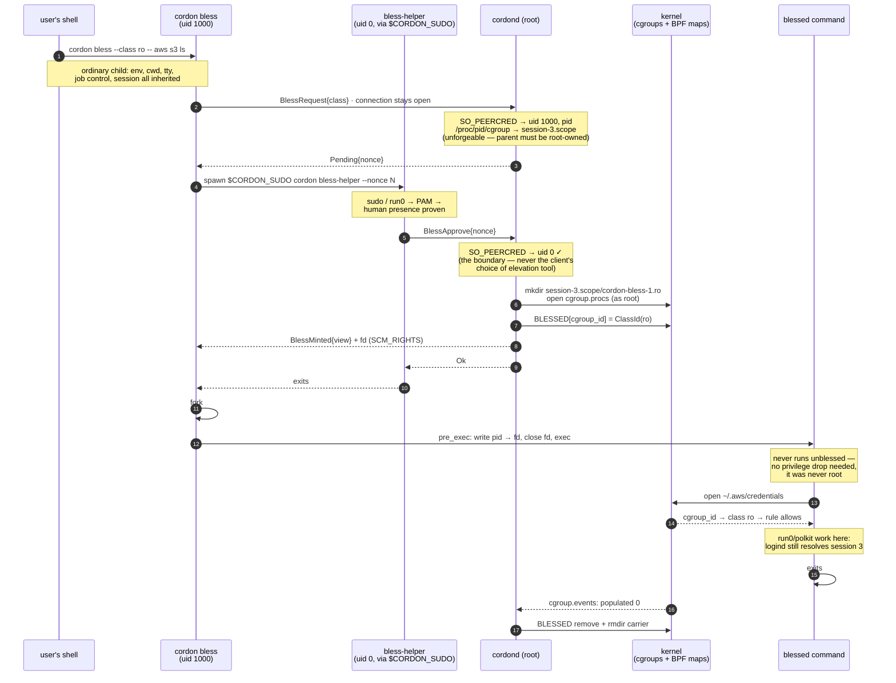

# cordon B2 — usable blessing: socket authz, `policy edit` defaults, unprivileged spawner

## Context

B1 shipped and is validated at three tiers (unit, 23 VM scenarios, a real-system run on
this workstation). The host run exposed three problems that unit tests and the VM
structurally could not: the VM has no unprivileged users talking to the socket, no
`sudoedit` ergonomics, and no logind/polkit at all.

1. **`cordon bless list` is unusable from a user account.** Two independent blockers:
   `config.rs:155` resolves the socket by euid (root → `/run/cordon.sock`, user →
   `$XDG_RUNTIME_DIR/cordon.sock`), so a user looks in the wrong place for a *system*
   daemon; and the socket is `srwxr-xr-x root:root`, while `connect(2)` on a Unix socket
   needs **write** — so every verb is root-only in practice and B1 decision #1 ("BlessList
   ungated, parity with `PolicyShow`") is inert.
2. **`sudo cordon policy edit` edits the system policy by default**, but the common case is
   editing your own user tier.
3. **The blessed shell is barely usable.** Confirmed on the host, two distinct causes:
   - **No logind session.** The carrier lives at `system.slice/cordond.service/…`, which has
     no `session-N.scope` ancestor and is outside `user@1000.service`. polkit resolves the
     session from the caller's cgroup, so `run0`/`pkexec` fail with *"requires interactive
     authentication. However, interactive authentication has not been enabled by the calling
     program."*
   - **The environment is scrubbed.** `sudo`/`run0` reset the environment;
     `crates/cli/src/bless.rs` restores only `HOME`/`USER`/`LOGNAME`, so the blessed shell has
     no `DISPLAY`/`WAYLAND_DISPLAY`/`XDG_RUNTIME_DIR`/`DBUS_SESSION_BUS_ADDRESS` and GUI apps
     fail with `cannot open display`. DESIGN §16.5 specified "the caller's full environment
     and cwd"; that requirement fell through the gap when we moved to CLI-as-spawner.

**Root cause of (3):** the blessed process is *born in the wrong place* — parented through a
privilege tool (under `run0`, a transient systemd unit, so there is not even a parent chain
back to the user's shell) and then relocated into the daemon's cgroup. What it should be is
an ordinary child of the user's shell that merely carries a blessing.

**This matters for the design, not just ergonomics:** under `run0` the environment cannot be
recovered after the fact (no ancestor to read `/proc/<pid>/environ` from), so "fix the env"
is *not* separable from "fix who spawns the target". The rework below is the only path, not
gold-plating.

## Workflow (unchanged from PLAN-bless2)

**Before each commit: stop, present the diff summary, wait for explicit review + approval.**
Every commit: compiles, `just test` green (cargo test + clippy `-D warnings` + fmt), the
existing 23 smoke scenarios stay green. VM runs via `packaging/test/run-bpf-lsm-vm.sh`
(CI-pinned v6.12 by default).

Part A (commits 1–2) is independent and mechanical. Part B (the spawn rework) opens with a
**derisk spike** that can invalidate its design — do not write the commits before it lands.

---

## Part A — small, independent

### Commit 1 — `fix(ipc): gate policy apply on root, open the socket to unprivileged readers`

The fix that *tightens* security rather than trading it away. Today `PolicyApply` is
protected **only** by socket DAC — the handler is ungated, so "whoever can reach the socket
can apply" is literally true. Move that protection into `authorize()` and the socket mode
stops carrying security weight:

- `crates/daemon/src/ipc.rs`: `authorize()` requires uid 0 for `PolicyApply` as well as
  `BlessMint`/`BlessRevoke`. Reads (`Status`, `PolicyShow`, `BlessList`) stay open. Extend
  the existing `authorize` table test.
- `crates/daemon/src/ipc.rs`: `chmod` the socket to **0666** right after `bind` (before the
  accept loop), so any local user can connect. Writes are root-gated in `authorize`; reads
  are deliberately world-readable.
- `crates/cli/src/main.rs` / `crates/core/src/config.rs`: when no explicit `--socket`/config
  socket is set and the per-user default does not exist, fall back to `/run/cordon.sock` —
  so an unprivileged `cordon bless list` finds the system daemon. Pure function +
  unit test (`resolve socket: explicit > config > user default if present > system`).
- Closes the "the socket has no peer-cred check yet" caveat carried in `STATUS.md` and
  DESIGN §15.8 — update both.

**Open decision (needs your call):** 0666 makes `PolicyShow` world-readable, which discloses
protected *paths* to any local user. On a single-user workstation that matches B1 decision
#1's intent; on a multi-user host it leaks. The alternative is 0660 with a `cordon` group,
which needs group management in packaging. Recommendation: **0666 now**, note the group
option in DESIGN as the multi-user deployment posture.

### Commit 2 — `feat(cli): `policy edit` defaults to the invoker's user tier`

- `crates/cli/src/main.rs`: `PolicyCmd::Edit` gains `--system`; bare `cordon policy edit`
  now resolves `SUDO_UID` → username → that user's tier (the existing `--user`
  self-bootstrapping path already handles "no `[[include]]` yet"). `--user NAME` keeps
  editing someone else's tier; FILE, `--user` and `--system` stay mutually exclusive
  (clap-enforced).
- Real root with no `SUDO_UID` has no "own tier": error naming `--system`/`--user` rather
  than silently editing the system policy.
- Tests: target resolution table (sudo invoker / explicit `--user` / `--system` / FILE /
  root-without-invoker).
- **Breaking UX change** — `sudo cordon policy edit` means something different afterwards.
  Call it out in `README.md` and `STATUS.md`.

---

## Part B — the spawn rework

### B0. Derisk spike — ✅ **both assumptions confirmed on the host (2026-07-26)**

Run via `sudo bash packaging/test/bless-b2-derisk.sh`. Results:

1. **fd delegation works.** An unprivileged process wrote its own pid into a root-owned
   `cgroup.procs` received over `SCM_RIGHTS` and landed in the cgroup — the kernel checks
   migration permission against the *opener's* credentials, as expected. `cordon bless`
   therefore never needs to be root.
2. **A child of `session-N.scope` keeps the user's session.** From inside
   `session-3.scope/cordon-derisk`, logind reported `3 - nb (1000)` — the invoker's own
   login session. The same probe under `cordond.service/<child>` reported *"Caller does not
   belong to any known session"*, which is precisely today's polkit failure. `session-3.scope`
   is `root:root`, so the inode-recycling hijack does not apply, and systemd left the
   directory alone.

   *(The spike's first version compared against a bogus "baseline" — a `setpriv`'d child of
   the root script inherits the **script's** cgroup, i.e. root's sudo session, not the user's
   — and so reported a false failure. The assertion now checks for the invoking user's own
   session id + uid directly.)*

Both commits 4 and 5 are therefore buildable as written. The original assumptions and their
fallbacks are kept below for the record.

1. **Does an fd passed over `SCM_RIGHTS` actually let an unprivileged process join a
   root-owned cgroup?** Expected yes: `cgroup_procs_write_permission()` overrides with
   `of->file->f_cred` — the credentials of the process that **opened** the file — precisely
   to make delegation-by-fd work. Test: root opens `cgroup.procs`, passes the fd to an
   unprivileged process, which writes its own pid.
2. **Does a process in `session-N.scope/<child>` keep its logind session** (so polkit/`run0`
   work)? Test on the host: `mkdir` a root-owned cgroup under `session-3.scope`, move a
   shell into it, run `run0 true`. Also watch whether systemd cleans the directory —
   session scopes are **not** `Delegate=yes`.

If (1) fails, Part B collapses to "ship the environment over IPC" (DESIGN §16.5's original
shape). If (2) fails, the carrier stays under the daemon and the session problem needs a
different answer (a systemd transient scope in the user's session, i.e. the original B1
design, at the cost of a D-Bus dependency).

### The handshake (why two connections, not a rendezvous socket)

The obvious shape — the root helper mints and forwards the fd to the unprivileged parent
over a socket in `$XDG_RUNTIME_DIR` — has a hole. The daemon must place the carrier in the
**invoker's** session scope, but under `run0` the helper runs in a *transient systemd unit*,
so its peer creds say nothing about the user's session. Having the helper *claim* a pid is
worse: a caller could name another user's process and get a carrier created inside that
user's session scope, then join it via the fd — appearing, to polkit, to be in a session
that is not theirs.

So the daemon is the rendezvous, and the session is read from the one peer that cannot lie
about it — the unprivileged CLI itself:

1. The CLI connects **as the user** and sends `BlessRequest{class}`. The daemon derives the
   session scope from *that* connection's `SO_PEERCRED` pid and replies with a single-use
   `nonce`. The connection stays open.
2. The CLI spawns the helper under `$CORDON_SUDO`; the human authenticates.
3. The helper connects **as root** and sends `BlessApprove{nonce}`. The daemon mints, and
   sends the `cgroup.procs` fd back down the *requester's* still-open connection.

The helper never touches the fd, there is no rendezvous socket to protect, and the placement
decision rests on kernel-attested credentials rather than anything a client asserts. The
nonce is single-use with a short TTL and is bound to the requesting connection; it need not
be secret, since approving it requires uid 0 regardless.

### Commit 3 — `feat(bless): daemon hands back the carrier's cgroup.procs fd`

- `crates/core/src/proto.rs`: the `BlessMinted` reply gains an **out-of-band fd**. The wire
  stays newline-JSON; the fd rides as `SCM_RIGHTS` ancillary data on the same `sendmsg`.
  New `send_msg_with_fd` / `read_msg_with_fd` helpers beside `write_msg`/`read_msg`.
- `crates/daemon/src/backend/bpf_lsm/bless.rs`: `mint` opens `<carrier>/cgroup.procs` for
  write and returns the `OwnedFd` alongside the `BlessingView`; `ipc.rs` passes it to the
  peer and closes its copy.
- **Security note to document:** the holder can move *any* task it names into that carrier,
  not just its own child (the permission check uses the opener's creds). Since blessing only
  grants what the class's rules name and DAC still applies, and the holder is the invoking
  user, this is not an escalation — but it is a real property and belongs in DESIGN §16.4.
  The CLI closes the fd immediately after the join.
- Tests: fd round-trip over a socketpair; mint failure paths still clean up the carrier.

### Commit 4 — `feat(bless): unprivileged spawner — natural env, cwd, tty, session`

The inversion. `cordon bless` runs **as the user**, a direct child of their shell:

- `crates/cli/src/bless.rs`: no root requirement. Send `BlessRequest{class}`, keep the
  connection open, spawn `$CORDON_SUDO cordon bless-helper --nonce N`, then block reading the
  `cgroup.procs` fd off that same connection (see *The handshake* above). Then fork,
  `pre_exec` writes the child's pid into the fd, exec.
- **Everything the privilege drop existed for disappears**: no `setgroups`/`setgid`/`setuid`,
  no `SUDO_UID` parsing, no passwd lookup, no `HOME`/`USER`/`LOGNAME` fixups, no
  passwd-shell resolution (`$SHELL` is correct again, because we were never re-parented
  through sudo). `DropTo` and `Invoker` are deleted; `join_cgroup_and_drop_on_exec` becomes
  `join_cgroup_on_exec`. Environment, cwd, tty, job control and session are inherited
  because nothing ever moved them.
- New hidden `bless-helper` subcommand: runs root (via whatever elevation) and sends exactly
  one `BlessApprove{nonce}`. It never spawns anything and never touches the fd.
- `$CORDON_SUDO` (default `sudo`) is the **testability seam**: the VM has no sudo, so the
  smoke sets it to a no-op wrapper. Not a security hole — a faked elevation simply produces
  a non-root helper and the daemon's `authorize()` refuses the mint. Security lives in the
  daemon-side uid check, never in the client's choice of elevation. Document that.
- Tests: helper/parent handshake over a socketpair; peer-uid rejection; exit-status mapping
  (kept from B1).

### Commit 5 — `feat(bless): create the carrier in the invoker's session subtree`

Only if B0(2) passed.

- The daemon learns the peer's session cgroup from `SO_PEERCRED`'s pid
  (`/proc/<pid>/cgroup`), walks up to the `session-N.scope` ancestor, and creates the carrier
  there instead of under its own cgroup.
- **Refuse and fall back** to the daemon's own cgroup when the chosen parent is not
  `root`-owned: a user-writable parent lets the invoker `rmdir` an empty carrier and `mkdir`
  a replacement, and cgroup ids are recycled kernfs inode numbers — so within the GC window
  they could land a cgroup still registered in `BLESSED` and self-bless. `user@UID.service`
  is delegated (owned by the user) and must never be used; `session-N.scope` is `root:root`
  and is the target. Pure `carrier_parent()` + unit tests over a tempdir fake.
- Reconcile must scan the new locations as well as the old.

### Commit 6 — `test(bless): VM + host coverage for the new spawn model`

- Smoke: replace scenario 23's `SUDO_UID` simulation with the **real** unprivileged path —
  run `cordon bless` as a non-root uid with `$CORDON_SUDO` set to a root no-op wrapper, and
  assert the child runs as that uid, keeps its environment (a canary variable set before the
  call survives into the blessed child — the regression test for this whole milestone), and
  still gets the blessed read.
- Add: unprivileged `cordon bless list` works (commit 1); a faked elevation is refused by the
  daemon (commit 4's security property).
- Session placement is **not VM-testable** (no logind) — host-only, recorded in the plan's
  verification section.

### Commit 7 — `docs(bless): record B2`

DESIGN §16.4 (fd-delegation property), §16.5 (the elevation is now client-side; the daemon's
uid gate is the boundary), §16.6 (new lifecycle); PLAN-bless B2 marked done; `STATUS.md`;
`README.md` (`cordon bless` no longer needs a literal `sudo` prefix from the user).

## Locked micro-decisions (veto at review if wrong)

| # | Decision | Choice |
|---|---|---|
| 1 | Socket mode | 0666, with `PolicyApply` moved behind the uid-0 gate (recommend; 0660+group is the multi-user alternative) |
| 2 | `policy edit` default | The invoker's tier; `--system` for the system policy; error if there is no invoker |
| 3 | Join mechanism | `SCM_RIGHTS` fd from the daemon; the CLI never needs root |
| 4 | Elevation | Client-side `$CORDON_SUDO` (default `sudo`); security is the daemon's uid-0 check, never the client's choice |
| 5 | Carrier parent | The invoker's `session-N.scope` **if root-owned**, else fall back to the daemon's cgroup |
| 6 | Env/cwd/tty | Inherited by construction (never re-parented) — nothing is shipped or restored |
| 7 | Rendezvous | **The daemon itself**: request (uid 1000) → nonce → approve (uid 0) → fd back on the requester's connection. No rendezvous socket |
| 8 | Session source | The **unprivileged** peer's `SO_PEERCRED` pid — never a client-asserted pid, which would let a caller target another user's session |

## Verification

- Per commit: `just test`; commits 3–6 also get a VM run.
- Final VM: all smoke scenarios green (23 + the new ones) on pinned v6.12.
- **Host-only, required before calling B2 done** (the VM cannot reach any of it): a blessed
  shell in which `run0 true` succeeds, `gedit` opens a window, `echo $DISPLAY` is non-empty,
  and `cordon bless list` works unprivileged.
