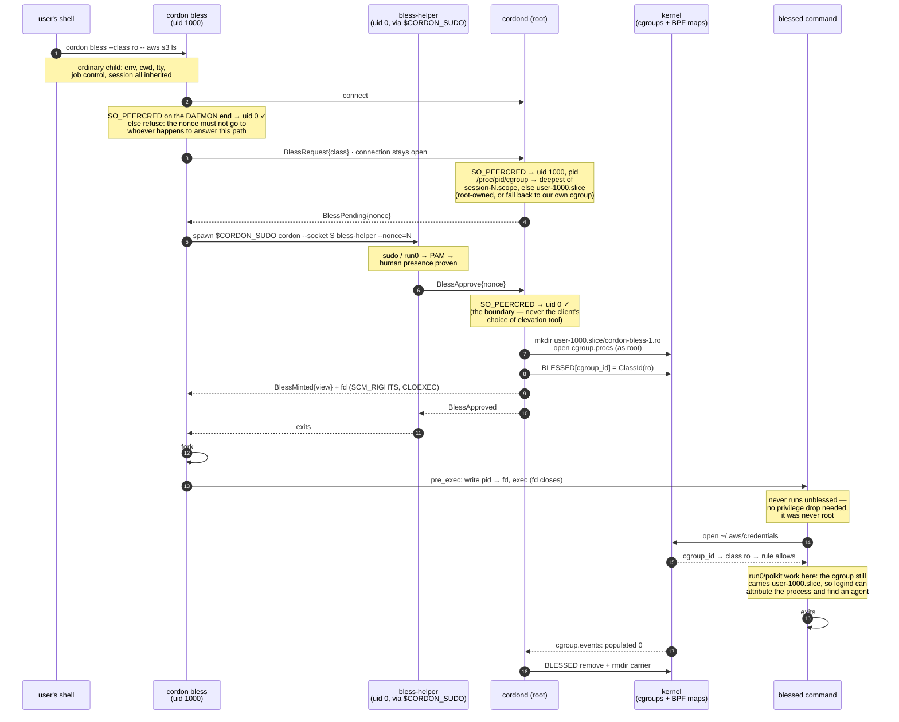

# ADR 0014: The blessing lifecycle

Status: Accepted

## Context

A blessing lives in a root-owned carrier cgroup ([ADR 0012](0012-blessing.md)). It has to be
placed where logind still attributes the process, survive no longer than its process tree,
and survive a daemon restart without granting anything new.

## Decision

1. You run `cordon bless --class NAME -- <cmd>`, with no `sudo` prefix, and it runs as you.
   `--class` may be omitted when the policy declares exactly one class. With no `<cmd>`, the
   default is `$SHELL`.
2. The CLI checks that the daemon is root, sends `BlessRequest`, and holds the connection open.
   The daemon parks a single-use nonce and blocks. Nothing is minted yet.
3. The CLI spawns `$CORDON_SUDO cordon bless-helper --nonce=…`. The human authenticates to
   whatever that tool is. The helper reaches the daemon as uid 0 and approves ([ADR
0013](0013-bless-authentication.md)).
4. The daemon validates `NAME` against the compiled class registry. It creates a fresh
   root-owned cgroup `cordon-bless-<id>.<class>` inside the requester's own user subtree, which
   it locates from the pid that `SO_PEERCRED` reports for that connection. logind attributes a
   process to a user purely from the cgroup path. From the user it finds a session, and polkit
   needs the session to find an authentication agent. So the carrier must keep one of the two
   path components that logind reads:
   - `session-N.scope`, when the requester is in one (a tty or login session). This is the
     most precise, because it gives an exact session id.
   - Otherwise `user-<uid>.slice`. This is the common desktop case. On a modern systemd, a
     terminal lives under the *delegated* `user@UID.service/app.slice/app-*.scope`, with no
     session scope anywhere above it. `cg_path_get_owner_uid` keys on the user slice to
     resolve the user, and from the user logind falls back to that user's display session.
     That is exactly how an ordinary unblessed shell there resolves.

   A parent that is not root-owned is refused. `user@UID.service` and everything below it is
   delegated to the user. A parent owned by the user would let the invoker rmdir an empty
   carrier and mkdir a replacement onto a recycled inode, which is a cgroup id that is still
   registered. In that case the daemon falls back to its own cgroup, where the blessing still
   *works*, but the blessed shell loses polkit. The daemon registers
   `BLESSED[cgroup_id] = ClassId(NAME)` and sends the carrier's `cgroup.procs` descriptor back
   down the requester's connection ([ADR 0012](0012-blessing.md)).
5. **The CLI is the spawner, and it is unprivileged throughout.** It forks, and the child's
   `pre_exec` writes the child's own pid through that descriptor and then execs. The child
joins
   *before* `exec`, so the target runs zero instructions unblessed. No privilege is dropped,
   because there never was any privilege. The write succeeds on the credentials of the
   descriptor's *opener*. The environment, cwd, tty, job control, signals and exit code are
   inherited, because nothing ever moved them.
6. Descendants inherit the cgroup, and so they inherit the blessing. `bless -- bash` blesses
   the whole subtree.
7. **GC on exit.** The daemon watches the `populated` flag in the carrier's `cgroup.events`.
   When the tree drains (`populated 0`), the daemon removes the cgroup and drops the `BLESSED`
   entry. So the grant evaporates with the process tree, and there is no standing cgroup that
   is always armed. A mint grace window (`MINT_GRACE`) covers the interval where a fresh
   carrier is legitimately empty, because the CLI has not joined the target yet. Once the
   window expires, a carrier whose CLI died before joining is reaped.
8. `cordon bless list` and `cordon bless revoke <id>` list and tear down live blessings. The
   cgroup of each invocation *is* the handle. Revoke writes `cgroup.kill`, and the same GC
   finishes the teardown. Root may revoke any blessing, and so may the uid that minted it,
   because a user who minted one unprivileged must be able to revoke it the same way. A
   blessing adopted at restart (step 9) has no recorded minter, so only root may revoke it
   (`may_revoke`).
9. **Restart reconciliation.** Only the LSM links are pinned ([ADR 0002](0002-bpf-lsm-boundary.md)), so a restarted daemon loads
   a fresh, empty `BLESSED`, which fails closed. At startup the daemon scans every directory
   that placement can choose for leftover carriers. That is its own cgroup, every
   `user-*.slice` and every `session-*.scope` (`carrier_roots`). Empty carriers are removed.
   A populated carrier is registered again if its class is still declared. A populated carrier
   whose class vanished is adopted as inert, which means it is only garbage-collected, because
   a live process tree is never killed for a policy change under it. Only root-owned
   directories are adopted. Registering a carrier again is a *grant*, so it is held to the
   same trust check as placement in step 4.

## Consequences

> **Why placement is not "put it in the session scope".** On a desktop the requester is not
> *in* the session scope. Only the session leader is. So a rule keyed on the session scope
> alone would send every desktop blessing to the daemon's cgroup, where logind cannot attribute
> the process at all. What the carrier needs is not the session. It needs to stay somewhere
> that logind can still tell *whose* process it is (`CgroupPath::placement`).

> **Apply-time remap (correctness keystone).** `policy apply` recompiles, and `ClassId`s are
> dense and sorted by name, so they *renumber*. So every apply re-points the live `BLESSED`
> entries by class name (`Blessings::remap`), inside the same single-writer path that owns the
> maps. A class that disappeared is unregistered, and its blessing goes inert, rather than
> being left pointing at a renumbered id. Without this remap, a live blessing would silently
> change meaning on an unrelated policy edit.
